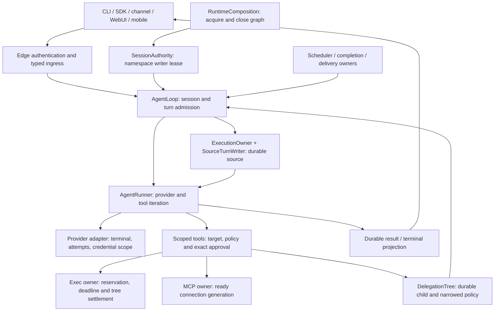

# A3 design, invariants and alternatives

This design belongs to the [frozen `A3-PLAN-2026-11-11` baseline](plan-review.md#frozen-baseline-and-subsequent-work).

The user accepted the [reference-based architectural direction](plan-review.md#user-acceptance)
on 2026-11-11. The selected scope is Linux/macOS execution with Android remote; canonical
child sessions, separated consent/enforcement, request-owned tool bindings, owner-local
recovery and separate output/retention lifetimes govern the current design. Full consent
remains volatile; restart does not restore prior consent. The user subsequently selected
the four defaults for internal subagent lifetime/budgets, initial device proof and retention.
The user selected a first release without legacy migration; the
[first-release contract](v1-product-contract.md) defines that scope and the selected defaults.
The user's subagent clarification keeps orchestration in the original chat/main agent.
Canonical child history is an internal ownership contract; a separate public child chat
or management interface is not required.

The candidate retains `AgentLoop` for session and channel coordination and `AgentRunner`
for provider/tool iteration. It adds explicit facts at existing ownership boundaries:
which instance and session own work, which effect was approved, which generation supplied
a tool, and which receipt proves a completed effect. This follows the repository's
[small-core constraints](../../../.agent/design.md) and
[separate security boundaries](../../../.agent/security.md).

The implementation observations below remain pinned to
`0518de5f5013b77cbc20d2c5b456e973f33c68f5`; they are historical context for later review.
**Required invariants below are acceptance obligations drawn from the A3 packets; source
observations describe mechanisms, not a certification that every obligation holds.**
[Independent counterexamples and remaining gates](review.md) qualify the record.
Historical reasons and alternatives are in the [source comparison](../../audits/architecture-review-2026-11-06/README.md)
and [I05 seams](../../audits/module-review-2026-11-06/integrated/I05-final-reconciliation.md).

## Ownership and data flow

The diagram shows the required ownership flow. AR3 means the current child runner does
not yet follow its canonical child source/execution edge; metadata alone does not
establish that ownership.

`RuntimeComposition` acquires resources and retains reverse-order cleanup; it does not
replace the owners of source history, native processes, cron occurrences or remote device
credentials. Its [`_finish_close`][runtime-close] distinguishes owned-work failure from a
clean close. An edge projects a committed fact to clients; display text and transport
acknowledgement cannot create that fact.

| Fact | Authoritative owner | Consumers may do |
| --- | --- | --- |
| Instance roots and prepared target | Bound configuration, resource policy and the concrete path resolver | Display the target, assess risk and revalidate the same target at execution. |
| Session identity and execution | Namespace lease, session incarnation/generation and `ExecutionOwner` | Read or mutate only with current admission; keep historical readers separate. |
| Approved effect | `ApprovalAdmission` and risky-action policy | Authorize the selected effect once while live authority still holds. |
| Tool binding and readiness | Tool registry plus MCP connection owner | Use the originating definition and connection, or refuse on live revocation. |
| Process lifetime | Exec session/native admission owner | Observe root exit separately from tree quiescence; join Stop and shutdown. |
| Delegated subagent | `DelegationTree` with canonical session storage | The main agent starts, follows up, waits or cancels through current owner admission. Clients may optionally inspect authorized activity/history. |
| Delivery or external effect | The specific mutation, occurrence, process or sender owner | Reconcile the receipt; never infer replay permission from a timeout. |

One typed fact can cross owners; enforcement remains local. A filesystem grant is not
OS confinement, a registered tool is not authorization, and a successful model response
is not a delivery receipt. This keeps the design smaller than a global authority,
generation or workflow service.

## Canonical admission and effect outcomes

**Invariant.** Validate ingress before publication; durably admit required source input
before acknowledging it or dispatching dependent work. A failed mandatory writer fences
the invocation. Recovery uses the original identity and receipt. It must not replay an
effect merely because the response was lost.

[`SourceTurnWriter._append`][source-append] checks the admitted owner, compares current
source with its shared snapshot and commits through `SourceSessionStore`. A failed append
fences all streams sharing its writer. [`consume_pending_followup`][source-followup]
binds the committed original input to its invocation projection. The
[`AgentRunner` injection boundary][runner-injection] treats mandatory writer failure as
fatal while preserving optional callback behavior. These are narrow corrections to the
existing source owner, rather than another persistence queue in the runner.

The outcome fact is separate from its acknowledgement:

| Outcome | Required proof and recovery |
| --- | --- |
| `not_applied` | Owner proves a pre-effect refusal. A new admissible request may be attempted. |
| `applied` | Owner has commit or effect proof, even if the reply is missing. Read back the same result. |
| `partial` | Owner proves which subset applied. Preserve the remainder for explicit reconciliation. |
| `uncertain` | Work may have applied and proof is incomplete. Retain ownership; no blind replay. |
| Acknowledgement outstanding | The client has not observed the result. This is delivery state, not a fifth effect outcome. |

The candidate's [`WebUIRequestResult`][mutation-result] carries an outcome separately from
result/status/message. Other owners retain their own formats. The smaller alternative is
an owner-local disposition/helper while keeping compatible output fields; inventing one
public result taxonomy for every provider, tool and transport is unnecessary without a
demonstrated caller. See historical [A7/A8](../../audits/architecture-review-2026-11-06/admission-requests.md),
[R06](../../audits/module-review-2026-11-06/integrated/I05-final-reconciliation.md) and
[D6](decisions.md#d6-attempt-and-effect-outcomes).

## Exact approval and live authority

**Invariant.** Human approval selects a server-owned pending effect and can be consumed
only for that effect. Text such as “yes,” an automation payload, a remote annotation or
a reused fingerprint cannot supply new approval. Revocation, target changes and current
permission checks still apply immediately before the effect.

The loop uses typed `ApprovalDecision` admission. [`ApprovalAdmission.consume`][approval-consume]
revalidates pending identity under the session lock; [`_decision_matches`][approval-match]
requires the opaque approval ID and checks optional echoed identity fields when both
sides supply them. An unpredictable ID may legitimately select server-owned details;
omitting an optional echo alone is not a demonstrated bypass. The stronger requirement
is that the selected effect's permission is single-use and cannot survive into a later
unapproved execution.

[`RiskyActionPolicy._effect_fingerprint`][effect-fingerprint] includes tool name and
arguments and, for file writes, the resolved target. Its
[`validate_write_target_binding`][target-binding] rechecks the assessed path through the
concrete tool before dispatch. Approval, filesystem policy and native proof remain
separate. [Review gates](review.md) track the independently reproduced repeated-effect
gap; this source description does not assert single-use authorization is already proven.

A viable smaller choice is a one-use opaque pending-effect token owned by admission,
with existing public compatibility fields retained. A global `approval_granted` switch
is insufficient to describe an exact effect. Historical rationale: [S1/S2/S6/S7](../../audits/architecture-review-2026-11-06/authority-sandbox.md),
[R01/R02](../../audits/module-review-2026-11-06/integrated/I01-authority.md), and
[A3-4 AC4.1](../../audits/implementation-packets/A3-4-client-control-contracts.md).

## Process ownership, confinement and close

**Invariant.** One owner retains a launch from reservation through proven non-start or
tree settlement. An uncertain spawn remains owned. A finite hard deadline runs without
polling or notification. Stop, timeout and shutdown converge on one termination result.
Output remains bounded while both pipes drain.

[`_ExecSession` creates its deadline task][exec-deadline] when the session becomes live.
[`NativeProcessReservation.admit_launch`][native-admit] acknowledges the supervisor and
opens the launch gate under a current private permission reference.
[`NativeProcessHandle.wait_quiescent`][native-quiescent] requires supervisor settlement
and a tree receipt; root exit alone is not enough. The candidate also has portable owned
subprocess helpers for bounded adapters. Their host-specific guarantees must be checked
separately from the stronger unrestricted-native proof path.

| Capability | Source observation at the pin | Qualification consequence |
| --- | --- | --- |
| Managed shell confinement | [`managed_bwrap_available`][bwrap-available] is Linux-specific; managed wrapping refuses missing confinement. | A successful path resolver or Windows process test does not establish managed confinement. |
| Whole-tree unrestricted native proof | [`native_supervisor_available`][native-available] admits Linux/POSIX only. | Client support on macOS/Windows does not establish this executor capability. |
| Generic process ownership | Existing POSIX group / Windows Job handling lives at exec boundaries. | Qualify each real host; a root-process mock cannot establish escaped-descendant proof. |
| Durable session writer | The lifetime writer lease uses a [POSIX descriptor proof boundary][session-lease]. | Startup and read-only compatibility are distinct from managed writer admission. |
| Private remote owner IPC | [`OwnerIPCServer._check_peer`][ipc-peer] uses `SO_PEERCRED` and otherwise refuses. | A Darwin `LOCAL_PEERCRED` repair exists separately and needs reconciliation. |

The historical alternative was a smaller executor matrix or a Linux executor serving
another client OS. The selected direction requires Linux and macOS executors, with
Android remote. Each native adapter needs its own isolation, owner-authentication and
process-lifetime proof; missing guarantees refuse explicitly. macOS is the remaining
verification target. Text path checks cannot supply that proof. See [S3/S9](../../audits/architecture-review-2026-11-06/authority-sandbox.md),
[P2–P6](../../audits/architecture-review-2026-11-06/persistence-lifecycle.md),
[D1](decisions.md#d1-platform-and-executor-scope) and [A3-2](../../audits/implementation-packets/A3-2-runtime-process-ownership.md).

## Session writers, incarnations and restart

**Invariant.** A cooperating runtime has one namespace writer and one canonical history
owner. Session keys are address labels; incarnation distinguishes delete/recreate, and
generation fences reset or ownership changes. Work captured for an old identity cannot
write to a new session with the same key. Unknown effects stay visible and non-replayable.

[`DurableSessionAuthority.acquire`][session-authority] acquires `LifetimeWriterLease`,
constructs `SessionManager` with managed access and verifies existing mode evidence.
[`ExecutionOwner._validate_unlocked`][execution-validate] checks store identity, key,
incarnation, generation and execution token before dispatch. Runtime metadata is parsed
at the edge by [`parse_runtime_session_metadata`][runtime-metadata]; malformed versions
and stale parent references are not executable. This extends the existing history rather
than creating a parallel task history.

Offline conversion/export uses a copied-state owner and must not adopt live roots.
Reopening readable history does not authorize replay or restore a volatile Full proof.
The independently reproduced process-continuation gap shows why every queued producer
must carry this identity through its final admission, including after restart; see
[RR2](review.md#rr2-process-completion-can-target-a-recreated-session).
Historical rationale and alternatives: [A1–A8](../../audits/architecture-review-2026-11-06/admission-requests.md),
[R06/R07/R09](../../audits/module-review-2026-11-06/integrated/I02-durability.md),
[A3-3](../../audits/implementation-packets/A3-3-durable-session-runtime.md).

## Future coding harness and session coordination

The user required the current plan to preserve both future directions and clarified that
SuperAgent coordinates normal sessions, while ordinary subagents work normally inside
each session. The [extension contract](future-harness-extension.md) keeps session
coordination outside the subagent execution tree. A task-session link does not consume
helper depth, grant authority, suppress a normal composer or change subtree Stop.
Future task lifecycle and budgets need their own explicit contract.

Preserve normal canonical execution, source and input ordering; effective repository
targets; process completion provenance; request-owned tools; separate provider capacity;
and client projections. Coding and later session coordination extend existing tool/
session/channel edges. The future direction introduces no new subagent behavior, task
database, coordinator activation or replacement loop in the current release.

## Durable recursive children

**Invariant.** Reserve bounded capacity and persist one child session before launch.
Bind parent incarnation, assignment/attempt, runtime profile and narrowed policy to that
child. Effective authority is the intersection of live parent authority, role policy and
assignment. Child Stop covers descendants; parent Stop fences new admission; siblings
remain independent. Uncertain launches retain a visible record.

The candidate's [`DelegationTree.reserve`][child-reserve] deduplicates an attempt under
parent identity, checks limits and persists metadata before returning admission.
`delegated` is the supported native runtime profile; optional domain roles are policy,
not separate topology owners. The inspected `DelegationTreePolicy` defaults are depth 2,
two live children per parent and four live descendants. These are observed candidate
values from [`DelegationTreePolicy`][child-policy]; [D3](decisions.md#d3-durable-delegation)
distinguishes that original observation from the user's later explicit default selection.

[`stop_subtree`][child-stop] distinguishes settled cancellation from uncertainty.
[`_restore`][child-restore] turns unresolved live child records into uncertain records.
[`NativeChildBackend.resume`][child-resume] refuses replay after restart. A background
child may outlive an ordinary parent reply under its admitted scope, which differs
from the lifetime of a bounded foreground role. Typed client references must retain
authorization and the child's current generation. Main-chat orchestration routes internal
controls; optional read-only child inspection does not require a separate composer or
manual close/archive/resume interface. Resource release remains the runtime owner's job.

The selected [client UI contract](v1-product-contract.md#client-ui-behavior-for-subagents)
projects subagent task/status/results into the original conversation. Optional authorized
detail is read-only, replaces the child composer with status/return navigation and
preserves the parent draft/context. Main-chat approvals identify the actual child effect;
the parent Stop stays usable while owned work is active and shows stopping or uncertainty
until settlement. Reconnect merges canonical state without duplicate work or stale-run
updates. Desktop/WebUI, TUI and Android remote share these meanings in existing layouts.
This adds no second task-state authority or new lifecycle management surface.

The original bounded-role-only recommendation remains a historical alternative. The
accepted direction includes canonical child-session architecture using existing sessions
and the normal runner, with separate identity for each active run. Awaited helpers can
share that execution path without every helper requiring a public persistent task.
External Codex/Claude child backends are future work, not a capability supplied by this
native interface. See [G1–G7](../../audits/architecture-review-2026-11-06/delegation-context.md)
and [A3-5](../../audits/implementation-packets/A3-5-delegation-cutover.md).

[AR2](review.md#ar2-worker-children-bypass-risky-action-consent) and
[AR3](review.md#ar3-child-metadata-is-disconnected-from-canonical-execution-history)
show that current worker consent and canonical child history do not yet meet the
invariants above. Child metadata and final-message projection are insufficient proof.

## MCP generations and capability readiness

**Invariant.** The definition presented to the model and the tool/connection executed for
that request have the same registration identity. Failed readiness publishes no tools.
A failed replacement preserves the authorized old connection. Revocation remains live;
retirement waits for every admitted user of the originating binding.

[`MCPProvider.reload`][mcp-reload] stages changed-server wrappers privately before
publication. [`_GenerationLease`][mcp-lease] counts execution users, retires an old
connection and closes it once when idle. A terminated wrapper refuses a name-based retry
on a replacement connection. These mechanisms preserve useful execution lifetime, but
the independent runner/reload counterexample in [review](review.md) exposes a gap before
execution begins: a request may already have captured the old definitions.

Historical [D5](../../audits/architecture-review-2026-11-06/decisions.md#d5-request-tool-registration-lifetime)
retained safe-boundary reload deferral and request-owned bindings as alternatives. The
accepted direction requires the originating definition, registration and resource lifetime
from capture through settlement, with live revocation. Safe-boundary deferral is a valid
implementation strategy when it satisfies that same contract. A global generation
service has no established requirement here.

Capability presentation also separates declared, configured, registered, ready and
authorized. The same admitted skill candidate must supply its displayed provenance and
body; malformed shadowing, disabled skills, prompt overrides and optional CLI catalogs
stay at their own edges. Historical reasons: [R15/R17](../../audits/module-review-2026-11-06/integrated/I03-client-capabilities.md)
and [A3-6](../../audits/implementation-packets/A3-6-capability-readiness.md).

## Provider terminal and credential scope

**Invariant.** Clean transport EOF without a required terminal event is failure, even
after visible deltas. Do not execute a partial tool call or silently retry it on another
provider. Logical request usage and physical transport attempts have separate identities.
Only the fallback owner advances the prepared route; the fallback's own limits apply.

The Responses parser tracks explicit terminal events and the compatible provider's
[`chat_stream` terminal check][provider-terminal] rejects a missing finish event on the
inspected streaming path. This is an adapter contract, not proof about all third-party
providers. Model capabilities and provider policy remain immutable request snapshots;
provider names do not become authorization rules.

[`OAuthCredentialCoordinator.begin_login`][oauth-begin] records a login intent;
[`commit_login`][oauth-commit] validates the current generation before publication.
The credential owner also controls logout and derived bearer generations. Instance roots
and explicit credential-profile ownership must be traced through the real callers; a
coordinator type alone does not prove isolation of every provider, MCP or usage store.
Do not mutate an ambient environment credential to configure one unrelated client.

The smaller alternative is to keep these types local to adapter/request/credential
owners and preserve existing public usage fields, rather than introducing a universal
retry service. References: [R04/R08/R17](../../audits/module-review-2026-11-06/integrated/I03-client-capabilities.md),
[A3-1 prepared route](../../audits/implementation-packets/A3-1-authority-foundations.md),
[A3-6 AC6.2](../../audits/implementation-packets/A3-6-capability-readiness.md).

## P-256 mobile cutover

**Current scope:** device-key pairing is an initial-release design. The historical
candidate's legacy cutover below does not create a current migration requirement.
No forced re-pairing or released-version compatibility path is required; see
[the first-release decision](v1-product-contract.md#selected-first-release-without-legacy-migration).

**Invariant.** The approved device, instance, TLS origin and current device generation
must match a fresh, expiring one-use challenge. Native custody owns the private key,
signing and tokens. Access scopes are checked at production dispatch. Revoke prevents
issuance and use; rollback cannot revive old bearer authority.

[`DeviceProofClaims`][device-claims] uses protocol 2 and purpose `remote.access`;
[canonical JSON bytes][device-canonical] have sorted keys, compact separators and UTF-8 encoding.
[`verify_device_proof`][device-verify] verifies P-256/secp256r1 ECDSA/SHA-256 DER signatures
and the expected instance, origin, installation, fingerprint, generation, challenge,
nonce and expiry. [Android's native custody][android-key] uses an Android Keystore P-256 key.
[`complete_device_proof`][pairing-complete] checks approval and issues the device-bound
access grant; [`complete_device_recovery`][pairing-recovery] accepts a fresh proof for
lost token delivery. `issue_device` returns no bearer refresh authority. These are source
observations; restart, queue pressure, revoke and real transport behavior need separate
qualification.

The smaller original option was to repair bearer custody through explicit recoverable
rotation. The candidate instead chooses a device-key cutover with legacy v1 revocation
and re-pairing. That changes wire and persisted-state compatibility. The historical
packet proposed P-256 and required algorithm/encoding/consumption approval before
implementation. The user's later four-default selection now supplies that product
decision provenance in [D2/D4](decisions.md); implementation conformance and shared
schema/byte-vector evidence remain later work.
Emulator or host fixtures cannot substitute for the physical Android/desktop-owner
criterion in [A3-7](../../audits/implementation-packets/A3-7-mobile-pairing.md).

## Retention, scheduler and deletion proof

**Invariant.** Bound memory, bytes and work before allocation or admission. Preserve
source, journal, scheduler and delivery proof when capacity rolls over. Known-unstarted
work may resume; uncertain effects require reconciliation. Every destructive path needs
a complete reference inventory, and a dry run must leave all persistent bytes unchanged.

[`SchedulerStore` epoch loading][scheduler-epochs] validates checksummed archives and
their chain; retained cursors, classifications and reconciliation bridges are part of
recovery evidence. [`CronDeliveryRuntime` settlement][delivery-settle] keeps confirmed
delivery, confirmed non-send, partial and unknown outcomes distinct.
[`ProcessCompletionRuntime.start`][process-recovery] preserves uncertain restart
dispositions rather than blindly replaying. The independent deadline and proof archive
mechanisms are worth retaining even while their adjacent gaps are corrected.

The candidate has partial incomplete-evidence gates and an existing migration preview,
but [RR1/RR3](review.md) show deletion and inherited dry-run paths that violate this
invariant. A quota cannot supply missing reference proof. Keep retention duration,
completion output view and resource
limits separate from correctness; the audit did not choose new policy values. A viable
smaller alternative to archive rollover is refusal before admission at the old safe cap.
Rollover is justified only with atomic publication and retained proof, not by a claim of
unmeasured speed. Historical rationale: [P1/P4–P9](../../audits/architecture-review-2026-11-06/persistence-lifecycle.md),
[R07/R10/R12/R13](../../audits/module-review-2026-11-06/integrated/I02-durability.md),
[A3-8](../../audits/implementation-packets/A3-8-durability-retention.md).

## Artifact and rollback provenance

**Invariant.** Qualification binds source, lockfiles and resolved dependencies, built
bundle, toolchain, executable/APK digest, signer where applicable, state format and
rollback target. A zero-exit build without its expected output is failure. Build and
native preparation must precede exposure of signing credentials.

Stage a separate candidate release and isolated state; verify before switching. Drain
the old writer/effect owner, keep the previous verified target and compatible state,
then verify the switch. A failed rollback is a failure requiring operator action.
Testing that today's reader can export an old format does not attest that an immutable
previous executable can read the actual post-cutover state.

The candidate's [stopped-copy rollback runbook][rollback-runbook] retains newer scheduler,
occurrence, completion and delivery evidence, exports a digest and keeps cron disabled
when the previous format cannot represent it. Remote revocation must survive rollback;
an incompatible older build must keep remote access disabled. This is a compatibility
requirement, not permission to deploy or restore live data.

Keeping the existing scripts with a provenance tuple and a tested switch is smaller
than introducing a new release service. Current installed-reader and Android claims
remain [reported until receipts are inspected](review.md). References:
[R20/R21](../../audits/module-review-2026-11-06/integrated/I04-release-residuals.md),
[A3-9](../../audits/implementation-packets/A3-9-release-qualification.md),
[A3-10](../../audits/implementation-packets/A3-10-compatibility-retirement.md).

<!-- Pinned source references -->

[android-key]: https://github.com/JadenChun/nanobot-custom/blob/0518de5f5013b77cbc20d2c5b456e973f33c68f5/mobile/android/app/src/main/java/ai/nanobot/mobile/network/CustodyStore.kt#L437-L490
[approval-consume]: https://github.com/JadenChun/nanobot-custom/blob/0518de5f5013b77cbc20d2c5b456e973f33c68f5/nanobot/agent/turn_admission.py#L100-L128
[approval-match]: https://github.com/JadenChun/nanobot-custom/blob/0518de5f5013b77cbc20d2c5b456e973f33c68f5/nanobot/agent/turn_admission.py#L131-L150
[bwrap-available]: https://github.com/JadenChun/nanobot-custom/blob/0518de5f5013b77cbc20d2c5b456e973f33c68f5/nanobot/agent/tools/sandbox.py#L143-L169
[child-policy]: https://github.com/JadenChun/nanobot-custom/blob/0518de5f5013b77cbc20d2c5b456e973f33c68f5/nanobot/agent/child_sessions.py#L45-L63
[child-reserve]: https://github.com/JadenChun/nanobot-custom/blob/0518de5f5013b77cbc20d2c5b456e973f33c68f5/nanobot/agent/child_sessions.py#L289-L385
[child-restore]: https://github.com/JadenChun/nanobot-custom/blob/0518de5f5013b77cbc20d2c5b456e973f33c68f5/nanobot/agent/child_sessions.py#L182-L253
[child-resume]: https://github.com/JadenChun/nanobot-custom/blob/0518de5f5013b77cbc20d2c5b456e973f33c68f5/nanobot/agent/child_backend.py#L122-L137
[child-stop]: https://github.com/JadenChun/nanobot-custom/blob/0518de5f5013b77cbc20d2c5b456e973f33c68f5/nanobot/agent/child_sessions.py#L568-L616
[delivery-settle]: https://github.com/JadenChun/nanobot-custom/blob/0518de5f5013b77cbc20d2c5b456e973f33c68f5/nanobot/cron/delivery_runtime.py#L729-L749
[device-canonical]: https://github.com/JadenChun/nanobot-custom/blob/0518de5f5013b77cbc20d2c5b456e973f33c68f5/nanobot/remote/device_proof.py#L121-L128
[device-claims]: https://github.com/JadenChun/nanobot-custom/blob/0518de5f5013b77cbc20d2c5b456e973f33c68f5/nanobot/remote/device_proof.py#L50-L118
[device-verify]: https://github.com/JadenChun/nanobot-custom/blob/0518de5f5013b77cbc20d2c5b456e973f33c68f5/nanobot/remote/device_proof.py#L147-L200
[effect-fingerprint]: https://github.com/JadenChun/nanobot-custom/blob/0518de5f5013b77cbc20d2c5b456e973f33c68f5/nanobot/agent/policy.py#L399-L420
[exec-deadline]: https://github.com/JadenChun/nanobot-custom/blob/0518de5f5013b77cbc20d2c5b456e973f33c68f5/nanobot/agent/tools/exec_session.py#L171-L207
[execution-validate]: https://github.com/JadenChun/nanobot-custom/blob/0518de5f5013b77cbc20d2c5b456e973f33c68f5/nanobot/session/execution_owner.py#L86-L106
[ipc-peer]: https://github.com/JadenChun/nanobot-custom/blob/0518de5f5013b77cbc20d2c5b456e973f33c68f5/nanobot/remote/ipc.py#L171-L177
[mcp-lease]: https://github.com/JadenChun/nanobot-custom/blob/0518de5f5013b77cbc20d2c5b456e973f33c68f5/nanobot/agent/tools/mcp.py#L566-L601
[mcp-reload]: https://github.com/JadenChun/nanobot-custom/blob/0518de5f5013b77cbc20d2c5b456e973f33c68f5/nanobot/agent/tools/mcp.py#L1984-L2024
[mutation-result]: https://github.com/JadenChun/nanobot-custom/blob/0518de5f5013b77cbc20d2c5b456e973f33c68f5/nanobot/webui/inbound_commands.py#L187-L196
[native-admit]: https://github.com/JadenChun/nanobot-custom/blob/0518de5f5013b77cbc20d2c5b456e973f33c68f5/nanobot/security/native_admission.py#L146-L158
[native-available]: https://github.com/JadenChun/nanobot-custom/blob/0518de5f5013b77cbc20d2c5b456e973f33c68f5/nanobot/agent/tools/native_process.py#L263-L279
[native-quiescent]: https://github.com/JadenChun/nanobot-custom/blob/0518de5f5013b77cbc20d2c5b456e973f33c68f5/nanobot/agent/tools/native_process.py#L72-L82
[oauth-begin]: https://github.com/JadenChun/nanobot-custom/blob/0518de5f5013b77cbc20d2c5b456e973f33c68f5/nanobot/providers/oauth_credentials.py#L1429-L1446
[oauth-commit]: https://github.com/JadenChun/nanobot-custom/blob/0518de5f5013b77cbc20d2c5b456e973f33c68f5/nanobot/providers/oauth_credentials.py#L1469-L1480
[pairing-complete]: https://github.com/JadenChun/nanobot-custom/blob/0518de5f5013b77cbc20d2c5b456e973f33c68f5/nanobot/remote/pairing.py#L727-L782
[pairing-recovery]: https://github.com/JadenChun/nanobot-custom/blob/0518de5f5013b77cbc20d2c5b456e973f33c68f5/nanobot/remote/pairing.py#L681-L719
[process-recovery]: https://github.com/JadenChun/nanobot-custom/blob/0518de5f5013b77cbc20d2c5b456e973f33c68f5/nanobot/process_completion.py#L241-L253
[provider-terminal]: https://github.com/JadenChun/nanobot-custom/blob/0518de5f5013b77cbc20d2c5b456e973f33c68f5/nanobot/providers/openai_compat_provider.py#L3513-L3537
[rollback-runbook]: https://github.com/JadenChun/nanobot-custom/blob/0518de5f5013b77cbc20d2c5b456e973f33c68f5/docs/migration/a3-release-rollback.md#L1-L33
[runner-injection]: https://github.com/JadenChun/nanobot-custom/blob/0518de5f5013b77cbc20d2c5b456e973f33c68f5/nanobot/agent/runner.py#L493-L564
[runtime-close]: https://github.com/JadenChun/nanobot-custom/blob/0518de5f5013b77cbc20d2c5b456e973f33c68f5/nanobot/runtime_composition.py#L623-L637
[runtime-metadata]: https://github.com/JadenChun/nanobot-custom/blob/0518de5f5013b77cbc20d2c5b456e973f33c68f5/nanobot/session/runtime_authority.py#L80-L121
[scheduler-epochs]: https://github.com/JadenChun/nanobot-custom/blob/0518de5f5013b77cbc20d2c5b456e973f33c68f5/nanobot/cron/scheduler_store.py#L733-L748
[session-authority]: https://github.com/JadenChun/nanobot-custom/blob/0518de5f5013b77cbc20d2c5b456e973f33c68f5/nanobot/session/runtime_authority.py#L219-L261
[session-lease]: https://github.com/JadenChun/nanobot-custom/blob/0518de5f5013b77cbc20d2c5b456e973f33c68f5/nanobot/session/mode_storage.py#L46-L52
[source-append]: https://github.com/JadenChun/nanobot-custom/blob/0518de5f5013b77cbc20d2c5b456e973f33c68f5/nanobot/session/turn_writer.py#L95-L132
[source-followup]: https://github.com/JadenChun/nanobot-custom/blob/0518de5f5013b77cbc20d2c5b456e973f33c68f5/nanobot/session/turn_writer.py#L140-L175
[target-binding]: https://github.com/JadenChun/nanobot-custom/blob/0518de5f5013b77cbc20d2c5b456e973f33c68f5/nanobot/agent/policy.py#L437-L486
