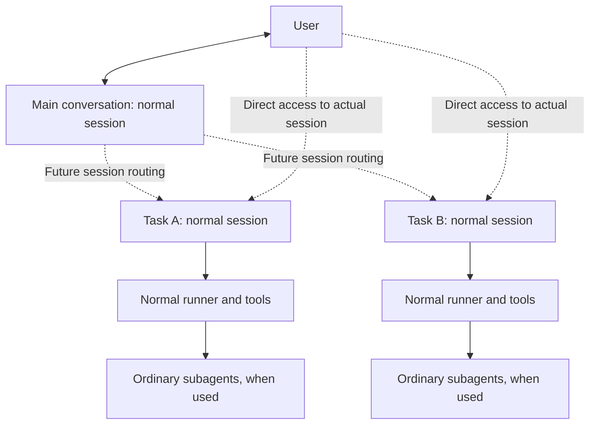

# Extension towards a coding harness and SuperAgent sessions

**Status: future directions retained as design constraints; implementation deferred.
The current subagent interaction remains separate and unchanged by this future work.**

On 2026-11-11 the user required this plan to account for future coding-harness and
SuperAgent implementation before freezing. The user then clarified: "for the future
super agent design it should not affecting our current subagent behaviour becasue it is
based on session instead of the subagent, so the subagent is suppose to be just working
normally as it is now".

This adds an extension contract to A3, not a new coordinator implementation or a change
to subagent behavior. Existing A3 repairs retain their own scope. The user subsequently
selected the four v1 defaults in the [product contract](v1-product-contract.md#final-selections-for-plan-freeze);
this future direction adds no change to those defaults or ordinary delegation behavior.

## Existing direction and precedence

| Planning input | Direction retained and qualification |
| --- | --- |
| [Harness prototype direction](../../harness-prototype-direction.md#agreed-outcomes) | One assistant works across ordinary existing repositories. Use compact discovery and read relevant context on demand; separate runtime/private state from repository knowledge. Historical assessments later in that document retain their dates and limits. |
| [Orchestrator harness plan](../../ORCHESTRATOR_HARNESS_IMPLEMENTATION_PLAN.md#confirmed-product-decisions) | Direct work for simple tasks; optional planning, exploration, delegation and review through the normal runner. Its foreground-only, non-recursive role matrix describes that earlier package, not a universal constraint on future session coordination. Its implementation claims are not reverified here. |
| [SuperAgent session direction](../../superagent-research-and-session-direction.md#future-interaction-direction) | A main conversation creates or reuses normal task sessions; users retain direct access to those actual sessions. Surface questions, results and failures without requiring constant supervision. Schema, routing policy, UI layout and lifecycle details remain future design decisions. |
| [Local inference boundary](../../superagent-research-and-session-direction.md#local-inference-constraint) | Stored sessions, runnable tasks, active subagents and simultaneous model requests are different quantities. Backend capacity belongs at the provider/inference boundary; per-session ordering protects correctness. |
| [Consolidated remaining work](../../nanobot-remaining-work.md#direction-and-existing-foundations) | Preserve ordinary-repository access, selected knowledge saving, process continuation and optional domain integrations. Historical source/test claims are inputs, not matching-head evidence from this planning review. |

The current [v1 contract](v1-product-contract.md) governs current delegation and UI scope.
Its read-only subagent inspection does not define the UI of a future managed task session.
The user's latest clarification governs that distinction. Keep the repository's
[small-core](../../../.agent/design.md) and [security](../../../.agent/security.md)
constraints. No historical document activates an old harness, restores retired H1
coordination or introduces a second history writer.

## Session coordination and subagents are separate layers

The diagram describes future session coordination, not an implemented runtime.

| Concern | Required separation |
| --- | --- |
| Task/session relationship | A task session is a normal session associated with ongoing work. A link from the main conversation is routing/context metadata; it does not make that session a delegated subagent. Task, project, session and active run need not share an identity or lifetime. No new task schema is selected here. |
| Subagent execution | Each normal session uses its ordinary delegation tools, policy, control path and owned subagent tree. The future coordinator must not replace them, insert extra parent-model hops or change subagent behavior. |
| Budgets | Creating/reusing a normal task session does not consume a subagent-depth level or child-run reservation. Actual subagents launched inside it consume normal subagent budgets. Future task admission needs its own explicit finite policy and cannot bypass delegation limits by renaming an actual subagent. |
| Stop and lifetime | Current Stop continues to cover the current run's owned subagent work. Future task hold/stop/reopen is an explicit session/task operation with a named target and authority. A router turn ending or stopping must not implicitly become cancellation or restart of every linked task session. Exact future task lifecycle remains to be designed. |
| Permissions | Session creation, access and input use current user/instance/session authority. Merely linking sessions grants no capabilities. Within any session, subagents keep the same narrowed authority and exact-effect approval rules. |
| User interface | Current delegated-helper detail remains read-only and main-chat-mediated. A future task session opens its actual normal conversation, allowing authorized direct instructions. Its composer is not a subagent composer. Manual/direct sessions remain available. |

Avoid hard-coding every related session as a subagent, every task as one model turn, or
every session with a relationship as read-only. Conversely, future direct task access
does not add direct controls to ordinary subagents. These distinctions preserve both
experiences without adding a generalized agent-backend framework now.

## Foundation contracts to preserve

| Extension need | Current foundation and boundary |
| --- | --- |
| Coding in existing repositories | Bind the effective repository/path and allowed read/write scope through existing tool admission. Folder discovery does not grant access. A shell directory change or UI focus change cannot silently retarget another tool or an already admitted run. Optional worktrees may isolate overlapping edits; ordinary work needs no mandatory clone or manifest. |
| Context and knowledge | Keep the project catalog small; retrieve instructions, evidence and selected knowledge when relevant, including after compaction. Governing policy remains effective independently of retrieved task history. Runtime transcripts, receipts and secrets stay separate from repository knowledge. Knowledge-only synchronization policy does not automatically commit/push code repositories. |
| Optional coding workflow | Let the normal agent choose direct tools, exploration, planning, bounded delegation or review as useful. Preserve role/tool policies and tool/plugin edges. Future coding validation uses admitted commands and evidence; no fixed planner-worker-review chain or new code execution engine is required by this record. |
| Canonical execution and results | Each session keeps one canonical input order, source writer and execution owner. Retain accepted inputs, tool intents/results, effect dispositions and artifact references through settlement. A future task index/status projection must not replace these facts with the router's last summary or a copied transcript. |
| Routing and direct collaboration | Future routing preserves original input, actor, explicit target, source/destination and deduplication identity. Direct-session input and routed input join the same admission path; update the main view from canonical task/session events. Similar wording or a common project is insufficient to broadcast a message to all tasks. |
| Tools and authority | Keep exact approvals, live revocation, prepared targets and request-owned tool/MCP bindings. A coding role, worktree, task label, retrieved instruction or coordinator output grants no extra authority. Future worker capabilities require explicit policy at the same tool owners. |
| Process continuation | A process/job can complete later and continue its owning normal session without an extra waiting model worker. Retain originating session/run, project, instructions/references and reply destination. A completion for A remains A's work after the main conversation switches to B. |
| Capacity and responsiveness | Per-session input serialization, finite subagent/task/process budgets and provider/backend request capacity remain distinct. A local backend with one inference slot can queue its work without an all-provider turn semaphore. Status/receipt/Stop paths must not require a spare model generation. Model throughput and fairness remain unmeasured. |
| Output and recovery | Bound live output separately from retained history/effect evidence. Future task status and code artifacts use canonical bounded references, with explicit truncation/uncertainty. Retry delivery without blindly repeating edits, commands or external effects; linking sessions does not authorize automatic replay. |
| Client projection | Keep activity, approvals and navigation at the existing client/channel edges. A future main page can prioritize questions, review requests, failures and results, and open actual task sessions. Desktop/TUI/Android may adapt layout while preserving targets, authority and state. No future layout is selected here. |

These are constraints on current foundations, not a requirement to add unused schema
fields, placeholder APIs, a parallel task database or a scheduler now. Future task
metadata/state gets an explicit owner when scoped; canonical session history remains
authoritative for execution. Domain workflows stay in optional tools, skills or plugins.

## Mapping to A3 and later review

| Current stage | Foundation checked during later A3 implementation review |
| --- | --- |
| A3-1 / A3-3 | Repository target versus session/run identity, canonical source/input admission, original actor and one writer. Relationships do not collapse task sessions into subagents. |
| A3-2 / A3-8 | Process ownership, original continuation target/destination, durable uncertainty and duplicate-completion refusal across project switching and restart. |
| A3-4 / A3-5 | Normal-session and subagent contracts stay separate. The helper-only read-only view and existing subtree Stop are scoped to delegation; shared admission/approvals remain reusable by normal task sessions. |
| A3-6 | Request-local provider/tool/MCP state and live revocation. Distinguish backend capacity from session ordering and subagent limits; add no all-provider turn gate for future coordination. |
| A3-7 | Android remains a remote client of the same normal session owner. Future task projection cannot bypass native/edge authorization or require a separate phone executor. |
| A3-8 / A3-10 | Retain evidence and existing generic session/process/tool owners during cleanup. Do not restore retired channel-specific coordination or remove a foundation merely because a future coordinator is deferred. |

For the current refactor, review these structural boundaries and existing contracts.
Passing A3 does not require future task creation/routing/UI features. Implementation
review must report a missing seam rather than infer it from a class or planning document.

## Future implementation acceptance scenarios

Use these when the corresponding future capability is actually scoped; they are not
tests executed for this planning record or new first-release feature requirements.

1. Work in repository A, then B, then return to A after compaction. Use existing checkouts,
   retrieve relevant instructions/decisions and keep admitted tools and delayed completions
   bound to the right project. Do not automatically publish changes to code repositories.
2. Create/reuse task sessions A and B from the main conversation. In each, ordinary
   subagents behave as before. Task-session routing changes neither helper depth nor
   permissions, controls, history ownership or result delivery within that session.
3. Open A and send a direct instruction while a routed follow-up arrives. Admit each
   original input once in the same canonical order; return to a main view that reflects
   the actual updated session without a duplicate runner or copied conversation.
4. Give an ambiguous follow-up or correct its task target. Avoid broadcasting it to all
   sessions. Stop/hold A explicitly without stopping B; stale input or a subscription must
   not revive stopped work. Specify the task lifecycle before implementing this scenario.
5. Constrain a local backend to one inference request while independent cloud-backed work
   runs. Show truthful queued/running states; preserve same-session ordering, ordinary
   subagent limits and status/Stop responsiveness without a gateway-wide model-turn gate.
6. Interrupt after an edit or external effect but before acknowledgement. Reconcile the
   same session/task outcome and original destination, without duplicate effects or
   restored Full consent. Surface questions/failures/results without repeated healthy noise.

## Deferred work and plan readiness

With the current v1 choices frozen in the [A3 baseline](plan-review.md#frozen-baseline-and-subsequent-work), qualify the current refactor
against latest staging, including the remaining macOS work. Subsequent coding-harness
work can reuse these foundations under a bounded feature specification. Later SuperAgent
work adds session creation/reuse, routing, task state/attention and direct-session UI at
the edges, while ordinary subagents continue to work normally inside each session.

Before that coordinator is enabled, settle its task/session representation, lifecycle,
target correction, direct/routed input reconciliation, cross-channel authority and reply
privacy, finite task budgets and provider-aware service policy, and client behavior.
No strict-router-only model, external agent backend, cloud execution, speculative work,
watchdog, new model assignment or performance benefit is selected by this extension record.

The plan now accounts for both future directions and records observable checks for their
extension points. This is architectural compatibility on paper; it is not proof that the
current implementation supplies those seams. This extension contract is included in the
frozen plan; subagent behavior and nanobot implementation code remain unchanged by this documentation update.
