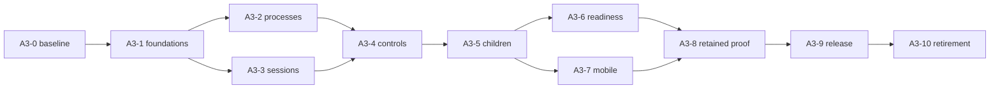

# A3 implementation and acceptance plan

**Current phase: plan frozen as `A3-PLAN-2026-11-11`; implementation review is next.** The [planning review](plan-review.md) records selected
Linux/macOS execution plus Android remote, and the [reference answers](reference-design.md)
supply the D2–D7 architectural direction, accepted by the user on 2026-11-11. The
stage mapping below applies that accepted direction. The historical candidate table
retains its original observations and does not establish implementation acceptance.
The user selected the four first-release defaults by choosing step 1, then authorized
step 2 to freeze and publish this documentation baseline. Later platform qualification focuses
on macOS; Linux/Android evidence is user-confirmed and retains its original source/host
scope. Historical Windows cancellation does not add Windows to the current matrix.
Actual test execution belongs to the later implementation acceptance phase.

The user selected a first release without legacy migration. The
[first-release contract](v1-product-contract.md) supersedes historical legacy cutover,
forced re-pairing, prior-release reader and two-version upgrade requirements. Initial
authentication, restart recovery, revocation and current data integrity remain required.

The sequence is A3-0 plus ten implementation stages. It preserves the
[original packet dependencies](../../audits/implementation-packets/README.md), with the
current candidate and review state added. The [design](design.md) supplies the invariants
and alternatives; [decisions](decisions.md) records accepted direction and product defaults; [review](review.md)
supplies corrections and gates. A packet ready for dispatch and an implementation
`READY_FOR_REVIEW` report are different from accepted stage evidence.

At `0518de5f5013b77cbc20d2c5b456e973f33c68f5`, PR #27 reports all ten stages
`READY_FOR_REVIEW`. No stage is declared accepted by this record. Original finding
closure defaults to `UNVERIFIED`, even when related code exists or a broad suite passes.

## Accepted direction mapped to stages

These owner contracts and the four first-release defaults are selected. The
[product contract](v1-product-contract.md#final-selections-for-plan-freeze) records
subagent lifetime/budgets, initial device proof and output/retention policy. Implementation
review uses the [frozen baseline](plan-review.md#frozen-baseline-and-subsequent-work)
and latest staging.

| Direction | Governing stages | Selected constraint |
| --- | --- | --- |
| D2 permissions | A3-1, A3-4, A3-5, A3-7 | Separate consent/profile/enforcement, recheck live authority per effect, retain volatile Full consent. |
| D3 delegation | A3-3, A3-4, A3-5, A3-7 | Canonical subagent sessions and normal runner/history, separate active runs, narrowed authority and bounded admission. Original-chat activity/control; optional read-only detail with return navigation and shared client semantics. |
| D4 compatibility | A3-7, A3-9, A3-10 | One initial supported wire/state contract with explicit versions and one live owner; no legacy migration for this first release. |
| D5 request lifetime | A3-6 | Exact request-owned definitions/bindings/resources through settlement, with live revocation. |
| D6 recovery | A3-1, A3-4, A3-6, A3-8 | Owner-local dispositions, compatible outputs, explicit uncertain effects and reconciliation before replay. |
| D7 output/resources | A3-2, A3-5, A3-8 | Separate live output, completion, capacity and durable retention; preserve unresolved evidence and existing finite limits. |

## Order and write ownership

These are acceptance dependencies. Work touching a shared source writer, runtime
composition, command router or public/persisted contract needs one write owner and a
reviewed prerequisite. A3-6 and A3-7 also need integrated qualification before release.
An independent conceptual lane does not justify concurrent edits to the same owner.

| Stage and packet | Needs accepted evidence from | Sole boundary for a bounded implementation slice | Required acceptance evidence | Historical candidate review state and current qualification scope |
| --- | --- | --- | --- | --- |
| [A3-0 baseline](../../audits/implementation-packets/A3-0-qualification-baseline.md) | Exact staging source | Evidence capture only: source, dependencies, Python/Bun/native tools and pre-existing failures | Frozen commands, exit codes, source/lock/package/bundle identities and exact failure signatures; platform gaps named | Historical local report pending in archive; candidate hosted evidence is separate. Baseline acceptance unverified. |
| [A3-1 foundations](../../audits/implementation-packets/A3-1-authority-foundations.md) | A3-0 | Bound instance/file facts, source writer and runner outcomes, prepared fallback, prompt provenance and early input | Explicit-root media including reload; assessed target equals executed target; mandatory-write failure stops dispatch; recovered input once; continuation terminal recomputed; fallback does not replay primary; guidance/input guards | Reported ready. Closest acceptance evidence and unresolved original IDs must be reconciled. |
| [A3-2 process ownership](../../audits/implementation-packets/A3-2-runtime-process-ownership.md) | A3-1 | Exec reservation/deadline/termination, confinement adapter, composition close and bounded subprocess consumers | Proven non-start releases reservation; uncertain launch retains it; no-poll hard timeout; concurrent Stop/shutdown settle once; bounded dual pipes; tree quiescence on real hosts; retryable cleanup | Retain independent deadline/termination mechanisms. Linux/macOS executors selected; macOS verification remains, with existing Linux evidence reused where applicable. |
| [A3-3 durable sessions](../../audits/implementation-packets/A3-3-durable-session-runtime.md) | A3-1 | Existing session manager/mode/writer, incarnation metadata and SDK ingest | Old conversation identity/history survive reopen; stale parent/generation refused; uncertain effects not replayed; valid prefix plus invalid ingest publishes nothing | AR3 and RR2 expose missing producer/child ownership integration with A3-5/A3-8. |
| [A3-4 client/control](../../audits/implementation-packets/A3-4-client-control-contracts.md) | A3-2, A3-3 | Typed approval, canonical admission and Stop; WebUI/TUI queues, replay and per-surface generations | One exact effect per valid approval, including child effects identified in the original chat; races/stale/revoked decisions refused; FIFO input retained until owner admission; reconnect once; original-chat Stop available for owned active work and stopping until settlement; lost reply readback distinguishes effect outcome | **HOLD AR1**; AR2 must use this consent contract for child effects. Shared UI criteria below apply. |
| [A3-5 delegation](../../audits/implementation-packets/A3-5-delegation-cutover.md) | A3-4 | One canonical subagent session/execution/source owner, narrowed policy and parent-tool lifecycle; existing activity/detail UI projections | Distinct child identities/history; duplicate attempt once; finite refusal no leak; no authority escalation; parent-mediated follow-up/cancellation and subtree Stop/restart proof; main-chat task/status/results with optional read-only detail/return; reconnect without duplicate or stale-run activity; historical display cannot control live work | **HOLD AR2/AR3** for later implementation review. Native runner, awaited default, explicit background work and finite 2/2/4 plus four gateway-wide child runs are selected. No separate public child management interface. |
| [A3-6 capability readiness](../../audits/implementation-packets/A3-6-capability-readiness.md) | A3-5 | Tool schema/loader/MCP owner, provider/credential adapters, skill provenance and bounded workbench | Ready-only publication, failed replacement preserves old binding, request-bound definition/execution; explicit stream terminal; physical attempts; current login generation; explicit instance separation; scoped skills and bounded payloads | **HOLD AR4**; executing-call leases do not prove definition-capture lifetime. |
| [A3-7 mobile](../../audits/implementation-packets/A3-7-mobile-pairing.md) | A3-5; integrate A3-6 before release | Remote owner/proof/token/store/edge, native key/correlation/cache and shared UI | Initial device proof; restart and lost-delivery recovery; native Cancel/revoke; production scope and origin checks; bounded native completion; Android/desktop-owner flow; the same original-chat subagent activity, approval, Stop, detail/return and reconnect semantics with touch navigation | **HOLD AR5/AR6** for later implementation review. User-confirmed Android evidence retains its scope; legacy cutover/re-pairing is outside the first-release requirement. |
| [A3-8 durability/retention](../../audits/implementation-packets/A3-8-durability-retention.md) | A3-6, A3-7 | Source/journal/transcript archives, scheduler/occurrence/outbox/completion, attachment/Dream/cleanup and parser/index owners | Boundary append readable or refused; crash-safe rotation once; retained scheduler order and unknown disposition; incarnation-bound continuations; complete-reference deletion; byte-preserving dry-run; bounded parsers and complete asset paging | **HOLD RR1/RR2/RR3**; any new ProcessRecord format needs reader/export compatibility. |
| [A3-9 release qualification](../../audits/implementation-packets/A3-9-release-qualification.md) | A3-8 | Existing install/build/signing/deploy scripts and first-release qualification | Exact installed executable/bundle/toolchain/APK/signer tuple; clean installation and restart/recovery; preserve revocation/uncertainty on supported rollback or refuse; qualify selected targets using matching evidence | **HOLD** for later implementation acceptance. Linux/Android previously verified per user; macOS remains. No historical-release executable or two-APK upgrade requirement; Windows is outside the matrix. |
| [A3-10 pre-release cleanup](../../audits/implementation-packets/A3-10-compatibility-retirement.md) | Accepted A3-9 candidate | Obsolete/duplicate registration, startup and writer paths | Trace current callers/state and keep one live owner; preserve current revocation and uncertain-effect evidence; rerun affected checks | Pre-release cleanup needs a named disposition; no adapter solely for an unreleased legacy format. Six repairs still need later semantic reconciliation. |

## Client behavior acceptance

The user selected [reference-aligned subagent UI behavior](v1-product-contract.md#client-ui-behavior-for-subagents).
A3-4 owns existing composer/approval/Stop and reconnect admission; A3-5 owns canonical
child activity/result projection and optional read-only detail; A3-7 carries the same
contract into Android remote. Use current client layouts and existing owners, without a
separate task UI framework or client-owned lifecycle store.

The [later UI scenarios](v1-product-contract.md#later-ui-acceptance) cover sibling results/
failure and capacity refusal, inspect/return, ordered follow-up and exact approval,
subtree Stop, and reconnect/late-event/restart handling. Record the visible state alongside
the canonical owner/effect result. Client tests alone do not prove process settlement,
and backend tests alone do not prove that the user sees the right state. Execute these
checks after plan freeze; this update supplies planning criteria only.

## Extension boundaries for future work

The user required the plan to preserve the coding-harness and SuperAgent directions,
and clarified that future SuperAgent coordination operates on normal sessions while
subagents keep working normally within each one. The
[extension contract and stage mapping](future-harness-extension.md#mapping-to-a3-and-later-review)
define the current foundations to preserve: repository targets, canonical session/input/
source owners, process continuation identity, ordinary delegation, exact authority,
provider request capacity and client projections.

During later A3 code review, check those boundaries and avoid coupling normal task
sessions to subagent depth, controls, read-only inspection or lifetime. The selected
gateway child cap counts actual subagent runs; it is not a limit on stored normal
sessions or an all-provider model-turn semaphore. Current subagent behavior acquires
no new requirement from the future coordinator.

The [future workflow scenarios](future-harness-extension.md#future-implementation-acceptance-scenarios)
belong to bounded later feature work. A3 acceptance does not require implementing task
routing, a router page, task-state storage, cross-channel coordination or a new scheduler.
Those need their own selected contracts when scoped. This preserves extension points
without creating a second execution/history engine now.

## Finding traceability

The [machine ledger](evidence.json) assigns each of the 136 I05 IDs to exactly one
original repair package and one **primary acceptance stage**. The primary stage is an
editorial routing aid derived from the packet scope and original finding; it does not
change the finding, its priority, its activation conditions or its source owner's
authority. Supporting stages remain explicit because an instance or lifetime finding
can span several boundaries. An acceptance report must identify any unresolved part.

| I05 package | Findings | Planned contributing stages | Source-owned concern |
| --- | ---: | --- | --- |
| R01 | 14 | A3-1, 2, 4, 5, 6, 7 | Effective resource, workspace and instance authority |
| R02 | 6 | A3-4, 5, 8 | Exact approval and delegated mutation trust |
| R03 | 4 | A3-7, 9 | Listener/mobile/local side-effect authentication |
| R04 | 5 | A3-6, 7, 9 | Credential, catalog and diagnostic provenance/privacy |
| R05 | 2 | A3-1, 8 | Historical instruction authority and Dream custody |
| R06 | 6 | A3-1, 3, 4 | Canonical source, ingest and effect outcomes |
| R07 | 5 | A3-8 | Source/history capacity and proof-preserving rotation |
| R08 | 5 | A3-1, 6 | Provider terminal, fallback, attempts and login generation |
| R09 | 11 | A3-2, 6, 9 | Process/composition/lease lifetime |
| R10 | 4 | A3-8 | Scheduler, process continuation and trigger durability |
| R11 | 8 | A3-7 | Native/mobile custody, correlation, cancellation and capacity |
| R12 | 8 | A3-8 | Media/session deletion and maintenance |
| R13 | 7 | A3-6, 7, 8 | Bytes/work limits and complete asset visibility |
| R14 | 8 | A3-4, 6 | Client queue and selection-generation integrity |
| R15 | 9 | A3-1, 6, 10 | Manifest/guidance, skill provenance and activation |
| R16 | 6 | A3-4, 7, 9 | Routes, strict inputs and local readiness |
| R17 | 7 | A3-6 | Schema, MCP request binding and model generation |
| R18 | 6 | A3-10 | Compatibility, gated paths and dormant machinery |
| R19 | 2 | A3-8, 9 | Cron administration scope and real production qualification |
| R20 | 6 | A3-9 | Installed artifact, bundle, toolchain and signing identity |
| R21 | 5 | A3-9 | Staged deployment, CI, historical verifier and real upgrade |
| R22 | 2 | A3-1 | Input aliases and progress guards |
| **Total** | **136** | **22 packages** | **No original ID merged or closed by this mapping** |

T01-F10 and K01-F11 retain their distinct IDs despite partial overlap in the missing
`apply_patch` fact. S02-F02, K01-F03 and A01-F07 are repeated integration references,
not additional findings. K01-STG-F01 is separately routed to R15/A3-6 and excluded
from 136. The 95 E01 bodies retain limited-depth status; its 26 retained findings stay
outside this partition. The audit's original priorities and reachability matrix remain
authoritative qualifications, copied into the ledger with links to the original reports.

AR1–AR6 and RR1–RR3 are current-candidate review findings, not replacements or additions
inside the frozen denominator. Some are inherited or partial repairs. A passing global
suite cannot establish that each original finding was fixed.

## Evidence required for an implementation acceptance

For each bounded correction, record the source/environment identities, exact criterion,
before/after observable result, commands and exits, focused test IDs, compatibility and
rollback result. Test through the real owner/production entry point with only bounded
external effects substituted. Keep fixture, host, emulator and physical-device proof
distinct. Reuse earlier evidence only when its inputs still match.

The repository's [strict regression contract](../../migration/p6-error-attribution.md)
requires frozen full-source checker reports in the same dependency environment and zero
new diagnostic signatures across **all** files. Lower totals alone do not pass. A
repair-batch comparator pass does not close P6: unchanged full strict checking must exit
zero and the required local full test suite must pass. This documentation work runs
structural/link/hash checks only; it creates no new product test evidence.

## Rollback and requalification

| Boundary | Required rollback behavior |
| --- | --- |
| Non-format foundations and controls | Revert a failed bounded slice with its dependants in an implementation branch; retain source/approval receipts and unresolved effects. |
| Process or composition changes | Stop/drain owned work or preserve uncertainty. Never replace a live owner with a second owner to make rollback appear successful. |
| Child/session metadata | Preserve child and parent incarnation histories. Keep a compatible reader/export; an old text announcement must not regain live authority. |
| MCP/provider reload | Failed replacement preserves the still-authorized old binding; a revoked binding stays revoked. No name-based replay on a new generation. |
| Initial mobile contract | Preserve revocation and pending/cancel generations. If an older development build cannot represent current authority, keep remote pairing/access disabled; no legacy device migration is required. |
| Archives/scheduler/retention | Stop writers, verify a separate copy, preserve newer proof and export with a digest. When an old format cannot represent proof, keep cron disabled pending reconciliation. |
| Release and retirement | Preserve current state/proof before a bounded pre-release revert, or refuse unsupported rollback. Inject relevant failures on isolated copies and rerun affected checks at the final source/artifact digest. No historical-release executable is required for this first release. |

The [candidate stopped-copy runbook](https://github.com/JadenChun/nanobot-custom/blob/0518de5f5013b77cbc20d2c5b456e973f33c68f5/docs/migration/a3-release-rollback.md)
is a specification/source reference. Its existence is not an installed historical-reader
receipt or authorization for a live switch. Documentation may be accepted while code
merge and deployment remain held by [the review conditions](review.md).
