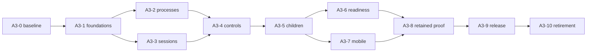

# A3 implementation and acceptance plan

The sequence is A3-0 plus ten implementation stages. It preserves the
[original packet dependencies](../../audits/implementation-packets/README.md), with the
current candidate and review state added. The [design](design.md) supplies the invariants
and alternatives; [decisions](decisions.md) records unresolved choices; [review](review.md)
supplies corrections and gates. A packet ready for dispatch and an implementation
`READY_FOR_REVIEW` report are different from accepted stage evidence.

At `0518de5f5013b77cbc20d2c5b456e973f33c68f5`, PR #27 reports all ten stages
`READY_FOR_REVIEW`. No stage is declared accepted by this record. Original finding
closure defaults to `UNVERIFIED`, even when related code exists or a broad suite passes.

## Order and write ownership

These are acceptance dependencies. Work touching a shared source writer, runtime
composition, command router or public/persisted contract needs one write owner and a
reviewed prerequisite. A3-6 and A3-7 also need integrated qualification before release.
An independent conceptual lane does not justify concurrent edits to the same owner.

| Stage and packet | Needs accepted evidence from | Sole boundary for a bounded implementation slice | Required acceptance evidence | Current review state |
| --- | --- | --- | --- | --- |
| [A3-0 baseline](../../audits/implementation-packets/A3-0-qualification-baseline.md) | Exact staging source | Evidence capture only: source, dependencies, Python/Bun/native tools and pre-existing failures | Frozen commands, exit codes, source/lock/package/bundle identities and exact failure signatures; platform gaps named | Historical local report pending in archive; candidate hosted evidence is separate. Baseline acceptance unverified. |
| [A3-1 foundations](../../audits/implementation-packets/A3-1-authority-foundations.md) | A3-0 | Bound instance/file facts, source writer and runner outcomes, prepared fallback, prompt provenance and early input | Explicit-root media including reload; assessed target equals executed target; mandatory-write failure stops dispatch; recovered input once; continuation terminal recomputed; fallback does not replay primary; guidance/input guards | Reported ready. Closest acceptance evidence and unresolved original IDs must be reconciled. |
| [A3-2 process ownership](../../audits/implementation-packets/A3-2-runtime-process-ownership.md) | A3-1 | Exec reservation/deadline/termination, confinement adapter, composition close and bounded subprocess consumers | Proven non-start releases reservation; uncertain launch retains it; no-poll hard timeout; concurrent Stop/shutdown settle once; bounded dual pipes; tree quiescence on real hosts; retryable cleanup | Retain independent deadline/termination mechanisms. Platform matrix remains open. |
| [A3-3 durable sessions](../../audits/implementation-packets/A3-3-durable-session-runtime.md) | A3-1 | Existing session manager/mode/writer, incarnation metadata and SDK ingest | Old conversation identity/history survive reopen; stale parent/generation refused; uncertain effects not replayed; valid prefix plus invalid ingest publishes nothing | AR3 and RR2 expose missing producer/child ownership integration with A3-5/A3-8. |
| [A3-4 client/control](../../audits/implementation-packets/A3-4-client-control-contracts.md) | A3-2, A3-3 | Typed approval, canonical admission and Stop; WebUI/TUI queues, replay and per-surface generations | One exact effect per valid approval; races/stale/revoked decisions refused; FIFO input retained until owner admission; reconnect once; Stop remains stopping until settlement; lost reply readback distinguishes effect outcome | **HOLD AR1**; AR2 must use this consent contract for child effects. |
| [A3-5 delegation](../../audits/implementation-packets/A3-5-delegation-cutover.md) | A3-4 | One canonical child session/execution/source owner, narrowed policy and typed client references | Siblings/nested child identities and histories; duplicate attempt once; finite refusal no leak; no authority escalation; subtree Stop/restart proof; current-generation controls; historical display does not control live work | **HOLD AR2/AR3**; D3 profile/budget provenance missing. |
| [A3-6 capability readiness](../../audits/implementation-packets/A3-6-capability-readiness.md) | A3-5 | Tool schema/loader/MCP owner, provider/credential adapters, skill provenance and bounded workbench | Ready-only publication, failed replacement preserves old binding, request-bound definition/execution; explicit stream terminal; physical attempts; current login generation; explicit instance separation; scoped skills and bounded payloads | **HOLD AR4**; executing-call leases do not prove definition-capture lifetime. |
| [A3-7 mobile](../../audits/implementation-packets/A3-7-mobile-pairing.md) | A3-5; integrate A3-6 before release | Remote owner/proof/token/store/edge, native key/correlation/cache and shared UI | Exact P-256 canonical proof; restart and lost-delivery recovery; native Cancel/revoke; production scope and origin checks; bounded native completion; physical Android/desktop-owner flow | **HOLD AR5/AR6**; physical qualification waiver reported, authority/provenance unverified; cutover/re-pair gaps remain. |
| [A3-8 durability/retention](../../audits/implementation-packets/A3-8-durability-retention.md) | A3-6, A3-7 | Source/journal/transcript archives, scheduler/occurrence/outbox/completion, attachment/Dream/cleanup and parser/index owners | Boundary append readable or refused; crash-safe rotation once; retained scheduler order and unknown disposition; incarnation-bound continuations; complete-reference deletion; byte-preserving dry-run; bounded parsers and complete asset paging | **HOLD RR1/RR2/RR3**; any new ProcessRecord format needs reader/export compatibility. |
| [A3-9 release qualification](../../audits/implementation-packets/A3-9-release-qualification.md) | A3-8 | Existing install/build/signing/deploy scripts and production qualification | Exact installed executable/bundle/toolchain/APK/signer tuple; isolated switch/rollback; immutable prior verifier/executable; two distinct APK upgrade; every supported target qualified at the digest | **HOLD** full Windows cancelled, macOS/native/physical evidence gaps and prior-reader receipts uninspected. |
| [A3-10 retirement](../../audits/implementation-packets/A3-10-compatibility-retirement.md) | Accepted A3-9 candidate/compatibility | Proven obsolete registration/startup/writer and narrow retained reader/adapter | Named disposition per removal; external caller/persisted-state proof; one live owner; current authority and revocation survive rollback; affected release checks rerun | **HOLD** prerequisite and D4 dispositions unaccepted; six repair commits need reconciliation. |

## Finding traceability

The [machine ledger](evidence.json) assigns each of the 136 I05 IDs to exactly one
original repair package and one **primary acceptance stage**. The primary stage is an
editorial routing aid derived from the packet scope and original finding; it does not
change the finding, its priority, its activation conditions or its source owner's
authority. Supporting stages remain explicit because an instance or lifetime finding
can span several boundaries. An acceptance report must identify any unresolved part.

| I05 package | Findings | Planned contributing stages | Source-owned concern |
| --- | ---: | --- | --- |
| R01 | 14 | A3-1, 2, 4, 5, 6, 7 | Effective resource, workspace and instance authority |
| R02 | 6 | A3-4, 5, 8 | Exact approval and delegated mutation trust |
| R03 | 4 | A3-7, 9 | Listener/mobile/local side-effect authentication |
| R04 | 5 | A3-6, 7, 9 | Credential, catalog and diagnostic provenance/privacy |
| R05 | 2 | A3-1, 8 | Historical instruction authority and Dream custody |
| R06 | 6 | A3-1, 3, 4 | Canonical source, ingest and effect outcomes |
| R07 | 5 | A3-8 | Source/history capacity and proof-preserving rotation |
| R08 | 5 | A3-1, 6 | Provider terminal, fallback, attempts and login generation |
| R09 | 11 | A3-2, 6, 9 | Process/composition/lease lifetime |
| R10 | 4 | A3-8 | Scheduler, process continuation and trigger durability |
| R11 | 8 | A3-7 | Native/mobile custody, correlation, cancellation and capacity |
| R12 | 8 | A3-8 | Media/session deletion and maintenance |
| R13 | 7 | A3-6, 7, 8 | Bytes/work limits and complete asset visibility |
| R14 | 8 | A3-4, 6 | Client queue and selection-generation integrity |
| R15 | 9 | A3-1, 6, 10 | Manifest/guidance, skill provenance and activation |
| R16 | 6 | A3-4, 7, 9 | Routes, strict inputs and local readiness |
| R17 | 7 | A3-6 | Schema, MCP request binding and model generation |
| R18 | 6 | A3-10 | Compatibility, gated paths and dormant machinery |
| R19 | 2 | A3-8, 9 | Cron administration scope and real production qualification |
| R20 | 6 | A3-9 | Installed artifact, bundle, toolchain and signing identity |
| R21 | 5 | A3-9 | Staged deployment, CI, historical verifier and real upgrade |
| R22 | 2 | A3-1 | Input aliases and progress guards |
| **Total** | **136** | **22 packages** | **No original ID merged or closed by this mapping** |

T01-F10 and K01-F11 retain their distinct IDs despite partial overlap in the missing
`apply_patch` fact. S02-F02, K01-F03 and A01-F07 are repeated integration references,
not additional findings. K01-STG-F01 is separately routed to R15/A3-6 and excluded
from 136. The 95 E01 bodies retain limited-depth status; its 26 retained findings stay
outside this partition. The audit's original priorities and reachability matrix remain
authoritative qualifications, copied into the ledger with links to the original reports.

AR1–AR6 and RR1–RR3 are current-candidate review findings, not replacements or additions
inside the frozen denominator. Some are inherited or partial repairs. A passing global
suite cannot establish that each original finding was fixed.

## Evidence required for an implementation acceptance

For each bounded correction, record the source/environment identities, exact criterion,
before/after observable result, commands and exits, focused test IDs, compatibility and
rollback result. Test through the real owner/production entry point with only bounded
external effects substituted. Keep fixture, host, emulator and physical-device proof
distinct. Reuse earlier evidence only when its inputs still match.

The repository's [strict regression contract](../../migration/p6-error-attribution.md)
requires frozen full-source checker reports in the same dependency environment and zero
new diagnostic signatures across **all** files. Lower totals alone do not pass. A
repair-batch comparator pass does not close P6: unchanged full strict checking must exit
zero and the required local full test suite must pass. This documentation work runs
structural/link/hash checks only; it creates no new product test evidence.

## Rollback and requalification

| Boundary | Required rollback behavior |
| --- | --- |
| Non-format foundations and controls | Revert a failed bounded slice with its dependants in an implementation branch; retain source/approval receipts and unresolved effects. |
| Process or composition changes | Stop/drain owned work or preserve uncertainty. Never replace a live owner with a second owner to make rollback appear successful. |
| Child/session metadata | Preserve child and parent incarnation histories. Keep a compatible reader/export; an old text announcement must not regain live authority. |
| MCP/provider reload | Failed replacement preserves the still-authorized old binding; a revoked binding stays revoked. No name-based replay on a new generation. |
| Mobile v2 | Preserve revocation and pending/cancel generations. If the rollback build lacks current authority, keep remote pairing/access disabled until a compatible build returns. |
| Archives/scheduler/retention | Stop writers, verify a separate copy, preserve newer proof and export with a digest. When an old format cannot represent proof, keep cron disabled pending reconciliation. |
| Release and retirement | Retain the verified prior executable and compatible state, inject pre/post-switch failures on isolated targets, and rerun affected checks at the final source/artifact digest. |

The [candidate stopped-copy runbook](https://github.com/JadenChun/nanobot-custom/blob/0518de5f5013b77cbc20d2c5b456e973f33c68f5/docs/migration/a3-release-rollback.md)
is a specification/source reference. Its existence is not an installed historical-reader
receipt or authorization for a live switch. Documentation may be accepted while code
merge and deployment remain held by [the review conditions](review.md).
