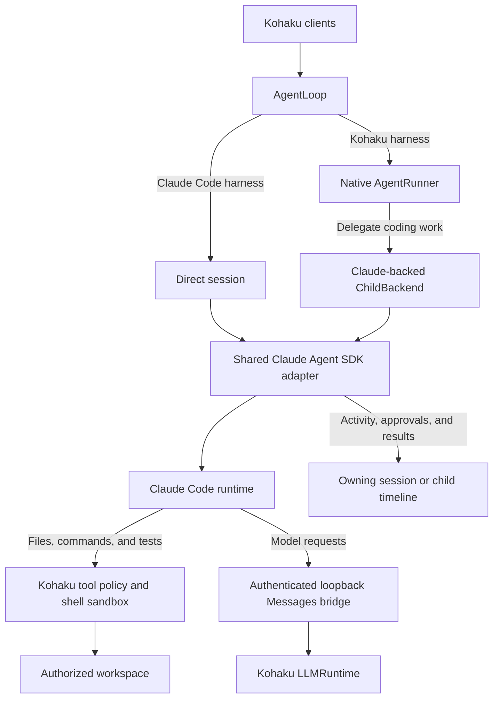

# Claude Code Harness Design

**Status** — Agreed design for `codex/coding-harness-session`. Prerequisites A and B are on `staging` at `1bdf7920`.
**Date** — 2026-11-24

- [Implementation work plan](./coding-harness-session-work-plan.md)
- [Core design constraints](../../.agent/design.md) and [security boundaries](../../.agent/security.md)
- [A3 authority and recovery decisions](./a3/decisions.md) and [subagent product contract](./a3/v1-product-contract.md)
- [Future harness extension](./a3/future-harness-extension.md) and [SuperAgent session direction](../superagent-research-and-session-direction.md)

## 1. Decision Summary

Kohaku uses its native `AgentRunner` for personal-assistant chats, Dream memory, skills, cron, and channel routing.
The Claude Agent SDK adds a harness for repository investigation, technical planning, implementation, and testing.

| Entry point | Execution owner | User interaction |
| --- | --- | --- |
| Direct session | Normal Kohaku session bound to Claude Code | Choose **Claude Code** in the **Harness** dropdown above the new-chat composer. Work directly in that chat. |
| Delegation from Kohaku | Claude-backed subagent owned by the original chat | Work with Kohaku on the PRD, findings, and plan. Follow Claude Code activity, approvals, and results in the same chat. |

Harness selection determines which engine runs the work. Kohaku can use one Claude Code context for a whole task.
It can also assign a bounded task to an explorer, planner, worker, or reviewer when that helps.
Each assignment gets the scope that the user authorized. An implementation assignment can include research, edits, and tests.

## 2. High-Level Architecture

`AgentLoop` dispatches direct Claude Code turns at its existing runner boundary (`kohaku/agent/loop.py`).
The delegation manager admits Claude-backed subagents through `ChildBackend` and still enters through `AgentLoop.execute_child_turn` into that **same** `ExternalHarnessRunner` boundary.
Both direct sessions and delegated children therefore share one SDK adapter, one `SourceTurnWriter`, one `AgentHook`, one `PendingExternalApproval` bridge, and one Stop path.

## 3. Component Design

### 3.1 Direct Session Binding and Controls

The new-chat draft shows a **Harness** dropdown above the composer input container.
The choices are **Kohaku** (default) and **Claude Code** when the backend is available.
**Model** is a separate control. Both selections go through the existing session creation flow.

The gateway validates the harness choice when it creates the session on first submission.
It saves the backend and harness in `harness_binding` before the first turn.
Kohaku uses the native backend for existing sessions and create requests without a harness choice.
Temporary chats do not persist session bindings or resumable SDK state: disable/hide **Claude Code** in the Harness dropdown when Temporary chat is active, and reject `harness="claude_sdk"` for temporary-chat creation at the gateway.
If the gateway rejects a selection, the client keeps the draft and shows the failure.

The header and sidebar show a **Claude** badge for a session bound to Claude Code.
The saved harness is immutable. To select another harness, create a new chat.
The usual **Working in** picker sets the folder before the first turn.
When the first Claude Code turn starts, Kohaku locks the folder. Use the selected checkout by default.
The task can use a Git worktree when it needs an isolated checkout.

A direct Claude Code binding uses `backend="external"` and `harness="claude_sdk"`.
The binding records the canonical folder when Kohaku locks it.
The runtime stores the SDK session ID once it receives it.
The generation identifies the current runtime for approval, Stop, and resume.

### 3.2 Kohaku Delegation (Orthogonal Harness × Role Composition)

**Harness** (`native` vs `claude_sdk`) and **Role** (`explore`, `plan_task`, `delegate_task`, `review_work`) are independent, composable axes.
Selecting `harness="claude_sdk"` changes which execution engine runs the role while strictly preserving that role's capability contract (`explore`, `plan_task`, and `review_work` remain read-only; `delegate_task` receives its declared `write_scope` plus scoped test execution when backed by Claude Code).

When Claude Code is available, Kohaku's tool guidance states:

> Use Claude Code (`harness="claude_sdk"`) for coding work, including codebase investigation, technical planning, implementation, and testing.

- **Tool surface:** Existing delegation tools (`explore`, `plan_task`, `delegate_task`, `review_work`) accept an optional `harness: "native" | "claude_sdk"` parameter (defaulting to `"native"`).
- **Continuing Claude context across role transitions without violating A3 immutability:** An existing read-only child (`explore` / `plan_task`) never widens its own admitted scope in place (`followup_child` remains bound to the child's original scope). Instead, `delegate_task` (with `harness="claude_sdk"`) accepts an optional `continue_from_child_id` owned by the same parent chat: Kohaku re-validates current user, chat, and workspace authority, creates a **fresh implementation child admission**, and launches the SDK with `resume=<prior_external_session_id>` and `fork_session=True`. This carries Claude's full codebase investigation context straight into implementation while keeping read-only child records immutable.
- **Direct plan handoff:** When an implementation plan already exists, Kohaku can call `delegate_task(harness="claude_sdk", ...)` directly with the plan, `write_scope`, and acceptance checks so Claude Code inspects, edits, and runs tests in one assignment.

The existing delegation owner manages the child ID, follow-ups, budgets, and Stop.
The parent chat shows the child's activity and approvals. It also shows the result when the work settles.
The child activity item shows a **Claude** badge when the child's admitted harness is Claude Code.
The child detail header shows the same badge across desktop WebUI, TUI, and Android clients. The child projection uses the saved harness identity.
The user gives follow-ups and approval decisions in the original chat.

### 3.3 Loopback Anthropic Messages Bridge

The bridge listens on `127.0.0.1` at an ephemeral port. It requires a token for the owning execution context.
The adapter gives the subprocess the loopback URL and the token. Kohaku retains upstream provider credentials.

- Set `ANTHROPIC_BASE_URL` and the bridge token in the subprocess environment.
- Convert `/v1/messages` requests to the selected Kohaku `LLMRuntime`.
- Support streaming SSE and non-streaming responses. Support `/v1/messages/count_tokens` for token estimates.
- Translate text, tool definitions, tool requests and results, images, and supported thinking fields.
- Route compaction and SDK model aliases to the same selected model preset.
- Preserve supported Anthropic cache and thinking fields on the Anthropic path.
- Record usage through Kohaku's existing usage context. Propagate cancellation to the provider.

The goal is to support Kohaku model presets through this bridge.
Anthropic supports Claude models through its documented gateway interface.
Qualify non-Claude presets with the real SDK before presenting them as compatible.
[Claude Code gateway support](https://code.claude.com/docs/en/llm-gateway)

### 3.4 Event Normalization and History

The SDK owns the model context, compaction, and SDK resume history.
Kohaku owns the canonical session or child history, with one writer for each execution owner.
Resume the SDK context through its stored ID. Use the canonical Kohaku history for display and inspection.

| SDK activity | Kohaku result |
| --- | --- |
| Text and reasoning deltas | Stream text through `AgentHook`. Keep reasoning in the live display. |
| Tool request | Record normalized intent and the owning run. |
| Tool result | Record the result and derive `fileEdits` from actual tool effects. |
| User approval | Show Kohaku's existing approval card in the owning chat. |
| Completion, error, or cancellation | Settle the run in its canonical history with the observed outcome. |

Map `Read`, `Write`, and `Edit` to `read_file`, `write_file`, and `edit_file`.
Map `Bash`, `Glob`, and `Grep` to `exec`, `find_files`, and `grep`.
Keep tool arguments and results typed at the adapter boundary.
Exclude direct Claude Code chats and SDK child transcripts from personal Dream consolidation.
Use `list_sessions`, `search_sessions`, and `read_session` for authorized direct chat inspection.
Include the session kind, workspace, and status in the metadata view.
Use the existing child activity and history for delegated work.

### 3.5 Tool Policy, Approvals, and Tests

The gateway applies current chat authority, the assigned workspace and scope, and the tool policy.
It checks authority before an effect and when an approval is applied.
Some SDK tool calls are approved before `can_use_tool` runs.
Use SDK tool restrictions and pre-tool checks to enforce workspace, private-path, and capability limits.
Use `can_use_tool` for calls that require a live user decision.
Apply the same effective limits to any SDK subagents or additional tools that the adapter enables.
[SDK permission order](https://code.claude.com/docs/en/agent-sdk/permissions)

**Sandbox** is the default. Claude Code's sandbox confines its shell commands.
Kohaku checks file tools and controls which MCP tools the SDK can use.
Use one shell confinement layer per command.
Reuse Stage 1B settings for exclusions, local bindings, and Unix sockets where they fit the admitted scope.
Enforce fail-closed Sandbox availability before launching the SDK (on Linux, verify `managed_bwrap_available()` and `socat` before admission; `SandboxSettings` in `claude-agent-sdk 0.2.188` does not expose a `failIfUnavailable` key). If the shell sandbox is unavailable, fail closed and show the configuration failure.
Use `HookMatcher(on_failure="block")` for Kohaku's `PreToolUse` enforcement hook so hook errors fail closed, and return `permissionDecision="ask"` from `PreToolUse` to escalate risky or unsandboxed commands into `can_use_tool` even when `autoAllowBashIfSandboxed=True`.
A user can select **Full access** through the direct chat permissions control.
A change that reduces authority fences active work and admissions under the old permissions.
If the SDK needs a process restart, reapply the current policy before resuming.
A child receives the scope admitted by Kohaku, including when its parent has Full access.
[Claude Code shell sandbox](https://code.claude.com/docs/en/sandboxing)

The owner binds a pending approval to the run, generation, and exact tool effect.
The existing card offers **Allow once**, **Allow & save `<tool>`** for an eligible executable, and **Deny**.
Kohaku decides eligibility with `permission_rules.py`.
On **Allow & save**, the gateway owns and saves the exact eligible executable.
Apply the saved exclusion through live policy and update the SDK settings on process refresh.
Approvals and saved exceptions must respect the child's admitted scope.
Stop cancels pending approval requests and reaches the owned process tree.

Claude Code runs the relevant tests for an implementation assignment.
- **Direct sessions & workspace-scoped tasks:** Use Claude Code's native `Bash` tool under Claude's OS sandbox (`bwrap` / Seatbelt), which isolates shell writes to the authorized workspace root and temp directories.
- **Narrow `write_scope` delegated workers:** Enforce `write_scope` strictly on all SDK file tools (`Write`, `Edit`, `NotebookEdit`) via `PreToolUse` hooks, while allowing sandboxed `Bash` inside the workspace root for running tests (still gated by `permission_rules.py` and `can_use_tool` for risky/destructive commands and unsandboxed exceptions).
- The agent runs routine tests under the current policy, fixes failures within its `write_scope`, and returns the diff, test commands and outcomes, and any remaining failures to Kohaku.
- Kohaku checks the result against the agreed scope and acceptance checks.

## 4. Packaging and Recovery

Bundle `claude-agent-sdk` (and `aiohttp` for the loopback bridge) in Kohaku's core dependencies, while still lazy-importing the SDK only when a Claude Code run starts so startup stays fast and missing-runtime failures degrade cleanly.
Use the SDK and bundled Claude Code versions qualified by the implementation smoke tests.
Launch the subprocess with a controlled environment and explicit settings sources.

The adapter starts on admission and closes its process when the owner stops or releases it.
It can release idle processes and resume a valid SDK context on a new admitted turn.
After a gateway restart, mark unfinished work interrupted or uncertain.
Retain the owner, SDK session ID, workspace, and available evidence.
Resume through a fresh admission after the work's effects are reconciled.

## 5. Implementation Phases

Stage 1A tool discovery and recovery are on `staging`.
Stage 1B added shared sandbox settings, the three-choice approval card, and read-only session lookup.
The [work plan](./coding-harness-session-work-plan.md) records these prerequisites and the verification commands.

| Phase | Outcome |
| --- | --- |
| 1. Model bridge | Qualify Anthropic Messages translation with the real SDK on Claude and a representative non-Claude preset. |
| 2. Shared SDK adapter | Normalize events and implement scope enforcement, live approvals, workspace-sandboxed test execution, cancellation, and resume/fork. |
| 3. Direct sessions (Gateway + WebUI) | Bind the harness selected above the composer (excluding temporary chats). Show the **Claude** badge and support direct workspace locking and recovery. |
| 4. Kohaku delegation (Orthogonal Harness × Role) | Add optional `harness="claude_sdk"` to existing role tools + `continue_from_child_id` (`fork_session=True`), routing through the shared `AgentLoop` runner seam. Show the child **Claude** badge and report edits and tests in the parent chat. |
| 5. TUI & Android UI parity | Expose the **Harness** selector (new chat) and **Claude** badge (direct chats + delegated children) consistently in TUI and Android clients. |

The release includes direct sessions, parent-owned delegation, and cross-client **Claude** badges across WebUI, TUI, and Android.
Support for additional harnesses, standalone task sessions created by the assistant, a Claude Plan mode control,
and Kohaku tools exposed to the SDK can follow as separate work.
