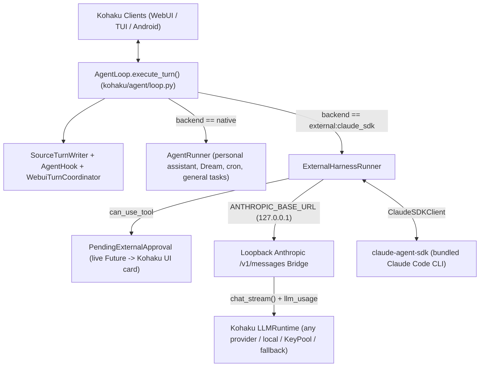

# Direct External Coding-Harness Session Design (Claude Agent SDK)

**Status:** Proposed architecture & engineering specification (implementation deferred until Stage 1 core-harness upgrades land)  
**Date:** 2026-11-24  
**Related records:**
- [`.agent/design.md`](../../.agent/design.md) (small core; extend at the edges; type dynamic boundaries at the edge)
- [`.agent/security.md`](../../.agent/security.md) (workspace containment, SSRF, sandbox boundaries)
- [`docs/architecture/a3/future-harness-extension.md`](./a3/future-harness-extension.md) (normal task/coding sessions stay separate from read-only ordinary subagents)
- [`docs/architecture/a3/decisions.md`](./a3/decisions.md) (A3 D2/D3/D6 authority, delegation, and restart recovery invariants)
- [`docs/superagent-research-and-session-direction.md`](../superagent-research-and-session-direction.md) (direct user collaboration in task sessions)

---

## 1. Decision Summary

Kohaku keeps its own **`native` `AgentRunner`** as the core harness for personal-assistant chats, Dream memory, skills, cron, multi-channel routing, and future SuperAgent orchestration.

For dedicated software-engineering work, Kohaku adds an optional **external coding-harness session backend** powered directly by the Python **`claude-agent-sdk`** (`pip install claude-agent-sdk`, which bundles the platform-specific Claude Code CLI binary inside its wheel with no separate Node.js/npm prerequisite on standard Linux/macOS targets).

### Agreed Product & Architectural Choices

1. **Direct interactive session first (not a hidden subagent):** A Coding Session is a first-class normal Kohaku session displayed natively in WebUI, TUI, and Android. Users send prompts directly to it, see live streamed text/reasoning/tool calls/`fileEdits`, approve/deny risky actions, and hit Stop — without a parent LLM hop in the middle.
2. **Any Kohaku model supported:** Coding Sessions can use *any* model preset configured in Kohaku (Anthropic, OpenAI/Responses/Codex, Copilot, Gemini, DeepSeek, OpenRouter, local servers, KeyPool, fallbacks) via a localhost-only Anthropic `/v1/messages` loopback bridge backed by Kohaku's `LLMRuntime`. Compaction and SDK side-calls use the session's selected model (matching Kohaku's current policy).
3. **Immutable session binding:** A session's backend (`native` vs `external:claude_sdk`) is fixed at creation. No mid-conversation hot-swapping between backends.
4. **Workspace selection & post-Turn-1 lock:** Before Turn 1, a Coding Session uses the normal chat-page `Working in` folder picker. Once Turn 1 starts, the workspace is locked for that session (switching repos requires a new Coding Session). Kohaku does **not** force Git worktree creation; the coding harness decides when to use branches or worktrees itself.
5. **Memory separation + on-demand inspection:** External Coding Sessions are excluded from personal-assistant Dream memory consolidation (`SOUL.md`, `USER.md`, `MEMORY.md`). Because Coding Sessions persist normalized history into Kohaku's canonical session store, the main `native` Kohaku assistant can discover and read Coding Sessions on demand via `list_sessions`, `search_sessions`, and `read_session`.
6. **Honest Sandbox + Full access UX:** In **Sandbox** mode, Claude's OS sandbox (`bwrap` on Linux, Seatbelt on macOS) confines shell commands while Kohaku's `can_use_tool` callback enforces workspace bounds and allows explicit user-approved unsandboxed fallback for tests/tools that require Docker, localhost, or package downloads. In **Full access** mode, the OS sandbox is disabled for frictionless test execution while `can_use_tool` still requires user approval for destructive/external commands.
7. **Gateway restart recovery (A3 D6):** If the gateway restarts while an external turn is in flight, the turn settles as `interrupted/uncertain` (never auto-replayed), while retaining `external_session_id` so the user can inspect `git status` and continue cleanly via `resume`.

---

## 2. High-Level Architecture



### Core Seam in Kohaku

`AgentLoop` currently routes all canonical turn execution through a single `self.runner.run(AgentRunSpec(...))` call (`kohaku/agent/loop.py:4139`).

- **Native sessions** continue through `AgentRunner` unchanged.
- **External coding sessions** branch at that same seam into `ExternalHarnessRunner`, which drives the **exact same `AgentHook`** (`kohaku/agent/hook.py`) and **`SourceTurnWriter`** (`kohaku/session/turn_writer.py`).
- WebUI, TUI, and Android require **no harness-specific timeline rendering** — only:
  1. A *"New Coding Session"* creation action (binding `backend="external:claude_sdk"`), and
  2. Locking the `Working in` folder picker once Turn 1 has been admitted.

---

## 3. Component Design

### 3.1 Session Metadata & Binding (`harness_binding`)

Persisted in session metadata at session creation (immutable thereafter):

```python
@dataclass(frozen=True, slots=True)
class SessionHarnessBinding:
    backend: Literal["native", "external"] = "native"
    harness: str | None = None              # e.g. "claude_sdk"
    external_session_id: str | None = None  # captured after Turn 1 for resume=
    locked_workspace: str | None = None     # canonical absolute path locked on Turn 1
    runtime_generation: int = 0
```

- **History ownership split:**
  - The external SDK owns its internal prompt history, prompt caching, and compaction (resumed across turns via `resume=external_session_id`).
  - Kohaku owns the **canonical display & audit timeline** (`SourceTurnWriter`: user prompts, streamed assistant text, normalized tool calls/results, `fileEdits`, approvals, usage, and terminal state).
  - Kohaku never replays its own raw message list back into the SDK on subsequent turns.

### 3.2 Loopback Anthropic `/v1/messages` Bridge

Allows `claude-agent-sdk` to run on **any** model configured in Kohaku without leaking real provider API keys into the subprocess.

- **Transport & Auth:** Ephemeral `aiohttp` server bound strictly to `127.0.0.1:0` (loopback only), authenticated via a random per-session bearer token (`ANTHROPIC_AUTH_TOKEN`).
- **Model mapping:**
  - Sets `ANTHROPIC_BASE_URL=http://127.0.0.1:<port>`, `ANTHROPIC_MODEL=<session_model>`, and `ANTHROPIC_SMALL_FAST_MODEL=<session_model>` (so compaction and internal SDK side-calls use the same selected model, matching Kohaku's policy).
  - If the SDK still requests an internal Claude alias (e.g. a Haiku sub-call), the bridge maps it to the session's bound `LLMRuntime` instead of failing with `model not found`.
- **Protocol translation:**
  - Inbound Anthropic `/v1/messages` request (`system`, `messages`, `tools`, `tool_choice`, `max_tokens`, `thinking`, `stream`) -> Kohaku's `LLMProvider.chat_stream(...)`.
  - Outbound `LLMStreamChunk` (text deltas, reasoning/thinking deltas, tool calls, usage, finish reason) -> standard Anthropic SSE events (`message_start`, `content_block_start`, `content_block_delta`, `content_block_stop`, `message_delta`, `message_stop`).
  - **Native Anthropic fast-path:** When the bound provider is native Anthropic (and not a non-Anthropic model), preserve `cache_control` and extended thinking blocks cleanly; strip Anthropic-only beta headers/fields for non-Anthropic providers.
  - **Accounting:** Every bridged request records token usage through Kohaku's existing `kohaku/llm_usage/` context so coding sessions appear accurately in usage tracking.

### 3.3 Event Normalization (`ClaudeSDKClient` -> `AgentHook` & `SourceTurnWriter`)

`ClaudeSDKClient` runs with `include_partial_messages=True` and streams typed messages:

| SDK Event | Kohaku `AgentHook` Call | Canonical Persistence (`SourceTurnWriter`) |
| --- | --- | --- |
| Text delta | `hook.on_stream(ctx, delta)` | Accumulated into assistant message (`append_message` / `begin_tool_batch`) |
| Thinking / reasoning delta | `hook.emit_reasoning(delta)` / `emit_reasoning_end()` | Live UI display only (matches `_persisted_content` non-persisted reasoning policy) |
| Tool call start (`Read`, `Edit`, `Write`, `Bash`, `Glob`, `Grep`, …) | `hook.before_execute_tool(...)` | Normalized tool intent via `begin_tool_batch(...)` |
| Tool call result | `hook.after_execute_tool(...)` | `record_tool_result(KnownToolResult(...))` + file-edit extraction for WebUI `fileEdits` cards |
| Turn complete / error / cancel | `hook.after_run(...)` / `on_error(...)` | Final assistant message + `RunStatus` (`COMPLETED`, `CANCELLED`, `ERROR`) |

- **Tool name normalization:** Map SDK tool names (`Read` -> `read_file`, `Write` -> `write_file`, `Edit` -> `edit_file`, `Bash` -> `exec`, `Glob` -> `find_files`, `Grep` -> `grep`) at the adapter boundary for display/diff tracking (`TRACKED_FILE_EDIT_TOOLS`) while preserving raw tool metadata for debugging.

### 3.4 Live Approvals & Sandbox Policy (`can_use_tool` + `sandbox`)

#### Bridging Live In-Flight Approvals
Unlike Kohaku's native `AgentRunner` (which stops a turn with `RunStatus.APPROVAL_REQUIRED` and resumes in a new turn), `claude-agent-sdk` suspends *in-flight* inside `can_use_tool`.

- Introduce a lightweight, server-owned **`PendingExternalApproval`** registry keyed by `approval_id`:
  1. When `can_use_tool` decides user confirmation is required, it registers an `asyncio.Future[ApprovalDecision]` under a new `approval_id`, emits Kohaku's normal approval card event to WebUI/TUI/Android, and awaits the `Future`.
  2. When `_dispatch_bus_approval_control` (`kohaku/agent/loop.py:4334`) receives the user's decision for that `approval_id`, it resolves the live `Future` directly instead of starting a new turn.
  3. Clicking **Stop** cancels the active turn task, rejects any pending approval `Future`, and interrupts/closes `ClaudeSDKClient`.

#### Balancing Security, Autonomy & Test UX (Sandbox vs. Full Access)

Claude Code's built-in sandbox uses `bubblewrap` + `socat` on Linux and Seatbelt (`sandbox-exec`) on macOS. It confines **shell commands (`Bash`)** — restricting writes to the workspace + temp dir and blocking outbound network by default — while **not** confining native file tools (`Read`/`Write`/`Edit`) or MCP servers.

- **No double-sandboxing:** Do **not** wrap the `ClaudeSDKClient` subprocess inside Kohaku's own `bwrap` (`kohaku/agent/tools/sandbox.py`); nested `bwrap` breaks Linux user namespaces and breaks Claude's internal sandbox/socket routing. Let Claude's OS sandbox own shell confinement while Kohaku's `can_use_tool` enforces file-tool workspace bounds and private-path denials (`~/.kohaku/`, `~/.ssh`, `~/.aws`).
- **Keeping dev CLIs smooth while Sandbox stays ON:** Expose configurable sandbox pass-through settings in Kohaku's coding-harness config, mapped directly into Claude's `sandbox` options:
  - `network.allowLocalBinding: true` (default for coding sessions so local dev servers & integration tests work inside Sandbox),
  - `network.allowUnixSockets` (opt-in, e.g. `/var/run/docker.sock`),
  - `excludedCommands` (user-managed list of trusted dev CLIs such as `docker`, `uv`, `adb` that bypass OS sandboxing while **still** passing through Kohaku's `can_use_tool` destructive-command check),
  - `allowUnsandboxedCommands: true` (gated by `can_use_tool`): when a command not yet in `excludedCommands` needs unsandboxed execution, Kohaku shows an approval card with three actions:
    1. **Allow once** — run this specific command unsandboxed without modifying config.
    2. **Allow & save `<tool>`** — run it and persist the base command name (e.g. `docker`, `uv`, `adb`) to Kohaku's `excludedCommands` list so future calls run automatically (disabled for generic shells/interpreters such as `sh`, `bash`, `zsh`, `python`, `node`, `env`, `sudo` and for commands matching `RISKY_EXEC_PATTERNS`, so a single click cannot accidentally open the entire sandbox).
    3. **Deny** — reject the unsandboxed retry and let the agent adapt inside Sandbox.
    *(When a newly saved command is added to `excludedCommands`, Kohaku updates config immediately and applies it on the next client launch/reload while `can_use_tool` honors it live for the rest of the current session.)*
- **Mid-session permission switching & subagents:**
  - Users can toggle **Sandbox** <-> **Full access** at any time on a Coding Session. Because `sandbox.enabled` is a subprocess startup option, toggling it cleanly stops idle/finished turns and restarts `ClaudeSDKClient` with the new `sandbox` config + `resume=external_session_id` (matching A3 D2's immediate fencing rule when returning to Sandbox).
  - Claude Code's own internal subagents inherit the parent client's `sandbox` config and route tool requests through the same `can_use_tool` callback automatically.

| Kohaku Chat Mode | SDK `sandbox` Config | Kohaku `can_use_tool` Policy (reusing `permission_rules.py`) | Practical UX for Autonomous Coding |
| --- | --- | --- | --- |
| **Sandbox** *(default: Autonomous Sandbox)* | `enabled=True`, `autoAllowBashIfSandboxed=True`, `failIfUnavailable=True`, `allowLocalBinding=True`, plus configured `excludedCommands` / `allowUnixSockets` and gated `allowUnsandboxedCommands=True` | **Auto-allow:** reads/edits inside `locked_workspace`, safe local commands, and configured `excludedCommands`. **Ask user (high-signal only):** `dangerouslyDisableSandbox=True` retries, destructive/external commands (`git push`, `rm -rf`, `git reset`, `drop table`), out-of-workspace writes. **Hard deny:** Kohaku private state/credentials (`~/.kohaku/`, etc.). | High autonomy for 95%+ of edits, unit tests, local servers, and configured CLIs (`docker`/`uv`/`adb`) with zero prompt fatigue — while retaining OS write containment and high-signal destructive guards. |
| **Full access** *(explicit volatile toggle per A3 D2)* | `enabled=False` | **Auto-allow:** normal reads/edits and local commands across the machine. **Hard deny:** Kohaku private state writes. **Ask user:** destructive/external patterns (`git push`, `rm -rf`, `git reset`, `drop table`, `kubectl apply`, `npm publish`). | Full system terminal UX for any CLI/socket/device/network workflow — still protected by Kohaku's destructive-command & private-path guardrails (not blind YOLO). |

- **Note on Linux Sandbox prerequisites:** If `bwrap` or `socat` is missing while Sandbox mode is selected, `failIfUnavailable=True` fails closed with a clear message (matching A3 D2), prompting the user either to install `bubblewrap`/`socat` or explicitly switch the chat to **Full access**.

### 3.5 Memory Separation & Cross-Session Lookup

- **Dream exclusion:** Dream scanning/consolidation skips sessions where `harness_binding.backend == "external"`.
- **Personal assistant visibility on demand:** Wire Kohaku's existing read-only session tools (`SearchSessionsTool`, `ReadSessionTool` in `kohaku/agent/tools/sessions.py`, and `ListSessionsTool` in `kohaku/agent/tools/session_messages.py`) into `fork_factories.py` and `MANAGED_WEBUI_TOOL_NAMES` (`kohaku/agent/tools/registry.py`).
- Enrich `list_sessions` output with lightweight session metadata (`kind: "coding" | "chat"`, `status: "running" | "waiting_approval" | "idle"`, `workspace`) so the main Kohaku assistant can see ongoing/past coding sessions and call `read_session` when the user asks about them.

---

## 4. Packaging & Runtime Lifecycle

- **Dependency:** Add `claude-agent-sdk` as an optional extra (e.g. `coding-sdk`) or core dependency in `pyproject.toml`. Standard PyPI wheels bundle the native Claude Code binary — no external Node.js/npm installation required.
- **Process lifecycle:** Spawn `ClaudeSDKClient` lazily on turn admission, reuse the process across turns within an active coding session (with an idle teardown timer, e.g. 10–15 minutes of inactivity, resuming seamlessly via `resume=external_session_id` on the next prompt), and guarantee cleanup on session delete, Stop, or gateway shutdown.
- **Restart recovery (A3 D6):** On gateway restart, any coding session with an unsettled active run is reconciled as `interrupted/uncertain` (no automatic command/edit replay), while preserving `external_session_id` and `locked_workspace` for user-directed continuation.

---

## 5. Prerequisites & Phased Implementation Plan

### Prerequisite A — Stage 1A: Core Harness Hygiene *(in separate session)*
- Wire `find_files` + `grep` (`fork_factories.py`, `MANAGED_WEBUI_TOOL_NAMES`, `context.py`).
- Re-enable safe parallel read-only tool batching (`execution.py`).
- Make ordinary tool-error recovery resilient without weakening safety/doom-loop stops (`runner.py`).

### Prerequisite B — Stage 1B: Shared Kohaku Sandbox Exception Policy & 3-Choice Approval UX *(build in Kohaku core first)*
Before implementing `claude-agent-sdk`, standardize the Sandbox escape-hatch and progressive-trust approval flow across Kohaku itself so both `native` `ExecTool` chats and `external` Coding Sessions share **one** config, **one** safety classifier, and **one** UI approval card:

1. **Shared config fields** (`kohaku/config/schema.py` / `ExecToolConfig`):
   - `sandbox_excluded_commands: list[str]` (trusted dev CLIs such as `docker`, `uv`, `adb`)
   - `sandbox_allow_local_binding: bool = True`
   - `sandbox_allow_unix_sockets: list[str]` (e.g. `/var/run/docker.sock`)
2. **Server-owned save-eligibility guard** (`kohaku/agent/permission_rules.py`):
   - Extract a single concrete executable name only when the command has no shell chaining/subshells, is not a generic shell/interpreter (`sh`, `bash`, `zsh`, `python`, `node`, `env`, `sudo`), and does not match `RISKY_EXEC_PATTERNS`. Only eligible commands expose *"Allow & save `<tool>`"*.
3. **Extended `ApprovalDecision` & client UI card** (`kohaku/agent/turn.py` + WebUI/TUI/Android):
   - Extend `ApprovalDecision` (currently `{"approve", "deny"}`) to support an explicit server-owned *"Allow & save"* action (client sends `approval_id` + action; server owns the exact executable name persisted to config, matching A3 D2).
4. **Native `ExecTool` Sandbox support** (`kohaku/agent/tools/shell.py`):
   - Honor `sandbox_excluded_commands` in native Sandbox mode (still gated by `RISKY_EXEC_PATTERNS`), and support the same 3-choice *"Allow once / Allow & save `<tool>` / Deny"* card when a command requires unsandboxed execution.
5. **Cross-session read tools** (`fork_factories.py` + `MANAGED_WEBUI_TOOL_NAMES`):
   - Wire existing `list_sessions` (enriched with kind/status/workspace), `search_sessions`, and `read_session` so the main Kohaku assistant already has on-demand cross-session lookup ready.

### Claude SDK Implementation Phases (after Prerequisites A & B)

| Phase | Scope | Verification Gate |
| --- | --- | --- |
| **Phase 1: Loopback Anthropic `/v1/messages` Bridge** | `kohaku/harness/anthropic_bridge.py` (`127.0.0.1:0`, bearer auth, SSE + tool_use + thinking translation, `SMALL_FAST_MODEL` mapping, `llm_usage` recording) | Unit tests with scripted `LLMProvider` (text, thinking, tool calls, errors, cancellation) + smoke test against Anthropic, OpenAI-compat, and local model presets |
| **Phase 2: `ExternalHarnessRunner` + `ClaudeSdkAdapter`** | `kohaku/harness/backend.py`, `kohaku/harness/claude_sdk.py`, `PendingExternalApproval` live bridge, `can_use_tool` reusing Prerequisite B's `permission_rules.py` + `sandbox_excluded_commands` + 3-choice approval card, event normalizer into `AgentHook` + `SourceTurnWriter` | Fake-SDK unit tests covering streaming, `fileEdits`, live 3-choice approval allow/save/deny, Stop cancellation, `resume`, and `failIfUnavailable` Sandbox refusal |
| **Phase 3: Direct Coding Session in `AgentLoop` & UI** | Immutable `SessionHarnessBinding`, single dispatch seam at `loop.py:4139`, Dream exclusion, WebUI/TUI/Android *"New Coding Session"* action + post-Turn-1 `Working in` lock, restart reconciliation | Integration tests across `AgentLoop` + WebUI WebSocket attach/stream/approve/stop + workspace-lock UI tests + `basedpyright` (`introduced: 0`) |
| **Phase 4: Personal Assistant Handoff** | Optional `open_coding_session` / `send_session_message` handoff from main chat into Coding Sessions (building on Prerequisite B's `list_sessions`/`search_sessions`/`read_session`) | Tests proving main `native` assistant can start, inspect, and hand off to Coding Sessions without Dream cross-contamination |

---

## 6. Deferred / Out of Scope for v1

- **Additional harnesses behind the same `SessionHarnessBackend` protocol:** ACP (`opencode acp`, `codex-acp`) and `google-antigravity` Python SDK can be added later as additional adapters without changing `AgentLoop`, `SourceTurnWriter`, or client UIs.
- **Forced Git worktree orchestration:** Deferred; Claude Code handles git branches/worktrees organically when needed.
- **Claude `plan` mode UI toggle:** Can be added as a lightweight session-local toggle on Coding Sessions in a follow-up once Phase 3 is live.
- **Exposing Kohaku tools (`save_knowledge`, `repository_catalog`) back into Claude Code via local MCP:** Clean Phase 5 enhancement once the base coding session is stable.
