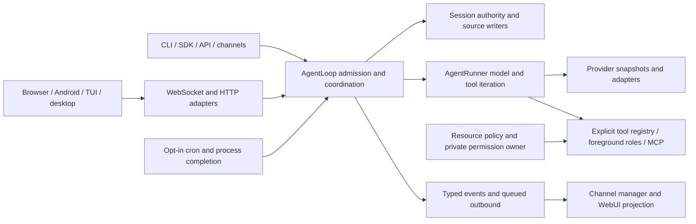

# Codebase discovery: current source map

Module-level/relevant-body source discovery is complete at `origin/staging`
`27adced0aacd55d61791bb88a7240d7ad7bd5b75` (tree
`d49aca97c9a34a2d17eae53d672fa591652457f1`). All **2,455 baseline tracked paths** have one
primary assignment. All **919 source targets** have evidence: **224 current reads** and
**695 prior reads carried by identical SHA256**, with **zero mapped-only source targets**.
All **47 changed implementation paths** have current evidence. Added discovery documents
are outside that pinned source denominator.

Read this map, the [completion record](completion-2026-11-06.md), and the
[report index](reports/README.md). The [refresh record](refresh-2026-11-06.md) preserves the
bounded 85/695/139 checkpoint and all changed responsibilities. The
[canonical audit plan](../project-audit-plan.md) and [continuation contract](continuation-plan.md)
own the next sequence: **source comparison and architecture discussion → bounded audit/optimisation**.
Sandbox remains the first later audit priority.

Complete discovery means relevant bodies/modules and connected callers were mapped. It
does not establish exhaustive semantic review, completed DSH/Codex comparison, accepted
new architecture, repair acceptance or stability qualification. Source/document reads and
standard-library processing were used; no tests, builds, checkers, dependency operations,
repository imports, applications or live services ran.

## Baselines and evidence

| Item | Recorded source |
| --- | --- |
| Current source | `27adced0aacd55d61791bb88a7240d7ad7bd5b75`; tree `d49aca97c9a34a2d17eae53d672fa591652457f1` |
| Prior discovery | `4e2bf4d8d0b34f133c01591b67826ca956fed384`; tree `d5cc262acda5fb8051ffac9996ee9ab189c361cd`; 2,467 tracked paths |
| Earlier planning/first pass | `b94b12527b014785c1454a04ef3b8138ee6070a5`; 2,451-path planning inventory |
| Divergence | Seven prior local-only commits are absent; eleven remote-only commits are present. The prior repair batch is not assumed merged into this source. |
| DSH comparison pin | `fcc0ad462172522aaf5c93a7b2e01f6b9f0b0159` |
| Codex comparison pin | Public `openai/codex` `0.166.0` / `rust-v0.166.0`, `6ff1e1ca3b30fc8b914720681fcf5fe62e95f856`; tree `03f3b46689faf274f126dc78508ed238564da8ba` |

Use [path-inventory.tsv](path-inventory.tsv) for path/workstream/role/current and previous
hash/change/report provenance, and [coverage-summary.json](coverage-summary.json) for exact
counts, deleted paths and the 139 completed detail paths. A path is
assigned once even when several reports inspect it; P01 is cross-cutting.

All essential evidence is included in this documentation package: [current baseline](baseline.json),
[prior baseline](provenance/prior-baseline.json), [change/deletion record](provenance/changed-paths.tsv),
fifteen [reports and exact coverage lists](reports/README.md),
[report integrity manifest](provenance/report-manifest.json), and
[portable reference index](provenance/source-reference-map.json). The [methodology](methodology.md)
explains hash inheritance, supersession and independent verification. Historical local
artifacts and temporary clones are optional; current evidence does not require them or
remote access to the local-only prior commits.

## Nine subsystem families

“Current” and “carried” count relevant-section inspections of source targets, not
whole-file semantic review. Source targets comprise 878 implementation/tooling files
and 41 runtime instruction files. The remaining paths are 997 test-support files,
54 assets/locks, 290 configuration/support files and 195 generic documents.

| Family | Primary streams | All paths | Source targets | Current | Carried | Mapped-only source |
| --- | --- | ---: | ---: | ---: | ---: | ---: |
| Entrypoints and turns | C00, H01 | 332 | 99 | 65 | 34 | 0 |
| State and context | H02, K01 | 290 | 130 | 80 | 50 | 0 |
| Sandbox and authority | S01, S02 | 46 | 21 | 4 | 17 | 0 |
| Providers and media | H03, M01 | 160 | 59 | 0 | 59 | 0 |
| Tools and automation | T01, A01 | 212 | 91 | 22 | 69 | 0 |
| Channels and extensions | E01, X01 | 336 | 106 | 2 | 104 | 0 |
| Backend, remote and mobile | E02, R01 | 333 | 138 | 22 | 116 | 0 |
| Browser, desktop and terminal clients | U01, D01 | 429 | 250 | 29 | 221 | 0 |
| Tooling and efficiency | Q01; P01 across all | 317 | 25 | 0 | 25 | 0 |

## Eighteen workstreams

| ID | Primary ownership | Current paths |
| --- | --- | ---: |
| C00 | CLI, command router, config, gateway composition and shared startup utilities | 165 |
| H01 | Agent loop/runner, bus, hooks, turn admission and delivery | 167 |
| H02 | Sessions, source events, request ledgers, history, memory and recovery | 228 |
| H03 | Providers, models, budgets, credentials, usage and accounting | 141 |
| S01 | Filesystem authority, folder grants, private state and security policy | 31 |
| S02 | Shell, Sandbox, native admission, exec sessions and process supervision | 15 |
| T01 | Explicit tool construction, plugins, MCP, foreground roles and retained adapters | 109 |
| A01 | Cron, local-trigger helpers, process completion and retained goal state | 103 |
| K01 | Context repositories, knowledge, skills, prompts and templates | 62 |
| E01 | Channel framework and sixteen non-WebSocket platform packages | 321 |
| E02 | HTTP API, SDK, WebSocket, backend WebUI and shared wire contracts | 144 |
| U01 | React WebUI and browser assets | 328 |
| M01 | Attachments, image/audio ingress, adoption and media ownership | 19 |
| R01 | Remote owner/IPC, pairing and Android/native transport | 189 |
| D01 | Python desktop adapter, Tauri shell and terminal UI | 101 |
| X01 | Optional apps, crawler and extensions | 15 |
| Q01 | Builds, dependencies, CI, deployment, migrations, tooling and documentation | 317 |
| P01 | Blocking work, locks, repeated I/O, buffers, retention and startup cost across every stream | Shared |

E01 includes `dingtalk`, `discord`, `email`, `feishu`, `matrix`, `mattermost`, `mochat`,
`msteams`, `napcat`, `qq`, `signal`, `slack`, `telegram`, `wecom`, `weixin` and `whatsapp`.
WebSocket is the seventeenth channel package and belongs to E02. H03 separately accounts
for OpenAI-compatible, Anthropic, Azure, Bedrock, Codex OAuth, xAI OAuth and Copilot
implementations plus routing/pooling/fallback. Each adapter/backend retains its own
inspection boundary; a shared base does not stand in for its implementation.

## Connected implementation owners

`RuntimeComposition` owns acquisition and reverse teardown of the shared graph.
`AgentLoop.execute_turn` binds source/execution ownership; `AgentRunner._run_core`
performs model/tool iteration. Adapters translate transport contracts rather than own a
second agent. The [differential record](refresh-2026-11-06.md#connected-current-behavior)
traces current cross-boundary behavior and caller identities.

## Effective capabilities, defaults and compatibility

| Surface | Current implementation and effective condition |
| --- | --- |
| Entrypoints | Classic CLI, direct SDK/API and acquired foreground/on-demand gateway paths exist. `require_runtime_ready` fences specified legacy background/admin launch paths; it is not a universal foreground fence. |
| Tool loading | `ToolLoader.load` uses `construct_core_tools` plus admitted entry-point plugins. Retained scanner/create helpers do not enable tools. The core manifest omits `create_goal`, `update_goal`, `my`, legacy spawn, and several retained tools; external installed plugins are unknown. |
| Foreground delegation | `ForegroundAgentManager` supports bounded planner/worker/reviewer/explorer work inside an outer turn. Retained `SubagentManager` construction does not expose independently addressable persistent child sessions. |
| Provider selection | Schema defaults select `anthropic/claude-opus-4-5`, provider auto, 200 tool iterations and 120,000 context tokens. Request runtime is captured for the admitted run. User configuration and credentials are unobserved. |
| WebSocket and remote | Normal `ChannelsConfig` defaults WebSocket false; `nanobot webui` explicitly enables/prepares it. A directly constructed `WebSocketConfig` default true and manifest default are separate seams. Remote access defaults off. |
| Workspace scope | Ordinary messages reject `workspace_scope`, `source_token`, and `full_confirmation_id`. Server workspace/session state supplies scope and internal source fencing. New-chat/scope controls and private Full confirmation remain explicit mutations. |
| Scheduled cron | `gateway.cron.enabled` defaults false. Composition is definitions-only unless the gateway installs the timer/runtime authority; admitted scheduling uses fresh turns and qualified receipt routes. Manual `run_job` and HTTP run admission remain fenced. |
| Local triggers | CLI enqueue and queue/store helpers remain, but `gateway.local_triggers`, gateway store injection and the production filesystem-queue consumer are absent. “Queued” is persistence, not evidence of processing. |
| Process completion | `gateway.process_continuations` defaults false. Explicit `notify_on_exit`, a captured owner/route and a sink are needed; completion submits directly to local-turn coordination independently of the absent queue consumer. |
| Dream, Heartbeat and goals | Config/settings/handlers remain, but periodic Dream/Heartbeat are inactive and rejected by the cron controller. Source commands reject `/goal`, `/trigger` and `/dream`; retained handlers and turn-local goal permission do not establish source-session availability. |
| Sandbox/Once/Full | Managed shell requires usable Linux Bubblewrap. Once and Full both require the native whole-process supervisor, currently Linux-only (`native_process.py:227`, `desktop_permissions.py:481`); Full additionally requires a live private owner-issued reference. Legacy restriction/backend settings, saved labels and displayed mode are separate from current execution authority. |
| Image/audio and optional tools | Media providers and attachment owners are present. Omitted image config uses a legacy enabled Codex-CLI compatibility choice; explicit upstream config defaults disabled. Browser/device defaults, desktop opt-in, optional crawler/VPN gates and installed executables are distinct. |
| Android alerts | Task-notification preference defaults off. Client-owned terminal events reach a global subscriber; eligible phone-started runs request a nonsticky `dataSync` foreground service. Registry/ownership are process/client-local, no wake lock or push path was added, and restart survival is not provided here. |

## Source, state and resource boundaries

| Boundary | Owning source and identity | State/resource boundary to preserve |
| --- | --- | --- |
| Shared runtime | `RuntimeComposition`, `DurableSessionAuthority` and gateway identity | One acquired loop/thread graph and lifetime writer lease; reverse teardown can retain failure when cancellation-resistant work remains. |
| Accepted work | `AgentLoop.execute_turn`, `execution_owner`, `SourceTurnWriter` | Session/store/incarnation/generation/source/run identities fence writes and execution; model request state is invocation-local. |
| History and recovery | `source_store`, `source_request`, checkpoints, memory recovery and `MemoryStore` | Canonical source, request consumption, legacy memory journal and WebUI display JSONL have different writers and durability rules. |
| Model boundary | Factory/registry, immutable model runtime, provider adapters and usage observer | Physical attempts, stream delivery, opaque continuation, credential generations and accounting have separate identities. |
| File/shell authority | `ResourceAccessPolicy`, folder grants, `DesktopPermissionOwner`, native admission | Resolved paths and read/write capabilities differ; opaque Full/Once references bind current source/runtime/revision. Labels/catalogs grant no authority. |
| Tool/child/plugin/MCP | Explicit manifest, registry/execution, foreground manager, MCP connection owner | Tool admission precedes effects; role budgets and exact write scopes are separate from provider capacity. Plugin data boundaries are not process isolation. |
| Automation | Cron scheduler/composition/outbox; process SQLite journal; local-trigger store | Definition, occurrence, run, completion, visible link and receipt differ. Process completion is not receipt acknowledgement; queue persistence is not activation. |
| Client presentation | Inbound router/workspace controller, transcript projection, `NanobotClient` | Server owns admitted scope/source; display repair may synthesize completion. Optimism, notification ownership and Android keepalive do not become durable source truth. |
| Delivery/remote | Channel manager, Telegram receipt sender, remote owner/IPC and Android custody | Queued turn completion differs from channel receipt. Remote owner authority, gateway session execution and device transport are separate lifetimes. |
| Installed artifact | Hatch/frontend builder, package/release scripts and launch adapters | Source presence differs from installed bundle/dependency/platform availability. No build or deployed artifact was inspected by execution. |

## Completion findings and instruction authority

The three [completion reports](reports/README.md#completion-reports) close 59 startup/core,
35 state/recovery and 45 knowledge/instruction assignments. Their exact 139 paths are
retained in coverage JSON and the ledger. They establish these connected boundaries:

- Startup admission validates clean absence or sealed recovery evidence. Explicit offline
  reconciliation advances conversion/transaction phases; separate finalization copies,
  unlinks, reproves and seals the receipt. Startup does not invoke that coordinator or
  grant offline recovery authority.
- `LifetimeWriterLease` owns runtime namespace access; recovery operations and checked
  source replacements have shorter, distinct lifetimes. Artifact projection defaults off,
  requires admitted source/reader/tool authority, and changes detached model context while
  preserving canonical tool text. Copied-state rematerialization is an explicit CLI path.
- Skill precedence is workspace → context libraries → enabled plugins → bundled skills.
  Catalog prerequisites check binaries/environment, without checking OS metadata or actual
  tool registration. No assigned bundled skill declares `always`; supporting scripts are
  read/executed only through explicit follow-up work. Main, foreground-role and legacy
  background loaders pass different policy/disabled-skill/context options.
- Global profile files, managed project AGENTS, packaged scenario prompts and workspace
  overrides have different loaders. Template text does not activate Heartbeat, Dream,
  goals, MyTool or other omitted tools. Repository discovery reports access without
  registering repositories or granting it.
- Legacy context budgeting, copied-state diagnostics, evaluator helpers, Desktop-picker
  helpers and service installers retain narrower or fenced caller paths. CLI onboarding
  is fenced, although direct wizard helpers can acquire credentials/login before a draft
  is saved. Knowledge Git sync and memory GitStore use different locking/index contracts.

See the [completion agenda](completion-2026-11-06.md#remaining-comparison-and-discussion-agenda)
for current documentation/source discrepancies and material questions. These are future
comparison/audit inputs, not newly graded defects or accepted product choices.

## DSH/Codex comparison agenda

Source comparison and architecture discussion are the next stage; neither is completed by this map.
Use the unchanged pins above and the [implementation REF matrix](../project-audit-plan.md#dsh-and-codex-implementation-comparison):

- REF1/REF2: compare source admission, steering, invocation request ledgers and tool-error
  recovery against inbox/turn ownership; distinguish canonical completion from synthesized
  WebUI tail completion.
- REF3/REF5: compare journal writer/ack/shutdown ownership, process continuation and
  retained output with the pinned recorder/job/process mechanisms. Include Android
  keepalive/client lifetime as a separate transport concern.
- REF4: compare per-attempt authority, native backend selection and unavailable/error
  paths, including server-owned scope, Once/Full proofs and Linux-only managed shell.
- REF6: compare bounded foreground roles with persistent addressable child sessions,
  preserving unresolved product choices rather than assuming parity is required.
- Across all references, trace configuration to active callers and state writers; compare
  cron definitions/manual admission/receipts, optional tools, credentials and resource cost
  in their supported scope. Source differences alone do not establish defects or stability.

The canonical sequence is **completed source discovery → source comparison and architecture discussion →
bounded audit/optimisation**. Sandbox retains priority within the later audit. Consequential
choices about platforms, managed task sessions, compatibility retirement and resource
policy remain discussion topics; this refresh selects no repair or new architecture.
