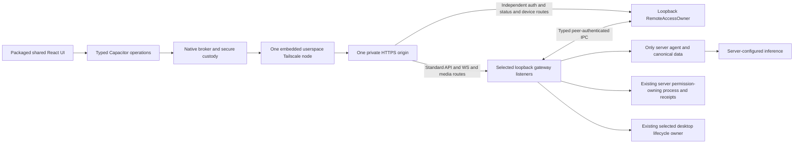

# Android-first Nanobot full-owner client implementation plan

Planning revision: 2026-11-01. Accepted product direction; implementation acceptance remains pending.
The [taskbook](mobile-client-tasks.md), [detailed tasks](mobile-client-implementation.md) and
[development isolation rules](mobile-development.md) form one current workflow. This revision changes
only those four documents, uses the accepted document review, and runs documentation/static checks.
It does not inspect source/tests/APKs, test a product, start services, install or activate anything.
Earlier implementation/test/device claims are historical and unverified here; existing code is neither
accepted nor rejected. M36 begins fresh implementation inspection. Planner: `development_planner_max`,
GPT-6.1 Sol Max, for interacting authority, compatibility, data retention and promotion boundaries.

## Delivery sequence and accepted direction

1. M36 freezes the complete desktop feature/API inventory and actual implementation/evidence baseline.
2. Retain M01–M13 foundation obligations, including emulator-first native transport, independent owner,
   live identity/revocation, replay and task authority. Reuse existing work only after applicability checks.
3. M30/M31 deliver one owner pairing, typed administrative delegation and the standard feature API.
   M37 supplies the backend directory API before M32 consumes it. M14–M19 qualify native/shared/local setup.
4. M32 full UI and M33 safeguards precede M35 integration on an isolated desktop-equivalent instance.
   M20–M22 then qualify the current candidate, physical Android and signed artifact; M34 closes full parity.
5. M38 independently reviews exact candidate versions. Only then may M39 perform a concretely opted-in
   installed promotion; M40 proves phone and desktop share the actual activated instance and recovery.
   No qualification or independent review depends on promotion.
6. M23–M29 are separately scoped additions: new Start/service-manager control, legacy exact-target
   approvals, iOS, actual VPS deployment, model linking and state migration.

Use Capacitor, shared React/TypeScript and one embedded userspace Tailscale node. Daily phone use must
not require a standalone Tailscale app. Reconsider framework only if the retained native feasibility
gate fails with measured evidence. The selected server owns the only Python agent, tools, files,
sessions, memory, skills, automations and credentials. The phone is a host-neutral client: no second
gateway/agent, phone model runtime or duplicated mobile feature implementation.

The current product matches the desktop WebUI feature surface and behavior. One pairing grants one
owner capability after explicit full-control consent; there is no separate daily admin pairing.
The old chat-only profile applies only to legacy devices until explicit re-pair/locally approved upgrade.
Persistent chat detaches without cancelling server work; temporary chats are available to owners and
remain connection-owned/discarded on disconnect. Settings/providers/models, Apps/MCP/CLI/API service,
local/custom and installed skills, automations, session actions, workspace mode/grants/Full and existing
supported lifecycle actions all belong to current scope. Initial setup and new-device approval remain
server-local exceptions, recorded in the parity inventory.

Non-goals: phone inference/tools, offline private transcript/write queues, push delivery, anonymous or
legacy administration, a desktop-shell rewrite, store publication, public ingress, generic process/unit
control, iOS implementation, actual VPS deployment/migration/model linking or home-tool workers.
Profiles remain portable to a later VPS; those deployments and inference arrangements require separate scope.

## Desktop parity and current baseline contract

M36 owns proposed `mobile/contracts/desktop-parity.json` and its immutable evidence manifest before
feature dispatch. Record implementation commit/tree and source hashes, dependency/config/schema/registry
versions, desktop build/feature flags and observed support. The inventory is derived from fresh source,
UI and tests when implementation resumes, never guessed exact existing routes in this revision.

Each row has: stable feature/action ID; baseline/source owner; HTTP route **and method** or WS action
(or control operation); shared UI entry; owner and legacy authorization; native operation ID, schemas,
payload/result/time/media limits; mobile adaptation; dependency task; positive/negative checks;
evidence links/hash/status; exception reason and explicit product acceptance if unsupported.
Every reachable desktop action maps to a row and every required row maps to native transport and a
test. A planned adaptation names its producing task; planned is not an accepted unsupported exception.
M31 closes existing-handler authorization/native-registry work and typed fixtures for later adaptations;
M37 owns directory-operation implementation/native positives, and M34 closes the whole inventory.
Page loads, representative requests and full suites alone cannot prove parity. An unsupported
operation is recorded and accepted before any qualified parity claim; no silent omitted categories.

Seed all categories, then expand every action from the baseline:

| Category | Actions and distinctions to inventory |
| --- | --- |
| Chat/history/media | Persistent/temporary create, send/stream/cancel/reconnect, history/search/navigation, existing session actions, attachments, previews, download/import/export where supported |
| Settings/providers/models | All settings panels, provider configuration, transient new-key write, model discovery/presets/defaults and supported management/auth flows |
| Apps/services | MCP and CLI apps install/configure/auth/run/remove/update as supported; API-service settings/control; external browser/callback flow and binary/import requirements |
| Skills | Local/custom editing and installed/marketplace list/install/update/remove, supported files/imports/downloads |
| Automations | List/create/edit/enable/run/delete and supported logs/history |
| Workspace/permissions | Current project selection, grants/read-write extent, workspace mode, Full, server-directory picker adaptation and confirmation/receipt binding |
| Devices/remote entry | Status/list/rename/revoke/self-revoke and owner entry management; explicit local-only initial setup, new-device comparison approval and scope-upgrade exceptions |
| Runtime/client | Existing supported restart/stop, advertised unsupported Start, exact local recovery, themes/navigation/accessibility and platform adaptations |

M01–M22 remain foundation/evidence tasks within this current release. The taskbook attributes historical
PASS/APK reports without attesting them. M36 records applicability per task/row; changed source, protocol,
authorization, dependency or artifact invalidates affected evidence and requires fresh qualification.
There is no blanket assertion that the mobile project or protocol is absent.

## One feature API, bounded native transport and secret handling

Owner clients use the same standard `/api/*`, existing WS path/`webui_request` actions and media paths
as the desktop, dispatched to existing feature handlers. Exact existing paths/methods are frozen at
M36. There is no second mobile settings/session/skills/workspace API or generic `api?path=...` proxy.

Proposed `/remote/v1/*` is the independent owner's narrow device-auth/status/device-control surface.
New clients use its pairing, refresh, handshake/status and device/entry control operations; it owns no
duplicate feature handlers. Legacy `/mobile/v1/*` auth aliases and chat-only feature shims are inventoried
and version-negotiated. Keep required legacy routes for supported devices; remove a shim only with a
tested negotiated migration or an explicitly accepted update-required cutoff. No silent break of the
promised legacy chat-only profile, scope upgrade or exchange for broad bootstrap tokens.

The native registry in proposed `mobile/contracts/operations-v1.json` maps each inventory operation
to fixed origin, method/path template or WS action, request/result schema, scope and finite limits.
Include every required method, binary/media/upload/download and auth-flow action from the inventory;
mutating HTTP is not restricted to GET or forced into an invented API. JS supplies typed arguments,
not arbitrary URLs/ports/headers/paths. Validate substitutions and redirects at every hop. The broker
injects app credentials and exposes approved projections/opaque media handles, never raw tokens.

Long-lived access/refresh/node/bootstrap credentials remain native. Existing provider secrets are
write-only and never returned by read, WS, error, export, log or crash surfaces. A user may type a new
provider key in the promised settings form; it exists transiently in input memory and is sent to the
standard write endpoint, then cleared. Disable persistence, autofill caching where controllable,
analytics, logging, replay storage and secret echoes for that input. This input exception is not
credential export or durable JS custody. Apply redaction to backend errors and audit metadata.

## Historical source and evidence baseline

The following observations were reported by the original architecture review; source, runtime and
artifacts were not reinspected in this documentation revision. They are dated context, not current
implementation acceptance or a claim that no implementation now exists. M36 must inspect the current
implementation and freeze a new baseline before any reuse or repair.

Original architecture-review HEAD inspected: `7ad57f9aaf163bd0476c2241637925343b1eb928`.
The current rebase and actual implementation-start manifest are tracked in
[mobile development](mobile-development.md) and task M10; historical observations below remain dated.
Original unrelated edits include runner/OpenAI-compatible/factory/fallback provider files and
`test_text_tool_recovery.py`, `test_text_tool_output.py`, `test_runner_fallback.py`; later active
runner/skills/provider work also remains outside this plan's ownership.
The original architecture planning wrote only this document; no dependencies, config or runtime changed.
Future implementation starts in a dedicated `codex/mobile-client` worktree/branch from the accepted
staging baseline, or reuses a suitable clean attached mobile worktree. The recent tiny-fix direct-edit
exception does not authorize mobile implementation in this shared checkout.

| Inspected seam | Observed behavior and implementation consequence |
| --- | --- |
| `webui/package.json`, `vite.config.ts` | React 18, Vite 5, TypeScript; web build produces `nanobot/web/dist`. No Capacitor/mobile project was observed at that review. Keep browser/wheel output separate from packaged mobile assets. |
| `webui/src/lib/bootstrap.ts`, `http.ts`, `api.ts` | Bootstrap/reads use browser fetch; bootstrap secret can persist in localStorage. Mobile needs a separate credential and HTTP path. |
| `webui/src/lib/runtime.ts`, `types.ts`, `App.tsx` | `RuntimeHost.socketFactory` is reusable; native detection currently implies desktop host functions. Add mobile surface semantics without granting desktop authority. |
| `webui/src/lib/nanobot-client.ts` | One multiplexed socket, turn identity, canonical reconciliation and correlated mutation replay exist. Preserve them; do not substitute a second chat client. |
| `webui/src/main.tsx`, `public/sw.js` | Browser PWA registration and public static caching exist. Package immutable assets and disable mobile service-worker registration. |
| `nanobot/cli/gateway_runtime.py`, `channels/websocket/runtime.py`, `webui/temporary_chats.py` | Gateway composes the existing agent/session/cron owners; persistent disconnect detaches, temporary disconnect disposes. |
| `webui/http_utils.py`, `ws_http.py`, `gateway_endpoint.py`, `gateway_tokens.py` | Local status requires real local peer, loopback Host and loopback forwarded values. Current tokens are ephemeral broad credentials; proxy assertion authentication is not device identity. |
| `webui/inbound_commands.py` | Mutation cache is keyed by request ID; authorization precedes admission and result delivery. Extend binding to the authenticated principal and retain these checks. |
| `webui/workspaces.py`, `security/desktop_permissions.py` | Restricted scope helpers exist; native authority references are process-local and source/task/revision bound. Phone authentication cannot manufacture those references. |
| `webui/media_gateway.py`, `media_api.py`, `attachment_ingress.py` | Attachments arrive in bounded WS messages; historical media uses signed URLs. A media signature alone must not authorize mobile remote retrieval. |
| `desktop/adapter.py`, `desktop/gateway_child.py`, `gateway/runtime.py`, `gateway/service.py` | Existing owner has selection admission, lifecycle locks, handle/PID birth proof and service rules. Desktop-managed listeners require loopback, a secret and no public URL/TLS override. |
| `desktop/src-tauri` | Current shell depends on Linux gio/WebKitGTK; it is not the mobile shell. Its guarded Quit/stop flow remains authoritative. |
| `pairing/store.py` | DM sender approval only. Do not reuse its channel/client strings or storage as authenticated mobile identity. |
| `config/schema.py`, `providers/factory.py` (supplied read-only evidence) | Provider `api_base`, `api_key`, API type and timeouts/headers feed server-side SDK configuration. No mobile provider configuration or provider edits are needed. |
| `cli/gateway.py`, `gateway/service.py` (supplied read-only evidence) | Gateway service installation exists; systemd user units use `Restart=always`. Desktop lifecycle admission intentionally refuses service-owned processes. |

Package paths without `nanobot/` in the table refer to that package. Original SHA-256 prefixes:
`webui/src/lib/runtime.ts` = `23381ec8c4d538df`;
`webui/src/lib/nanobot-client.ts` = `4858fb8b6e8c87cb`;
`nanobot/webui/ws_http.py` = `3a94cf7bc7ec11bf`; `inbound_commands.py` = `f74bb53531456501`;
`nanobot/desktop/adapter.py` = `b4b09748bd83980d`; `nanobot/gateway/runtime.py` = `5dcae525eb60ddee`.
These identify baseline drift, not a fresh source attestation; implementation freezes complete manifests.

The supplied read-only runtime report observed WebUI `127.0.0.1:8767`, health
`127.0.0.1:18793`, Tailscale 1.104.2 online with MagicDNS, and Serve configuration `{}`.
A local simulated proxy request with external Host, HTTPS forwarding and nonlocal forwarded address
produced the correct `wss` URL and ephemeral tokens; workspace management/project/Full controls were
false and management was null. This proves existing origin derivation and remote local-only denial
in that probe, not actual Serve routing, tailnet policy, phone connectivity or mobile authentication.
No real tailnet name, user identity or host address belongs in this document or public test artifacts.
New supplied preflight: x86_64 host, `/dev/kvm` present and readable/writable by the current user.
This proves preflight only. Java is present; SDK/adb/NDK, system images and native ABIs remain unqualified.


## Preferred architecture and protocol boundaries



Prefer one app-owned Go core using vendor `tsnet.Server.Dial` for HTTP TLS/WS, narrow C ABI and
Kotlin/JNI adapter. [tsnet](https://tailscale.com/docs/features/tsnet),
[Dial/HTTPClient](https://tailscale.com/docs/reference/tsnet-server-api) and
[libtailscale C ABI](https://github.com/tailscale/libtailscale/blob/main/tailscale.h) are retained
design references, not freshly verified support claims. Do not combine wrappers into two nodes.
If measured Go-core feasibility fails, test libtailscale plus native Android HTTP/WS while retaining
Capacitor. If neither passes, stop broad work for an accepted architecture revision; do not silently
require a separate VPN or switch frameworks. iOS adapters are future work only.

The bridge exposes state, pairing, named feature/control operations, one socket, attachments and
opaque session/installation-bound media handles. It exposes no raw tailnet dial, LocalAPI, shell,
general filesystem or localhost proxy. Require normal TLS/hostname/SNI, exact confirmed origin and
port, bounded schemas/queues, cancellation and explicit backpressure. Reject arbitrary schemes,
cross-origin redirects and remote content with native plugin authority. Only packaged assets load
privileged; CSP/navigation sandbox HTML/SVG/downloads. External auth/links use a separate validated
system-browser flow with instance-bound callback state and no app bearer in URLs.

Attachments preserve current WS envelope/ingress limits; no new upload endpoint is assumed. Where the
desktop actually uses another standard upload/download operation, inventory and qualify that operation.
Broker media/ranges require current device authorization plus existing signature checks. Tokens never
appear in DOM URLs. Use app-origin resource handlers or bounded native previews if a MIME/range
combination cannot work in the WebView. Temporary bytes are app-private, backup-excluded, finite,
expiring and purged on startup/logout/revoke/target switch; prefer memory. No offline private history
cache/write queue. Revocation cannot claw back bytes already displayed offline.

Mobile builds to `mobile/www`, disables mobile service workers/private caches and preserves browser
PWA and `nanobot/web/dist` wheel behavior. Keep the existing multiplexed `NanobotClient` and canonical
transcript/turn identities; do not build a second chat client.

Handshake negotiates `mobile_protocol=1` range, bridge/registry versions, mandatory feature capabilities,
stable `installation_id`, ephemeral `gateway_generation`, current device principal/scopes/expiry,
server WS epoch and frame/attachment/media limits. A package version alone proves no compatibility.
Incompatible mandatory requirements disable mutations with update guidance. Legacy/owner profile and
lifecycle capabilities are explicit. Compatible chat works on a host advertising lifecycle unsupported.
A new generation invalidates old replay; an installation mismatch at the same hostname needs fresh pairing.

## Host-neutral profiles and data locality

A profile contains label, private HTTPS origin, stable installation ID, negotiated capabilities and
native credentials, with one active target. It contains no interpreter, OS assumption or model key.
Switching closes sockets, cancels pending operations, clears media and segregates credentials/state.
Never auto-failover, merge chats, reuse credentials across origins or adopt a changed installation.
A future multi-profile UI does not require live VPS work now.

The current computer owns tools/files/history. A later VPS would own them there; an optional private
home/self-hosted model provides inference only. Only the selected server contacts providers using its
`api_base`, API type/model/auth/timeouts/headers. Localhost in a VPS config means that VPS. Tailscale
connectivity alone exposes no loopback service or home files. Future model linking needs intentionally
served authenticated data endpoints and narrow policy, never load/unload/admin APIs, a broad CGNAT
SSRF exception or phone credentials. Model unavailable stays distinct from gateway offline; no implicit
cloud fallback. New VPS identity/state transfer remains separately scoped with one authoritative writer.

## Device pairing, custody and live authorization

`RemoteAccessOwner` independently owns installation/device records, challenges, credential rotation,
introspection, revocations, audit and Nanobot-owned entry metadata. Proposed persistent layout:
`<selected-instance-root>/remote-access/`, directory 0700/files 0600, explicit Pydantic config,
instance resolver, bounded versioned parsing, locks and atomic fsync/replace/directory-fsync writes.
Persist stable installation/device IDs, credential hashes/version, scope/status/revision and sanitized
approval/revoke/audit metadata. Never persist bearer response caches or silently reset corrupt/unknown
records, identity or revocations. It owns no agent/session copy or competing gateway PID database.

Pairing remains server-local admission:

1. Native code signs the embedded node in through a validated system-browser flow. No reusable tailnet
   auth key is bundled or put in QR. Tailnet access and Nanobot authorization are separate.
2. Admitted local UI/CLI (or authenticated server-side SSH operator) creates a challenge with protocol,
   exact origin, installation, random nonce and proposed 120-second expiry, bounded attempts/rate limits.
3. Phone request has a separate nonce/collector secret retained natively. Phone and local operator show
   comparison code and explicit full-control/shared-history consent. Only local comparison approval may
   approve that exact new-device request; an already paired phone cannot approve enrollment remotely.
4. Atomic consume/collection permits one winner; another scanner/collector gets no credential.
5. Issue one per-device rotating refresh and short-lived access credential. Persist native refresh before
   acknowledgment; JS receives status only. New pairings grant owner; legacy records never widen silently.

Access maximum TTL is 10 minutes; refresh expires after proposed 30 days inactivity. Serialize atomic
rotation; uncertain refresh may require re-pairing rather than reusable previous tokens. Scope addition
needs explicit server-local consent. Reachable logout revokes; offline logout erases native secrets and
reports server revocation pending. Self-revoke remains accessible to current owner and legacy devices.

Android uses Keystore encryption for app-private versioned per-target credentials and sensitive node
state as supported by measured integration. Exclude credentials/node/private previews from backup.
Test lock/key invalidation, partial writes, process death, update, restore and reinstall; reinstall needs
fresh sign-in/pairing. Emulator custody proves API behavior only; physical security level is qualified later.

Every HTTP read/mutation, WS frame, attachment, media/range and delegated control operation checks
current principal/installation/scope/expiry before admission and result delivery. Owner unavailability
fails mobile requests closed and retires mobile sockets within a tested bound (target at most two
seconds), while local clients continue. Revoke acknowledgment follows denial of new admissions and
retirement of active mobile sessions. Already admitted server tasks may continue; revoke is not global
task cancellation. `client_id`, chat IDs, proxy headers and claimed scope/locality are never identity proof.

### Typed owner delegation and server-local permission authority

M07 provides the IPC transport/envelope; M30 explicitly owns proposed
`nanobot/remote/{management,permissions}.py` and revisions to `owner.py`, `ipc.py`, `client.py`,
`auth.py`, `devices.py`, `http.py`, `entry.py`, `protocol.py`, `store.py`, `pairing.py`,
`nanobot/config/schema.py` and narrowly scoped `nanobot/security/desktop_permissions.py` integration.
`nanobot/remote/permissions.py` is the gateway-side authorization adapter, not a new permission store
inside the independent auth/controller process. M36 records the concrete selected process/adapter that
already owns task authority; it keeps that authority throughout. Named handoff precedes writes.
Gateway peer credentials identify the selected OS user/role, not remote
owner authority. A gateway IPC caller may request only enumerated delegated operations.

Proposed typed `DelegatedAdminOperation` enumerates device list/rename/revoke/self-revoke,
entry status/update of already locally registered entry settings/disable, and grant/Full
proposal/commit/release through the existing server permission owner. Device refresh/status are
also callable directly on the owner listener. No generic method string, config/executable/PID/unit
selector, OS permission reference, caller-supplied `is_local`/`is_native` or asserted scope is accepted.
Initial enable/re-enable after entry-off, new challenge creation/approval and scope upgrades stay
server-local; record these deliberate exceptions in M36. Owner disable is allowed after warning.

The gateway forwards the opaque device credential, operation enum, bounded arguments, immutable
operation correlation and payload digest over peer-authenticated IPC. The owner itself validates the
credential and builds typed `AuthenticatedDeviceContext` (installation ID, stable device/principal,
current scope/record revision/expiry). It does not trust caller-provided identity fields. An internal
authorization handle, if used, is owner-issued, short-lived, bound to that device/operation/digest and
revalidated against current revocation/scope before effect and delivery; it never goes to the phone.

Owner scope authorizes delegation without falsifying network locality. Strict local checks still protect
local-only setup/enrollment. For grant/Full, RemoteAccessOwner validates device authority and returns a
typed, operation-bound delegation admission over IPC. The gateway adapter presents that admission to
the existing selected server permission-owning process/adapter; it validates current source/session/
task/revision, target/read-write extent, confirmation and expiry and mints/consumes its native receipts
**inside that same owning process**. Current device revocation is revalidated with RemoteAccessOwner
before commit and delivery. The separate auth/controller process never imports/copies gateway task
authority or native objects. Neither native references nor native receipts cross owner IPC or reach the
phone; only typed authorization/admission and safe status/projection/proposal IDs cross boundaries.
No live desktop reference is inherited. Concurrent source/target/
revision changes, another device, stale/reused receipt or revoke reject before effect. Owner authority
does not bypass existing server filesystem/command policy. M30/M33 test authorized delegation separately
from unauthorized gateway administration; a blanket deny of all gateway admin IPC is obsolete.

### Replay identity and current authorization

Immutable identity is `(installation_id, gateway_generation, request_id)` bound to stable device
principal, action and payload digest; credential versions are authorization state, not operation identity.
Authorize before cache lookup/join and delivery. Only `submit` with the current socket's server-issued
epoch creates an operation. After any attempted send, reconnect converts pending records to
`replay_only` with unchanged identity/digest. Join/return an existing operation across access renewal or
refresh rotation; effect count stays one. Miss/eviction returns `409 outcome_unknown` with no creation/
execution. Reject old serialized submit epoch, generation mismatch, different principal/action/digest.
Never mint a new ID/epoch to retry an uncertain action automatically; reconcile authorized canonical
state and require a new explicit action. Browser/desktop wire behavior retains compatibility.

## Remote route policy and independent control reachability

Use one private HTTPS origin with explicit path mappings to loopback destinations. M36 records actual
standard gateway HTTP/WS/media paths and listeners; M09/M11 qualify each. Proposed `/remote/v1/*`
maps directly to the independent owner listener for pairing/auth/refresh/status/device/entry control.
It must not transit gateway routing. Separate Serve entries are expected where needed; one origin
does not mean one mapping. Preserve path prefixes exactly as registered by each listener, match segment
boundaries, test longest-prefix routing, trailing slash/query/encoded-path behavior and WS Upgrade.
Do not strip/rewrite prefixes implicitly or expose private IPC/local management through a catch-all.
If the installed Serve version cannot realize the frozen routing, fail the measured routing criterion
for a bounded revision; do not silently add a raw forwarding proxy or rely on a running gateway.

M19's proposed `nanobot.remote.supervision` adapter supervises the selected-instance owner as its own
opt-in local user-service resource with a fixed command/config/socket/listener. The existing selected
desktop launcher/lifecycle owner continues to own the gateway. M35/M39 record exact launcher/service/
environment/resource identities; the controller never creates a second gateway supervisor.
Owner auth/status/refresh/device revoke remain reachable with gateway stopped, absent or failed.
A healthy owner reports gateway absence honestly; timeout does not prove Stop. Whole-host sleep/offline,
logout/pre-login availability and linger remain measured local-service facts, not guarantees.

| Capability | Current owner phone | Legacy chat-only phone | Anonymous/proxy-only |
| --- | --- | --- | --- |
| Initial remote enable/re-enable; new-device challenge/compare approval; scope upgrade | Server-local admission required | Server-local admission required | Deny |
| Device list/rename/revoke, self-revoke, registered entry settings/disable | Typed owner delegation; confirm destructive effects | Self-revoke/status only | Deny |
| Standard history/chat/media and current session actions | Same WebUI policy; shared history consent | Negotiated chat/read/media ceiling | Deny |
| Temporary chat/delete/settings/providers/models/apps/skills/automations | Same standard surface with confirmation/audit | Deny administration | Deny |
| Folder browser/workspace mode/grants/Full | Server API/permission receipts/current policy | Deny grants/Full/browser | Deny |
| Existing desktop-supported restart/stop | Standard action and existing process-ownership checks | Status only | Deny |
| Remote Start/new service-manager control | Unsupported unless separately qualified M23/M24 | Deny | Deny |

Admitted local browser/desktop keep their existing authorization and native admission. Gateway owner
auth is separate from trusted-proxy/locality checks. Reject unknown routes/actions, broad bootstrap-token
exchange and proxy configuration that bypasses device checks. Tailscale headers are diagnostic only.

Existing WebUI restart/stop are current parity where supported, without requiring deferred M23/M24.
Preserve existing locks, selector/command/port/generation, handle and PID birth proof and guarded Quit.
Refuse foreign/foreground/service-owned/unknown process adoption. A service-owned backend without a
qualified manager advertises lifecycle unsupported; never signal beneath `Restart=always`.
Remote Start may remain unsupported. M35 freezes the exact tested **local** launcher/recovery command
for the selected instance; the phone displays that instruction when gateway is stopped. Do not promise
a remote Start button or infer one from owner scope. Quit never silently auto-starts the gateway.

Entry off denies admissions, retires sockets and removes only owned **data and control** mappings;
verify observed state or show unconfirmed. A phone disabling its only entry receives local recovery
guidance first and cannot re-enable through the removed route. Disconnect affects that phone only.
Controller lifetime, entry-off, gateway Stop and desktop Quit remain distinct.

Use [Tailscale Serve](https://tailscale.com/docs/features/tailscale-serve) with normal TLS and tailnet
policy, never Funnel/public bind/TLS bypass. Retain prior/desired/observed mapping ownership; no global
`serve reset`, global Tailscale stop or overwrite of another app. Qualify installed CLI syntax rather
than assuming the historical 1.104.2 version still applies. See retained
[Serve CLI reference](https://tailscale.com/docs/reference/tailscale-cli/serve).

## Server directory API and mobile workspace adaptation

M37 is the backend owner; M32 consumes its frozen contract and owns UI only. Proposed standard routes,
subject to M36 collision/convention verification, are:

- `GET /api/workspace-directories/roots` → `{policy_revision, roots:[{root_id,label,display_path}]}`.
- `GET /api/workspace-directories/list?root_id=…&path_id=…&cursor=…&limit=…` →
  `{root_id,path_id,relative_path,breadcrumbs,policy_revision,directory_revision,entries,next_cursor}`.
  Root listing omits `path_id`; entries have directory `name`, opaque `path_id`, `is_symlink` and
  bounded accessibility metadata. No file contents, file listing, owner/secret metadata or recursive walk.
- `POST /api/workspace-directories/resolve` with `{root_id,manual_path,policy_revision}` resolves manual
  relative input or an absolute input explicitly within that selected configured root to the same path
  descriptor. It lists/grants nothing by itself and is not a new feature-grant endpoint.

Proposed config `remote_access.directory_browser.roots` (camelCase JSON aliases) is an explicit list of
`{id,label,path}` with default `[]` and maximum 32 roots. No implicit `/`, home directory, first known
project or copied native grant. Empty roots show configuration guidance. Owner settings may configure
roots through the normal write path under server policy; initial setup remains local. Browsing is
read-only visibility, never filesystem/tool authority or an implicit grant/Full ceiling.

Canonicalize configured roots and every request through the existing resolver/equivalent capability
containment. Path IDs/cursors are opaque browsing identifiers bound to installation/root/policy and
canonical directory identity, with at most five-minute expiry; they are not native permission references.
Reject traversal/NUL/oversized/malformed input, paths outside the selected root, symlink escape and
changed root/directory identity. In-root symlinks may resolve to the contained canonical target.
Manual entry follows the same rules. Never trust a previously listed path at grant commit.

Finite defaults/maxima: requested page limit 1–100 directories, scan at most 1,000 directory entries per
request, response at most 64 KiB, two-second work deadline, path at most 4,096 UTF-8 bytes/depth 64;
no recursion. An opaque cursor permits bounded continuation and invalidates on policy/directory change.
Errors: 400 malformed, 401 unauthenticated, 403 unauthorized/outside-root, 404 missing, 409 stale/raced,
413 bound exceeded, 429 rate limit, 503 unavailable/deadline. Return sanitized codes, no stack/private paths
outside authorized roots; inaccessible entries carry only bounded permission status or are omitted.

When the existing grant mutation (frozen M36) commits, M37's adapter re-resolves target under current
root policy, source/session/task/revision and permission owner, compares canonical target identity and
confirmation, and obtains a fresh server receipt. Use handle/identity-based containment at issuance
where supported; fail closed on replacement/symlink race or unverifiable identity. Test rename/replace/
symlink changes between listing, confirmation and commit. Grant policy remains distinct: existing owner
Full/manual grant actions follow server permission policy, while this browser stays within configured
visibility roots. Never treat a listing result as authorization.

M32 uses shared workspace controls with breadcrumbs, directory/error/loading states, manual entry and
“Use this folder.” Select only an explicitly chosen project or the current session's verified project;
no default to the first known project. Phone never opens the server-native folder dialog.

## States, confirmation and audit

Distinguish transport sign-in, local pairing/pending comparison, connecting, compatible ready, access
expired/uncertain refresh, revoked, protocol/installation mismatch, reconnect/outcome unknown, entry
off, gateway stopped/offline, whole server unreachable and model unavailable. Show selected instance;
never auto-adopt a hostname. Resume reauthenticates and reconciles canonical state. Persistent work
survives phone kill/handover; temporary chat disposal remains explicit and tested.

Shared shell/pages retain theme/font/local navigation preferences on device and shared session/model/
title mutations on server. Adapt safe areas, keyboard/composer, portrait/landscape, large fonts, Back
(top viewer/sheet first), camera/library chooser, permission denial and interrupted activities without
losing chat identity. Preserve baseline-supported auth/import/download flows with bounded native handling.

M33 confirms destructive/sensitive actions, including session delete, install/remove/update where
effectful, automation create/run/delete, grant/Full, device revoke, remote disable and supported runtime
restart/stop. Confirmation binds device, action/target/digest, current source/task/revision where
applicable, operation correlation and expiry; stale/replayed/another-device confirmation fails.
Do not hide current authority controls to avoid implementing confirmation.

Mutation audit contains stable installation ID, **acting device ID/principal**, immutable operation
correlation, action, sanitized target, outcome and timestamp, with finite sanitized metadata. Two owner
phones must be distinguishable; installation alone identifies only the server. Audit denial/failure and
deduplicated replay outcomes without a second effect. Never log bearer/provider keys, raw payloads,
native receipts/references, private contents or unbounded paths/errors. Retain durable audit/revocations
on rollback. Short TTL/rotation/self-revoke remain required; optional future step-up is not a blocker.

## Ownership, validation and finish lines

The [guide ownership ledger](mobile-client-implementation.md#ownership) and task table are binding.
M36 inventories before write dispatch. P0 owns `mobile/` foundation only. One backend writer owns
M06–M13, M30/M31 and M37 serially; native registry changes in M31 require a recorded mobile-file handoff.
M14/M15 own native product integration; M16/M17 own shared transport/layout. M18/M19 receive explicit
backend/config/settings handoffs. M32 receives shared UI; M33 receives audit/permission/UI boundaries.
M35/M20–M22/M34 verify and return code defects to owners. M38 is read-only independent review.
M39/M40 alone cover reviewed installed promotion/verification after actual external opt-in.
No concurrent writer touches a shared schema, config, registry, lockfile or generated output.

For each bounded implementation task: freeze prerequisites/source/environment, capture a meaningful
red behavior test (or deterministic before-check for setup/docs/device), implement minimally, refactor,
then focused green checks and affected broader regressions. Retain failures and exact cwd/command/
exit-code/hash evidence. Existing commands retained from prior docs/instructions, **not executed here**:

```bash
uv run --no-sync python -m pytest tests/webui/test_http_utils.py tests/webui/test_webui_mutation_replay_auth.py tests/webui/test_managed_media_access.py tests/webui/test_attachment_ingress.py tests/webui/test_permission_v2_api.py tests/security/test_native_admission.py tests/security/test_permission_v2_authority.py tests/desktop/test_adapter.py tests/gateway/test_runtime.py tests/gateway/test_gateway_service.py
ruff check nanobot/
# In webui/
bun run test -- src/tests/bootstrap.test.ts src/tests/runtime.test.ts src/tests/nanobot-client.test.ts src/tests/thread-shell.test.tsx src/tests/sw.test.ts src/tests/main-pwa-registration.test.tsx
bun run lint
bun run build
bun run test
# Repository root
uv run --no-sync python -m pytest
uv run --no-sync basedpyright --outputjson
python scripts/check_type_regressions.py BEFORE.json AFTER.json --baseline-root BEFORE_SOURCE --current-root AFTER_SOURCE
```

Refresh actual focused names at M36/M10; no proposed script is claimed present. Guide-proposed
`mobile/scripts/qualify-emulator`, `qualify-device`, Gradle/native/Go and `tests/remote` checks need
fresh existence/command verification. M01–M05 prove emulator x86_64 execution and separately label
arm64 compilation, app-node plus backend path, HTTP/WSS/TLS/media/ranges/deep links, denied raw
host/redirect/LocalAPI, queue/backup/suspend/death and transport-off behavior despite host Tailscale.
`10.0.2.2` is debug fixture only, never release fallback or embedded transport evidence.
Pin SDK/NDK/JDK/Go/C ABI/Capacitor/Gradle/WebView/API/ABI/image/licenses/provenance/reproducibility and
measure AVD acceleration. No physical/iOS prerequisite is attached to early backend/owner tasks.

| Gate | Binary evidence required on current candidate |
| --- | --- |
| Inventory/API | Every baseline action maps to UI, standard operation/native registry, auth/limits and evidence; unsupported exceptions explicitly accepted before parity claim |
| Identity/delegation | Missing/expired/revoked/wrong-instance/scope denied on every HTTP/WS/media/control route; authorized owner IPC succeeds; forged locality/native/OS role and local-only enrollment deny |
| Pair/rotate/revoke | One QR/collector winner, deterministic races/clocks, corrupt/version/reset/restore denial, atomic rotation and bounded current revoke/owner-loss retirement |
| Replay | In-flight/completed lost response across access renewal/refresh rotation effect count 1; unknown/evicted/old epoch/generation/different-device replay count 0; current auth before join/delivery |
| Task/Full | Owner grant/Full positive and server receipt/source/task/revision/confirmation checks; legacy denied; no inherited/native references, concurrent desktop changes and media projections safe |
| Folder API | Root/identifier/manual/symlink/permissions/pagination/time/byte bounds; no implicit grants; fresh commit rejects target/policy/source races and first-project fallback |
| Lifecycle/control | Existing desktop admission/Quit/races/foreign/service refusals; advertised unsupported Start; owner auth/status/refresh/revoke work with gateway absent; exact local recovery |
| Browser/desktop/privacy | Shared behavior preserved; mobile SW/debug paths/private caches absent; transient provider writes work, existing secrets and native/app credentials never echoed/persisted |
| Physical/signing | Actual supported Android arm64, cellular/Wi-Fi/OEM/Doze, hardware security level, battery/thermal, camera/media/Back/accessibility, update/reinstall/revoke and exact signed artifact |
| Installed finish | M38 exact manifest PASS before M39; reviewed package/WebUI installed, one writer, durable state retained and M40 actual desktop/phone same-instance evidence |

Follow `docs/migration/p6-error-attribution.md` as instructed: immutable before/after full-source reports
under identical dependencies, source/environment hashes and zero newly introduced signatures across all
files. Comparator output alone does not attest inputs. Never refresh baseline to absorb errors, add
skips/suppressions, run `ruff format` or call timeout/forced cleanup PASS. Historical strict-zero/full-suite
claims are not current qualification. Full green requires unchanged strict exit zero and the required
full local suite; bounded repair PASS never closes migration P6.

## Rollout, durable rollback and genuine external gates

M35 proves an isolated desktop-equivalent topology; it does not install/promote this branch into normal
staging. M34 freezes exact server commit/package, bundled WebUI SHA-256, app ID/version/APK SHA-256/
certificate fingerprint, protocol/registry/config/data versions, selected isolated instance and
launcher/environment. M38 independently reviews that tuple and the complete parity/negative matrix.
Changes after review require affected requalification and refreshed review.

M39 first prepares a reviewable installed transition: actual current/desired build versions/hashes,
target config/instance/data root and installation identity, environment/package/executable and launcher,
owner supervisor/gateway lifecycle ownership, data/schema/protocol compatibility, backup/recovery and
precise prior/desired owned mappings/services. Config/Serve changes cannot upgrade an old backend.
With concrete local installation/service/network opt-in, disable ingress/quiesce and stop the old writer,
install the exact reviewed server and bundled WebUI, transition the selected environment/launcher/config,
start one compatible owner/gateway and only then enable reviewed mappings. Preserve local desktop
entry. M40 verifies actual desktop/phone installation/history/workspace/capabilities, update/revoke and
stopped-gateway control/recovery. No qualification/review step waits on installed promotion.

Rollback removes only owned mappings/services/app resources and explicitly disposable fixture state.
Keep selected-instance stable identity, device/revocation/audit records, credentials' revoked status,
sessions and new authorized writes. Disable ingress before an incompatible backend downgrade. Check
previous backend's protocol/store compatibility before reopening; if incompatible, keep remote disabled
and use local recovery. Never blindly restore old owner state, resurrect revoked credentials, copy
native authority or fall back to broad bootstrap tokens. Backups preserve/reconcile newer revocations;
one writer remains authoritative. App rollback also obeys negotiated compatibility/update-required denial.

Real later inputs: pinned compatible Android/toolchain matrix and measured acceleration; selected isolated
fixture/origin/enrollment and concrete mapping/service setup opt-ins; supported physical Android/signing
custody; actual installed target/build/environment/launcher/config/service ownership and promotion opt-in.
They are not permission requests to revise docs or ordinary isolated task-by-task gates. Missing live
criteria stay PENDING while independent work continues. No credential, destination, service unit or
deployment permission is invented. Merge/publication retain explicit authorization. iOS/VPS/model/migration
inputs are deferred only, never Android prerequisites.
