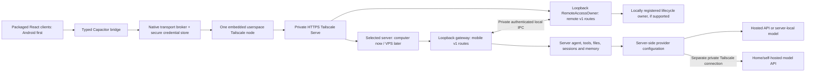

# Android-first Nanobot mobile client implementation plan

Planning baseline/revision: 2026-11-01 (owner-client revision). Status: accepted architecture; see the complete
[OpenCode task backlog](mobile-client-tasks.md) and [implementation steps](mobile-client-implementation.md).
The taskbook records the Android workflow to execute when the user invokes its OpenCode prompt.
This planning task only prepares the handoff; production activation, service installation,
network changes and publication retain their explicit setup/review gates.
No mobile build, emulator, phone, VPS or model endpoint has been tested in this planning task.
Planner: `development_planner_max`, GPT-6.1 Sol Max, for credential, transport and lifecycle boundaries.

## Delivery sequence and accepted direction

1. Prove native transport and credential-custody behavior in the Android emulator; no phone prerequisite.
2. Build scoped device identity and its server-side owner; qualify pairing against the real backend in the emulator.
3. Deliver Android chat using the existing React UI; qualify physical Android behavior before release.
4. Add explicit, separately granted gateway controls after lifecycle and recovery tests pass.
5. Defer iOS, VPS deployment/migration and exact-target remote approvals to separate future work.

Use Capacitor with shared React/TypeScript UI and a native API/core portable to later adapters.
Implement Android only initially. iOS builds/signing/device checks do not block Android work or release.
Embed Tailscale in the app: daily use must not require the standalone Tailscale app.
The selected Nanobot server owns the Python agent, provider credentials, tools, memory, sessions,
cron and server files: the current computer now, potentially a Linux VPS later. Clients share its API,
not a second agent. Model inference may run on that server, a hosted API or a separate private model host.
Flutter/React Native are fallback design changes only after concrete spike evidence and an accepted revision.
The wrapper shares UI; transport, secure storage, app suspension, signing and platform builds remain native work.

The first useful release supports persistent chat, history, streaming, existing attachment limits and
managed media previews. It does not implicitly grant settings administration, shell commands or Full access.
Phone disconnect must detach persistent chat without cancelling its work. Temporary chats remain
connection-owned and are excluded from the first mobile release because disconnect currently discards them.
Non-goals: local phone inference, a second gateway, offline private history/write queues, push delivery,
global Full, unrestricted remote administration, a desktop-shell rewrite and store publication.
Actual VPS provisioning/state migration, model serving and remote home-tool workers are also out of scope.

## Owner-client revision — 2026-11-01

The product decision has changed: the paired phone is the **same owner client** as the
desktop WebUI, not a restricted chat viewer. There is one pairing and one owner
capability; there is no separate chat pairing and admin pairing.

The server still runs the agent, tools, models, sessions and provider credentials. The
phone is a full remote control of that server. A paired phone may read and write the
same client surface the desktop WebUI exposes, including:

- settings, providers, model presets, MCP, CLI apps and API service;
- skills install/update/delete and marketplace;
- automations management;
- session delete and temporary chats;
- workspace grants, folder management, workspace mode and Full access;
- runtime restart/stop where the WebUI exposes it;
- remote-access settings, with an explicit warning before disabling the entry.

The native operating-system folder picker remains a server-desktop dialog and cannot be
operated by a phone. Folder management from the phone uses server-side path entry and
the existing management APIs. This is a UI transport limit, not a retained security
boundary.

### Threat model and safeguards

The phone is now a trusted owner device. Anyone with the unlocked phone or a stolen
refresh token can administer Nanobot until the device is revoked. This is the accepted
tradeoff for full client parity. Required safeguards:

- Pairing consent explicitly states that the phone receives full control.
- Destructive actions show a phone confirmation.
- Mobile owner mutations are audit-logged with installation ID and action.
- Device revocation invalidates owner access; self-revoke remains available.
- Provider API keys remain write-only and are never returned to the phone.
- Short access-token TTL and refresh rotation remain mandatory.
- Optional step-up authentication can be added later without changing the owner scope.

For legacy devices paired before this revision, the old chat-only scope remains until
the device is re-paired or explicitly upgraded. New pairings receive the owner scope.
The “Paired phone: chat M1” deny rows below describe that legacy profile, not the new
owner-client profile.

### API shape

There is one feature API: the existing desktop `/api/*` HTTP routes and the existing
`webui_request` WebSocket mutations. The mobile app must not grow a parallel set of
feature routes. `/mobile/v1` remains the thin device-auth edge for pairing, refresh,
handshake and device lifecycle; after an owner token is issued, the native transport
uses the standard `/api/*` paths and the standard WebSocket path.

The owner token is injected by the native transport and validated at the gateway
boundary. Standard HTTP/WS authorization marks the connection as an owner client so
the existing settings, workspace, session and mutation handlers apply their normal
logic without a second implementation. The old `/mobile/v1/model-settings`,
`/mobile/v1/workspaces`, `/mobile/v1/sessions/*/thread` and `/mobile/v1/api?path=...`
feature shims are transitional and should be removed once the owner path is qualified.

## Source and evidence baseline

Original architecture-review HEAD inspected: `7ad57f9aaf163bd0476c2241637925343b1eb928`.
The current rebase and actual implementation-start manifest are tracked in
[mobile development](mobile-development.md) and task M10; historical observations below remain dated.
Original unrelated edits include runner/OpenAI-compatible/factory/fallback provider files and
`test_text_tool_recovery.py`, `test_text_tool_output.py`, `test_runner_fallback.py`; later active
runner/skills/provider work also remains outside this plan's ownership.
The original architecture planning wrote only this document; no dependencies, config or runtime changed.
Future implementation starts in a dedicated `codex/mobile-client` worktree/branch from the accepted
staging baseline, or reuses a suitable clean attached mobile worktree. The recent tiny-fix direct-edit
exception does not authorize mobile implementation in this shared checkout.

| Inspected seam | Observed behavior and implementation consequence |
| --- | --- |
| `webui/package.json`, `vite.config.ts` | React 18, Vite 5, TypeScript; web build produces `nanobot/web/dist`. No Capacitor/mobile project exists. Keep browser/wheel output separate from packaged mobile assets. |
| `webui/src/lib/bootstrap.ts`, `http.ts`, `api.ts` | Bootstrap/reads use browser fetch; bootstrap secret can persist in localStorage. Mobile needs a separate credential and HTTP path. |
| `webui/src/lib/runtime.ts`, `types.ts`, `App.tsx` | `RuntimeHost.socketFactory` is reusable; native detection currently implies desktop host functions. Add mobile surface semantics without granting desktop authority. |
| `webui/src/lib/nanobot-client.ts` | One multiplexed socket, turn identity, canonical reconciliation and correlated mutation replay exist. Preserve them; do not substitute a second chat client. |
| `webui/src/main.tsx`, `public/sw.js` | Browser PWA registration and public static caching exist. Package immutable assets and disable mobile service-worker registration. |
| `nanobot/cli/gateway_runtime.py`, `channels/websocket/runtime.py`, `webui/temporary_chats.py` | Gateway composes the existing agent/session/cron owners; persistent disconnect detaches, temporary disconnect disposes. |
| `webui/http_utils.py`, `ws_http.py`, `gateway_endpoint.py`, `gateway_tokens.py` | Local status requires real local peer, loopback Host and loopback forwarded values. Current tokens are ephemeral broad credentials; proxy assertion authentication is not device identity. |
| `webui/inbound_commands.py` | Mutation cache is keyed by request ID; authorization precedes admission and result delivery. Extend binding to the authenticated principal and retain these checks. |
| `webui/workspaces.py`, `security/desktop_permissions.py` | Restricted scope helpers exist; native authority references are process-local and source/task/revision bound. Phone authentication cannot manufacture those references. |
| `webui/media_gateway.py`, `media_api.py`, `attachment_ingress.py` | Attachments arrive in bounded WS messages; historical media uses signed URLs. A media signature alone must not authorize mobile remote retrieval. |
| `desktop/adapter.py`, `desktop/gateway_child.py`, `gateway/runtime.py`, `gateway/service.py` | Existing owner has selection admission, lifecycle locks, handle/PID birth proof and service rules. Desktop-managed listeners require loopback, a secret and no public URL/TLS override. |
| `desktop/src-tauri` | Current shell depends on Linux gio/WebKitGTK; it is not the mobile shell. Its guarded Quit/stop flow remains authoritative. |
| `pairing/store.py` | DM sender approval only. Do not reuse its channel/client strings or storage as authenticated mobile identity. |
| `config/schema.py`, `providers/factory.py` (supplied read-only evidence) | Provider `api_base`, `api_key`, API type and timeouts/headers feed server-side SDK configuration. No mobile provider configuration or provider edits are needed. |
| `cli/gateway.py`, `gateway/service.py` (supplied read-only evidence) | Gateway service installation exists; systemd user units use `Restart=always`. Desktop lifecycle admission intentionally refuses service-owned processes. |

Package paths without `nanobot/` in the table refer to that package. Original SHA-256 prefixes:
`webui/src/lib/runtime.ts` = `23381ec8c4d538df`;
`webui/src/lib/nanobot-client.ts` = `4858fb8b6e8c87cb`;
`nanobot/webui/ws_http.py` = `3a94cf7bc7ec11bf`; `inbound_commands.py` = `f74bb53531456501`;
`nanobot/desktop/adapter.py` = `b4b09748bd83980d`; `nanobot/gateway/runtime.py` = `5dcae525eb60ddee`.
These identify baseline drift, not a fresh source attestation; implementation freezes complete manifests.

The supplied read-only runtime report observed WebUI `127.0.0.1:8767`, health
`127.0.0.1:18793`, Tailscale 1.104.2 online with MagicDNS, and Serve configuration `{}`.
A local simulated proxy request with external Host, HTTPS forwarding and nonlocal forwarded address
produced the correct `wss` URL and ephemeral tokens; workspace management/project/Full controls were
false and management was null. This proves existing origin derivation and remote local-only denial
in that probe, not actual Serve routing, tailnet policy, phone connectivity or mobile authentication.
No real tailnet name, user identity or host address belongs in this document or public test artifacts.
New supplied preflight: x86_64 host, `/dev/kvm` present and readable/writable by the current user.
This proves preflight only. Java is present; SDK/adb/NDK, system images and native ABIs remain unqualified.

## Preferred architecture and protocol boundaries



Prefer one small app-owned Go transport core using vendor `tsnet.Server.Dial` for HTTP TLS and WS,
with a narrow C ABI and Kotlin/JNI adapter; leave iOS unimplemented. HTTP and WS use the same node
without assuming WebView routing. Prove this design; no maintained Capacitor Tailscale SDK is assumed.
[tsnet](https://tailscale.com/docs/features/tsnet) and its
[Dial/HTTPClient API](https://tailscale.com/docs/reference/tsnet-server-api) establish the userspace seam.
The vendor [libtailscale C ABI](https://github.com/tailscale/libtailscale/blob/main/tailscale.h) is the
reference for native packaging/lifecycle. Do not create a second node by combining wrappers.

If the core fails qualification, retain Capacitor and test libtailscale with Android-native HTTP/WS.
If neither passes, stop broad work and return evidence/options; changing framework or requiring a
separate VPN needs an accepted revision. Future iOS may inspect
[TailscaleKit](https://github.com/tailscale/libtailscale/blob/main/swift/README.md) and experimental
[Aperture](https://github.com/tailscale/aperture-plus); neither proves support in this slice.

The bridge exposes state, pairing, named HTTP operations, one socket, attachments and media handles.
Operations map to versioned method/path/schema rules at the confirmed origin with bounded payloads;
there is no arbitrary URL fetch, raw tailnet dialing, LocalAPI, shell or general filesystem bridge.
Validate redirects at every hop; deny cross-origin redirects, arbitrary schemes, localhost targets
and unapproved ports. Public sign-in URLs open in the system browser through a separate validated flow.

| Traffic | Required native path |
| --- | --- |
| Pairing, bootstrap, refresh and compatibility | Native broker calls the fixed private HTTPS origin; credentials never enter JavaScript. |
| Session/history reads and approved mutations | Typed HTTP reads plus the existing `NanobotClient` WS protocol; preserve IDs, timeouts and source binding. |
| Attachments | Preserve current WS attachment envelope/ingress limits; native handles avoid unbounded base64 bridge copies. New upload endpoints are unnecessary for M1 and must pass the same gate if later introduced. |
| Images, audio/video and file previews | Broker obtains authorized bytes, returns opaque session-bound resource handles; app-origin resource handler or bounded native preview supports MIME/ranges/cancellation. Never pass bearer tokens to DOM URLs. |
| Deep links | Parse a versioned pairing payload or an instance-bound chat ID; reconnect and authorize before loading. No arbitrary URL navigation in the privileged WebView. |

Qualify media ranges and inline playback on Android. If a WebView resource scheme cannot carry a
required media type, use a bounded native preview backed by the same broker, and document that UX.
Private previews are memory-only where possible; necessary temporary files are app-private,
backup-excluded, bounded by ingress/media limits, expire and are purged on logout/revoke/startup.
No persisted private transcript cache or offline write queue is included. Previously displayed bytes
cannot be clawed back from an offline device; revocation stops future server access.
Abort pending work on instance changes, close resource handles and bound all bridge/socket queues.
Backpressure must reject explicitly or rehydrate canonical state, never silently drop effectful sends.

Only packaged assets load with plugin authority. Restrictive CSP/navigation rules keep untrusted
HTML/SVG/downloads sandboxed or outside the privileged WebView; external links use the system browser.
Mobile disables service workers, preserves browser PWA behavior and builds to `mobile/www`, not wheel dist.

Handshake `mobile_protocol=1` must negotiate supported protocol range, native bridge version,
mandatory chat capabilities, stable `installation_id`, ephemeral `gateway_generation`, principal/scopes,
expiry, attachment/frame limits and media behavior. Package version `0.3.0` is insufficient.
Incompatible mandatory chat/protocol requirements disable sends and explain which side needs updating.
Lifecycle is separately advertised and optional: unsupported lifecycle hides and denies start/stop
controls while compatible chat remains available, including on a data-plane-only VPS backend.
A gateway restart changes generation and invalidates pending replay assumptions without changing
the durable server installation identity. A reset/new identity at the same hostname requires fresh pairing.

## Backend profiles, deployment topology and data locality

The initial client contract is host-neutral: a backend profile contains a label, private HTTPS origin,
stable installation ID, supported capabilities and native per-target credentials. It contains no OS,
desktop path, interpreter or model keys. Permit future multiple saved profiles, with one active target
per connection; M1 need not implement a multi-profile management UI. Switching targets closes sockets,
clears pending operations/media and segregates credentials/history by installation. Never silently
fail over, merge chats, reuse a credential at another origin or auto-adopt an installation mismatch.

| Topology | Execution and inference location |
| --- | --- |
| Client(s) → private current-computer Nanobot → hosted/local model | Existing server owns tools/files/history; provider configuration selects inference. |
| Client(s) → private VPS Nanobot → hosted or VPS-local model | Same client API; tools/files/context repos/skills/memory/sessions live on the VPS. |
| Client(s) → private VPS Nanobot → private home/self-hosted model | Only inference runs on the model machine; agent tools/files/history stay on the VPS. |

Only Nanobot contacts the model; clients get no provider keys and need no second model VPN.
Server config owns `api_base`, API type (`auto`, `chat_completions` or `responses`), model/auth,
timeout/headers and endpoint/protocol validation. A schematic endpoint is
`https://model-host.<tailnet>.ts.net:<private-port>/v1`; `localhost` in VPS config means the VPS.
For a remote private model, both VPS and model host need Tailscale and an intentionally served,
authenticated private model listener/proxy plus least-privilege VPS-to-model port policy.
[Tailscale connectivity](https://tailscale.com/docs/how-to/connect-to-devices) does not create a service
or expose host-loopback automatically. Do not expose model load/unload/management/admin APIs or
add a broad `100.64.0.0/10` web-tool SSRF exception; existing web-tool URL guards remain unchanged.
Model unavailable is distinct from gateway offline. Home-host sleep/power, latency and streaming
timeouts can interrupt inference; no availability guarantee. Cloud fallback requires explicit server
configuration and consent, never an implicit reroute of private conversations.

Network access to a home model does not mount home files or execute home shell/browser tools.
A separately scoped worker/connector would be required and is outside this mobile slice.
A fresh VPS is a new installation requiring pairing by default. Physical migration, identity/state
transfer and cutover are separate work with one authoritative writer; never silently copy native
permission authority, run competing session writers or switch clients behind an unchanged label.

## Device pairing, custody and live authorization

`RemoteAccessOwner` is the single authority for new device records, pairing challenges, refresh
rotation, access-token introspection, revocation and the Nanobot-owned remote-entry configuration.
Implement it as a separate opt-in local process/service on the selected server, independent of the
agent process. Current Fedora user-service behavior is one host adapter, not a client assumption.
It owns no agent/session copy or competing gateway PID database. Its private Unix
socket admits only the selected local OS user; local administrative methods require the admitted
desktop/local-UI path, or authenticated server-side CLI/SSH on a headless host. The gateway uses
typed IPC for principal validation and revoke events. Headless setup needs no Tauri GUI/folder picker.
An absent/unreachable owner denies mobile operations and closes mobile sockets; local clients continue.

Proposed persistent owner layout: `<selected-instance-root>/remote-access/` containing versioned
identity/device records and remote-entry metadata; private directory mode 0700 and files 0600.
Use explicit config schema entries, the instance resolver, bounded parsing, locks and atomic
fsync/replace writes. Persist stable installation identity, device ID, credential version/hash,
status, scope set, revision and sanitized approval/revoke metadata. Do not store bearer values in
logs or durable token-response caches. Refresh/device secrets use high-entropy random generation.
Corrupt/unknown record versions fail closed; do not reset silently or turn off existing revocations.

Pairing sequence:

1. Native app creates its private local state and performs interactive Tailscale sign-in in the
   system browser. Tailnet approval/policy and Nanobot pairing are separate checks; no reusable
   Tailscale auth key is bundled, pasted into QR or supplied by the Nanobot gateway.
2. An authenticated server-local operator UI or CLI (including an authenticated SSH session)
   requests a pairing challenge from the owner. QR carries
   protocol, exact private HTTPS origin, installation ID, random challenge and a short expiry.
   Proposed limits: 120 seconds, one pending consumption, bounded attempts/rate limiting.
3. Phone scans, verifies normal TLS/hostname and requests pairing with challenge, random request
   nonce and a display label. Operator UI/terminal and client show the comparison code and chat scopes.
4. Local confirmation approves that exact pending request; atomic consumption allows only one
   winner. Approval alone must not let another scanner collect the first phone's credential.
   Bind final collection to the phone request's separate secret, retained only by native code.
5. Owner issues one per-device rotating refresh credential and short-lived scoped access credentials.
   Native code stores refresh material before acknowledging success; JavaScript gets status only.
   Rejected, expired, reused or instance-mismatched challenges issue nothing.

Prefer opaque access credentials validated by owner IPC, with 10-minute maximum lifetime; refresh
credentials expire after a proposed 30 days without use. These are initial policy defaults to lock in
the protocol tests, not existing gateway token behavior. Scope additions require a fresh local owner
action. Do not exchange a phone credential for legacy broad bootstrap/API tokens.
Refresh is serialized and atomically rotates credentials. Do not blindly retry an uncertain rotation;
M1 may require pairing again after a lost response rather than maintain reusable previous credentials.
Expired access can refresh; expired/revoked refresh cannot. Logout revokes while reachable and always
removes native secrets; offline logout reports that server revocation still needs local management.

Android uses app-private encrypted credential storage with an Android Keystore key; emulator tests
prove API/functional behavior, not hardware-backed security. Exclude node state/credentials from backup;
encrypt sensitive node-state persistence as supported by the measured integration. Lock-state access,
process death, update, OS restore and reinstall are qualification cases. Reinstall requires fresh
sign-in/pairing; the server can revoke stale records independently. Future iOS custody/Keychain
retention and signing/device qualification belong to its deferred package, not an Android gate.
No provider/model API keys, instance bootstrap secret, native permission references or LocalAPI
credentials are exposed to JS, QR, analytics, clipboard, crash reports or URL query logs.

Every HTTP read, bootstrap/refresh, WS command, upload/attachment, media/range request and controller
operation resolves a current device/principal and scope. Check authorization before mutation-cache
lookup/join and before result delivery. A mobile operation's immutable identity is
`(installation_id, gateway_generation, request_id)`; its record binds the stable device principal,
action and payload digest. Access-token versions and refresh-credential rotations are authorization
state, **not** operation identity. Renewal/rotation for the same principal preserves the original
in-flight task or completed result; another principal, action or digest is rejected before execution.
For mobile v1, require explicit `submit` versus `replay_only` intent and the originating WS epoch.
Only a first `submit` with the current socket's server-issued epoch may create a cache entry.
On reconnect, `NanobotClient.handleOpen` must convert every previously attempted pending mutation
to `replay_only`, retaining its original ID/generation/digest rather than resending a serialized submit.
Server replay joins/reports the existing operation only; a cache miss/eviction returns
`409 outcome_unknown` **without creating or executing anything**. A stale serialized submit with
the old socket epoch is also rejected. A gateway-generation mismatch is rejected before cache lookup,
even after cache loss/restart. Never regenerate an ID or change the epoch to retry an uncertain send;
the UI reconciles authorized canonical state and requires an explicit new action if needed.
These mobile fields are mandatory at the mobile edge; legacy browser/desktop wire behavior stays intact.
`client_id` and chat ID are never identity proof. An uncertain refresh response may still require
re-pairing as above; pending mutations cannot cross to the resulting different principal.
Active WS sessions have expiry timers and owner-driven revocation; reconnect/refresh authenticates
again. Revoke acknowledgment follows admission denial and closure/retirement of registered mobile
sessions; loss of owner IPC fails closed within a tested bounded interval (target at most two seconds).
Commands already admitted before revocation may continue as authorized server tasks. Device revoke
or phone loss does not cancel global work; cancellation of an exact running task is a separate action.

## Remote route and task capability policy

Proposed versioned remote namespaces are `/mobile/v1/*` on the existing gateway and `/remote/v1/*`
on the owner. Map only declared operations to existing handlers; reject every unknown route/action.
Serve exposes only the Nanobot-owned private path mappings; prove prefix/WS forwarding in the spike.
The gateway independently denies nonlocal attempts to reach legacy broad bootstrap, settings,
local/native or undocumented endpoints through this entry. Preserve local paths and local semantics.
Refuse setup if a conflicting trusted-proxy configuration would bypass device checks; do not change
`trustedProxyAuth` into a mobile security mechanism or trust nonempty identity headers as ownership.
Tailscale headers may be sanitized diagnostic context, never Nanobot pairing/grant authority.
On a headless server the authenticated local operator CLI supplies the equivalent setup/approval
boundary; it grants no desktop-native authority or new filesystem scope. Unsupported actions are
absent from advertised capabilities and denied server-side, independently of the client's OS.

| Capability | Authenticated local browser | Admitted local desktop | Paired phone: chat M1 | Anonymous / proxy assertion alone | Phone with explicit later owner scope |
| --- | --- | --- | --- | --- | --- |
| Pair approve, revoke devices, add scopes | Strict local UI checks | Local owner checks | Self logout only | Deny | No enrollment/admin delegation in this plan |
| Bootstrap and read sessions/history | Existing local auth | Existing local auth | Scoped mobile routes, explicit read consent | Deny | Same scoped reads |
| Persistent chat/send/attach/media | Existing policy | Existing policy | Allow within approved chat/task policy | Deny | Same plus separately admitted targets |
| Temporary chat, session delete, automation/skills install | Existing policy | Existing policy | Deny in M1 | Deny | Separate future scope/specification |
| Provider/config/MCP/package management, user-shell ingress | Existing policy | Existing policy | Deny | Deny | Outside this plan |
| Folder picker/repository grants/Full | Existing local/native checks | Existing authority/receipts | Deny | Deny | Exact-target proposal only; Full remains local |
| Runtime start/status/stop | Existing owner semantics | Existing handle admission | Status only, no lifecycle actions | Deny | Fixed selected gateway; lifecycle gate required |
| All remote entry on/off | Local explicit setup/toggle | Local explicit setup/toggle | Show status/disconnect phone | Deny | Disable owned entry only; re-enable locally |

Pairing consent explicitly grants reading this instance's persistent chat history/media; the UI must
not imply a device-private server history. Existing chats remain the same server chats. M1 permits
new persistent mobile chats with server-selected restricted scope; existing chats can be continued
only when current scope and task permission policy qualify. Otherwise they remain readable with
“Approval is needed on the server.” Do not silently rewrite an existing chat's focus or grants.

At phone ingress, intersect the requested task with `restricted_default_scope()`/existing managed
task authority; reject client-supplied Full, native references, arbitrary workspace changes and
settings actions. Never inherit a live local Full reference or make global folder grants available
merely because a session persists. The backend owner must prove this ceiling at dispatch and media
projection, including reconnect and concurrent local edits. If existing edge seams cannot enforce
it, stop for a bounded security design revision; runner/provider edits are not an escape hatch.
Normal agent work inside an already approved restricted workspace may have effects; chat-first
does not promise read-only execution. Unconfigured/unmanaged installations must establish a supported
local permission boundary before mobile sends are enabled. Blocked folder requests show durable
inline server-operator approval guidance; no phone action opens a computer folder picker.
Retain the selected server's filesystem policy. A VPS with no qualified permission boundary may
advertise sends/target actions unsupported; mobile compatibility does not implement remote VPS grants.

A later exact-target permission package requires a fresh local grant of a remote-approver scope,
server-owned target/session/task/source/revision binding, single-use receipt, expiry and explicit
read/write extent. It invokes the existing permission owner locally, never serializes its opaque
references. Replay, changed source, changed target, revoke, expired receipt and another device must
all fail. This package does not enable global Full or general machine administration.

## Setup and daily states

Local setup records the selected existing instance, transport/protocol support, permission boundary,
tailnet HTTPS/policy readiness and exact owned Serve mappings; remote access starts disabled.
The native client UI distinguishes network sign-in, backend pairing and connection readiness.

| State | User-visible behavior and allowed action |
| --- | --- |
| Not signed in / tailnet node expired | System-browser sign-in; no Nanobot credential prompt or model-key entry. |
| Unpaired / pending local confirmation | Scan operator UI/CLI QR, show comparison code, expiry and requested access. Cancel/retry safely. |
| Connecting / compatible and paired | Show selected backend identity and progress; retain the shared shell and bounded loading states. |
| Access expired | Refresh once through native custody; uncertain/expired refresh offers local re-pairing. |
| Revoked | Stop sends/streams, clear secrets/private previews and explain local pairing is required. |
| Instance mismatch / protocol mismatch | Disable mutations; explicit re-pair/update path, never auto-adopt a hostname. |
| Reconnect / send outcome uncertain | Refresh identity, attach exact active chat and hydrate canonical history before reconciling. Never automatically resend an uncertain effectful chat turn. |
| Gateway stopped | Owner status remains reachable when remote access is on; M1 directs local start, later owner scope offers guarded Start. |
| Phone suspended/killed / Wi-Fi-cellular change | No always-on socket promise. On resume reconnect, reauthenticate and reconcile; persistent server work continues. |
| Server asleep/offline / entry unreachable | Show last-known state and current unreachability; do not assert “stopped” from a timeout. No wake/offline guarantee. |
| Model unavailable while gateway connected | Keep connection state accurate; show inference failure/retry without inventing a cloud fallback. |
| Remote access disabled | Phone cannot enable it through the disabled entry; show local recovery guidance. |

Keep theme, font size and local navigation preferences on the device. Session contents, titles,
model selection and existing sidebar organization remain shared server state where those operations
are permitted; do not turn shared mutations into hidden per-phone preferences.
Use existing components for chat-first navigation, safe areas, keyboard/composer resizing, portrait/
landscape and accessible status. Android Back closes the top viewer/sheet before navigation.
Camera/library selection uses one attachment trigger and explicit source choices; cancellation,
permission denial and interrupted native activity retain the correct chat identity.

## Controller ownership and the meaning of off

RemoteAccessOwner is independently supervised by an opt-in server-local service and holds the device
authority even when the gateway is stopped. Its remote endpoints expose bounded status/refresh in M1;
later lifecycle scope adds only selected-gateway start/stop and disable-remote-entry operations.
No remote choice of executable, interpreter, config, workspace selector, PID, service name or command.
Local setup pins those values; secrets and administrative IPC never cross to the phone.

Lifecycle capability is explicit and server-advertised, never inferred from host label or native UI.
For the current desktop owner, reuse `DesktopAdapter`/`GatewayRuntime.start_desktop`,
`adopt_desktop_handle`, `desktop_identity` and `stop_desktop` with their existing locks, selector,
command, port, birth-identity and gateway-generation checks. Handles stay local to the adapter.
A foreground, service-owned, foreign, conflicting or unknown instance is not automatically adopted
or stopped. Report the existing refusal and require a deliberate local owner transition; never start
a competing gateway. The current runtime's Linux restriction is retained, not “ported” by renaming it.
A future service-owned Linux/VPS gateway needs a fixed, locally registered service-manager adapter;
initial VPS compatibility is data-plane only with lifecycle unsupported until that adapter is qualified.
Never route a service PID through desktop admission or signal it beneath `Restart=always`.
The later adapter must stop/start the exact registered unit through its manager, reconcile its desired
and observed state, and prevent supervisor restart from undoing Stop. Controller and gateway are
separate units; stopping the gateway must not stop its controller or create a second supervisor.
The client supplies neither arbitrary unit names/systemctl commands nor process/config paths.

| Control | Exact consequence and recovery |
| --- | --- |
| Disconnect this phone | Stop its embedded connection/clear local credentials as selected; server and other clients keep running. |
| Stop gateway (later privileged phase) | Stop only the admitted runtime/unit through its advertised owner adapter. Controller and private entry remain for authenticated Start/status. Unsupported lifecycle is denied. |
| Disable remote access | Deny mobile admissions and retire connections, then remove owned data **and control** Serve mappings. Server-local operator UI/CLI/SSH is the recovery path. |
| Re-enable remote access | Authenticated server-local setup restores validated owned mappings; a separately established SSH route can be used manually, but is neither provisioned nor assumed here. |
| Quit Nanobot desktop | Preserve the current guarded desktop Quit/stop semantics; do not silently reinterpret Quit as “keep the agent running.” Controller alone does not auto-start the agent afterward. |

Use [Tailscale Serve](https://tailscale.com/docs/features/tailscale-serve) to loopback, with normal
HTTPS validation and tailnet access policy. No Funnel, `0.0.0.0`, public WS override or TLS bypass.
The controller records prior state and ownership, checks conflicts and reconciles observed state;
it must not `serve reset`, disable global Tailscale or overwrite another app's mappings. Disable
must verify removal and retain an honest “unconfirmed” state if its acknowledgment is lost.
The [Serve CLI](https://tailscale.com/docs/reference/tailscale-cli/serve) documents per-entry off
and background persistence; qualify the installed 1.104.2 behavior rather than assume latest syntax.
Controller supervision after logout/reboot depends on the actual user-service configuration;
sleep, power-off and pre-login availability are not guaranteed. Linger/system privileges need separate local setup.

## Bounded work packages and one-writer ownership

Paths below are proposed implementation boundaries, not files created by this planning task.
Owners are responsibility labels assigned by the orchestrator, not invented recipients.
Each package freezes its contract, adds a red test/deterministic pre-check, implements, refactors
and reruns focused checks; preserve prior assertions.

| Package / owner | Allowed components and output | Depends on | Binary acceptance / rollback |
| --- | --- | --- | --- |
| P0 — Native transport owner: **first implementation** | New `mobile/` only: fixture UI, Capacitor shell, `native-network/`, Android adapter, emulator tests/toolchain evidence. Build/run x86_64; separately compile arm64-v8a without claiming execution. | Accepted plan, isolated staging fixture and emulator preflight | Android emulator passes the transport/custody gate below; otherwise no broad product/UI dispatch. No physical/iOS prerequisite. Remove prototype/revoke test enrollment. |
| P1 — Identity/backend owner | New `nanobot/remote/` identity/store/IPC/auth, minimal loopback owner listener, staging local approval/entry setup-teardown modules and tests; explicit `config/schema.py` entries. Freeze the versioned route/replay contract. | P0 go; explicit local staging setup gate; security review before merge/production activation | Real owner starts independently of the gateway; validated private mappings reach its listener, and teardown restores prior state. Concurrent QR consume, rotation, reset and fail-closed IPC/revocation pass. Defaults disabled; no production service install. |
| P2 — Identity/backend owner, sequential continuation | `nanobot/webui/{gateway_endpoint,gateway_tokens,ws_http,inbound_commands,gateway_services,workspaces,media_gateway,media_api}.py`, WebSocket edge and corresponding tests; any session-policy seam gets explicit ownership first. | P1 | All route/frame/media/replay checks use current principal; safe task ceiling and local regressions pass. Disable mobile ingress; retain revocations. |
| P3 — Native transport owner | Product Android `mobile/` shell/secure storage/media/deep-link/build integration; exact dependency lockfiles. | P1 reachable staging owner/entry PASS + P2 backend PASS | Emulator pairs/refreshes/revokes against the real backend, including instance/profile mismatch and broker-route proof; debug/internal builds only. Revert app build/revoke device. |
| P4 — WebUI transport/layout owner | `webui/src/lib/{runtime,types,http,bootstrap,api,nanobot-client}.ts`, `App.tsx`, `main.tsx`, required chat/media/components and tests; mobile Vite output wiring. | P2/P3 emulator gate | Shared chat works in Android emulator; no private-network fetch/DOM escapes, old SW or native authority inference. Browser/desktop regressions pass. Roll back mobile adapter without replacing browser bundle. |
| P5a — Desktop settings/control owner | Product local pairing/remote settings UI and opt-in user-service supervision; adopt the P1 entry/setup modules only after explicit backend ownership transfer, plus minimal local desktop integration/tests. | P2, P3, P4; explicit file handoff; security review before merge/production activation | Chat release has local pairing/revoke/on-off setup and no runtime start/stop grant. Rollback removes owned mappings/service, not sessions or unrelated Serve config. |
| P5b — Host lifecycle owner, later | Fixed lifecycle routes and minimal desktop integration; a later service-manager adapter only under an explicit named-file contract after P5a handoff. | P5a; separate lifecycle scope; owner-specific review before activation/merge | Desktop admission remains strict; service lifecycle stays unsupported until exact-unit supervision/race/recovery tests pass. Does not block Android release. |
| P6a — Release/verification owner: physical Android checkpoint | Run the named real-device acceptance below on the arm64 package; corrections return to the owning mobile/backend package. | P0–P5a emulator PASS; actual test phone | Cellular/handover/OEM/Doze/hardware custody/camera/battery gates pass before distribution. Emulator success alone cannot close this checkpoint. |
| P6 — Release/verification owner | Reproducible packaging, dependency/license evidence, Android signing and integrated acceptance report. | P6a, not P5b/P7/iOS/VPS deployment | Signed Android install/update/revoke and rollback pass. Revert artifact and disable/revoke remote access. |
| P7 — Permission owner, deferred | Exact-target remote-approval adapter and closest authority/replay tests only, under a new accepted contract. | P5a + explicit local scope grant design | All negative authority tests pass; Full stays local. Revoke approver scope/receipts independently. |
| P8 — iOS owner, deferred | Later `mobile/ios/` adapter, custody, media, signing/build/device qualification under a fresh bounded contract and shared-file handoff. | Explicit future scope; no edge into Android DAG | Actual iOS proof required before claiming iOS support; its absence/failure cannot block Android. Mac/iPhone availability is historical, not a current prerequisite. |

P1/P2 are one backend writer. P3 adapter construction may overlap P2 against a frozen contract,
but its real-backend gate waits for P2 PASS. P4 owns all shared WebUI/build files; the desktop owner must
wait or receive an explicit file transfer. P5a/P5b cannot overlap P1/P2 in `nanobot/remote/` or shared
configuration. P1 owns its staging listener/entry/approval modules through P3 qualification, then
hands them to P5a; no concurrent edits. Before P3, a local operator explicitly opts in to the recorded
staging instance, loopback listener, private Serve mappings and teardown. P1's local-only command
starts the owner independently in a bounded staging process, verifies readiness/HTTPS/route reachability
and supplies QR approval; it does not require P4/P5a UI or a production service installation.
The order is P0 emulator → P1 staging setup → P2 → P3 emulator identity → P4 → P5a → P6a phone → P6.
P5b/P7/P8, VPS deployment/migration and model serving are separate future work. P2 freezes host-neutral
profile/provider/lifecycle-capability contracts using fixtures; no live VPS/model is required for Android.
No package owns core runner/provider edits, cleanup or migration closure.

### P0 contract: the first dispatch

Build a tiny packaged page against an isolated **non-agent** staging echo/identity/media fixture,
not a second Nanobot instance. It is useful proof, not a throwaway UI rewrite. Credentials are
test-only, release actions disabled, production config untouched, private test exposure removed afterward.
Before a live test, record the agreed staging endpoint and enrollment; neither is invented by this plan.
Use the [Android emulator](https://developer.android.com/studio/run/emulator) for normal development
across API levels/screens. Record AVD/system-image/API/WebView, x86_64 native execution, separate
arm64-v8a build-only result, JDK/SDK/NDK/Go/C ABI and Capacitor/plugin pins, TLS trust and sizes.
The supplied `/dev/kvm` permissions are promising; measure actual boot and
[acceleration](https://developer.android.com/studio/run/emulator-acceleration) during later setup.
[Capacitor Android](https://capacitorjs.com/docs/android) and
[setup](https://capacitorjs.com/docs/getting-started/environment-setup) guide compatible version pins;
SDK licenses receive normal authorized acceptance during setup, not automatic acceptance in planning.
Audit library provenance/licenses/notices, transitive dependencies, reproducibility and OS floors.

[10.0.2.2](https://developer.android.com/studio/run/emulator-networking-address) aliases the developer
host's loopback, not the guest's. A clearly labeled debug-only direct-host fixture adapter can aid UI
work; it must be absent/denied in release, with no production endpoint or release TLS/trust exception.
It does not count as remote transport proof. The developer host already runs Tailscale: emulator
reachability may inherit host routes. Prove the app's embedded tsnet path using app-node/peer identity
plus backend network observation or a controlled, locally approved route/ACL fixture. Host routes
or a client-supplied identity alone do not prove this. Do not disable host Tailscale globally or
silently broaden policy. With embedded transport unavailable, private requests must fail without
falling back to host/system transport. Keep a standalone guest VPN disabled/absent for this proof.

**P0 go requires:** emulator interactive embedded login and verified native HTTP/WSS/TLS path;
bootstrap/refresh/read, attachment boundaries, image/audio/video ranges and deep links; normal TLS
rejection; simulated network changes, suspend/resume and process death; secure-storage API behavior
without secrets in JS/logs; denied arbitrary host/path/redirect/LocalAPI; bounded queues and reproducible
x86_64 execution plus separately labeled arm64 builds. P3 repeats real-backend identity/replay cases
in the emulator before P4. Neither P0 nor P3 requires a physical Android, iPhone or Xcode.

**P6a physical Android pre-release checkpoint:** execute arm64-v8a on actual supported hardware;
test cellular NAT versus Wi-Fi handover, OEM background/Doze/process recovery, hardware-backed key
custody, battery/thermal behavior, camera/library and permissions, upgrade/reinstall/revoke and media.
Record phone/API/WebView facts and standalone Tailscale disabled. Emulator simulations do not prove
real cellular routing, hardware security, power behavior or reliable background execution.

## Validation and evidence requirements

Existing commands discovered from AGENTS, package scripts, CI and the checker help (not run here):

```bash
# Focused Python protection and lifecycle regressions, after dependencies are frozen
uv run --no-sync python -m pytest tests/webui/test_http_utils.py tests/webui/test_webui_mutation_replay_auth.py tests/webui/test_managed_media_access.py tests/webui/test_attachment_ingress.py tests/webui/test_permission_v2_api.py tests/security/test_native_admission.py tests/security/test_permission_v2_authority.py tests/desktop/test_adapter.py tests/gateway/test_runtime.py tests/gateway/test_gateway_service.py
ruff check nanobot/
# Run from webui/
bun run test -- src/tests/bootstrap.test.ts src/tests/runtime.test.ts src/tests/nanobot-client.test.ts src/tests/thread-shell.test.tsx src/tests/sw.test.ts src/tests/main-pwa-registration.test.tsx
bun run lint
bun run build
bun run test
# Full local Python qualification, from repository root; do not substitute CI exclusions
uv run --no-sync python -m pytest
uv run --no-sync basedpyright --outputjson
python scripts/check_type_regressions.py BEFORE.json AFTER.json --baseline-root BEFORE_SOURCE --current-root AFTER_SOURCE
```

New proposed commands to implement/document in P0, **not existing repository scripts**:
`mobile/scripts/qualify-emulator android`; `go test ./...` in `mobile/native-network`;
Android Gradle native/emulator tests with project/AVD/API/ABI and acceleration recorded.
P6a proposes separate `mobile/scripts/qualify-device android`; no iOS command is an Android gate.
Add `tests/remote/` and mobile WebUI tests as packages land; report their actual names at handoff.
P1 also proposes `python -m nanobot.remote.staging` for locally approved owner/entry setup, status,
approval and teardown; its final CLI, selectors and reversible mapping diff must be recorded before use.

| Gate | Required deterministic evidence |
| --- | --- |
| Auth/identity | Missing/expired/revoked/wrong-instance/wrong-scope credentials fail on every allowed route, WS command and media range; spoofed Host/forwarding/proxy headers cannot turn remote into local. |
| Pairing | Single concurrent winner; wrong collector secret/nonce, reused/expired QR, rate limits, rotation uncertainty, owner restart, corrupt records, OS restore and reinstall tested. |
| Replay and effects | Lose a mutation response, separately renew access and rotate refresh, then reconnect/replay: test both in-flight join and completed-result return, same immutable operation/principal and effect-count **1**. Latest revoked/reduced-scope authorization denies join/delivery with no new effect. Replay-only cache miss/eviction, stale submit epoch and gateway restart must reject without execution; another principal/action/digest must fail. Instrument the harmless counter, including the existing mobile `handleOpen` resend path. |
| Chat continuity | Stream text/tool states converge with canonical transcript; active chat/turn IDs survive reconnect and UI remount. Gateway restart drops unsafe replay. Slow consumer and frame limits are exercised. |
| Task safety | Mobile cannot acquire local Full/target grants, trigger folder picker, change settings, bypass command policy or inherit live local references; concurrent desktop permission changes remain source-bound. |
| Lifecycle | Desktop two-start/race/PID/stale-handle/foreign/foreground/service refusals remain. Advertised unsupported lifecycle denies control. Later exact-unit service adapter must defeat Restart=always resurrection after manager Stop and keep the independent controller reachable. No generic unit/PID authority. |
| Emulator network | Native HTTP/WSS/TLS/SNI/Host/media/ranges, simulated network/suspend/death/offline/revoke pass with app-node plus backend path proof. Embedded transport unavailable fails closed despite host Tailscale; debug 10.0.2.2 path cannot appear in release. |
| P6a physical Android | Actual cellular/Wi-Fi handover, OEM/Doze behavior, hardware-backed custody, arm64 execution, battery/thermal/camera/permissions and update/reinstall/revoke evidence; standalone phone VPN disabled. |
| Staging dependency | P1 local opt-in, independent owner listener readiness, exact private mapping reachability and restoration/teardown pass before P3; no product settings UI or new agent instance is required. |
| Host-neutral contract | Fixtures prove origin/installation/profile isolation, one active connection, no silent failover/merge and server-advertised capabilities. A chat-compatible backend advertising lifecycle unsupported must allow chat while hiding/denying start/stop controls. Simulated gateway-online/model-unavailable stays distinct; provider secrets stay server-side. No live VPS/model deployment is required. |
| Regression/privacy | Browser/native desktop flows pass; remote probes keep local-only controls false. Both gateway binds stay loopback; no Funnel/public listener, bootstrap-secret copies, provider keys, private SW cache or privilege-bearing remote content. |

Follow `docs/migration/p6-error-attribution.md`: freeze before/after full-source checker output under
identical dependencies; retain source hashes, environment/commands and zero new diagnostic signatures
across **all** files using the comparator. Do not refresh a baseline to absorb errors. The document's
2026-10-13 strict-zero checkpoint is historical evidence, not a fresh check of this checkout.
Measure current strict status. A bounded package PASS is not migration P6/stage completion; unchanged
strict must exit zero and the required full local suite must pass before claiming full green.
Do not use `ruff format`, add skips/suppressions, or treat a timeout/forced cleanup as a passing test.

## Rollout, handoff and remaining gates

All features default off. Begin with emulator fixture proof, backend tests and privately enrolled
emulator pairing; then signed physical Android qualification before release. Preserve local desktop/browser
entry throughout. No Play Store/App Store submission, production exposure, service installation,
tailnet account/policy grant or approved spending is implied by plan acceptance. VPS deployment,
state/identity cutover, remote model serving and iOS each need separate scope and qualification;
none is a hidden dependency of Android development/release.
Local opt-in to HTTPS/policy/Serve/service changes is a genuine later setup gate with concrete diffs
and recovery instructions; identity/lifecycle changes need fresh independent security review before activation.
The owner must retain durable revocation state on app/backend rollback. If an older backend cannot
honor the device protocol, remove remote mappings/disable ingress first; never fall back to legacy
broad credentials. Stop/remove only the opted-in controller and its owned mappings, not Tailscale
globally; preserve sessions, device audit/revoke records and other services. App updates need tested
protocol compatibility; unsupported old apps receive update-required state without mutation access.

Each handoff contains: accepted package/owned paths; base commit and complete source/dependency
hash manifest; final diff and untouched-file check; exact red and green commands, outputs/exit codes;
new route/scope/schema registry; emulator/API/ABI/acceleration and later device/signing facts; traces tied to
chat/request IDs; negative-case matrix; install/revoke/rollback rehearsal; unresolved failures and risks.
Reviewers receive raw evidence and record PASS/CORRECT/REJECT per criterion; planning acceptance
means this specification is ready to dispatch.

Remaining development inputs are the pinned Android API/WebView/SDK/NDK/system image/ABI matrix,
measured emulator acceleration, a locally selected staging fixture/test enrollment and the existing
server's owner/permission capabilities. Physical Android model/API/signing are P6a release inputs,
not development prerequisites. VPS/model endpoint credentials/topology and iOS versions/signing
are deferred inputs only; do not request them for Android. If compatibility fails, return measured
options before raising support floors. These are not reasons to seek permission to revise this plan.
Independent review must assess the new persistent owner/IPC threat boundary, the native transport
and media qualification, live revocation/replay linearization, safe task ceiling and lifecycle adoption.
When the user invokes the OpenCode prompt, implement ready Android MVP tasks in the taskbook's dependency order,
retaining P0 feasibility and all measured setup gates. No independent human approval is required after
each task; review the integrated implementation before merge or production activation. Deferred packages
remain separately scoped and are not dispatched by the Android MVP handoff.
