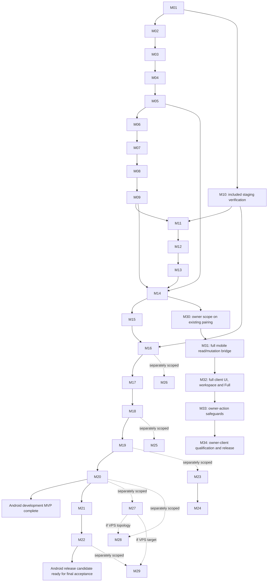

# Mobile client taskbook: OpenCode entry point

Status: Android M01–M22 implemented and qualified on the A142 / Android 16 arm64 device.
The 2026-11-01 owner-client revision is accepted: the paired phone is the same full
Nanobot client as the desktop WebUI, not a restricted chat viewer. M30–M34 define that
revision; the old chat-only “M1” profile remains only for legacy devices.
The final signed release is `mobile/evidence/20261101-m22-release/nanobot-mobile-release.apk`
(SHA-256 `936803375e50f9b54ca243eb2ea1609b4b1aa706bc5bd7182ce83e7ff4e3edd7`). Automated gates are
green: Python 17,111 passed / 22 skipped; WebUI 1,369 passed; phone 31 tests (8 live skipped, 23
passed). Device checks passed for QR/product pairing, camera and library attachments, signed media,
token refresh, cellular/Wi-Fi handover, orientation, process death, Doze, Back, font scaling and a
battery/thermal snapshot. A full gateway with the local `Qwen3.8-27B-UD-Q6_K_XL` provider then
completed real phone pairing and model turns (`GATEWAY_MODEL_OK` host check, `PHONE_OK` on the
phone); see `mobile/evidence/20261031-full-gateway/`. TalkBack was explicitly skipped by product
decision. Final human acceptance/review remains. Read this file first, then the matching tasks in
[the implementation guide](mobile-client-implementation.md).
The [accepted architecture](mobile-client-plan.md) remains authoritative for security and product behavior;
the taskbook supplies the complete execution order and supersedes its older P0-only dispatch wording.

## Outcome and starting state

Deliver Android chat, history, streaming, attachments and managed previews using the shared React UI,
Capacitor and one embedded userspace Tailscale node. The selected server runs the only Python agent
and owns tools, files, sessions, skills, memory and provider credentials. Persistent work survives phone
disconnect. No provider keys or process-local native permission references reach the phone; an
owner-paired phone receives delegated settings/Full authority, while legacy chat-only devices remain
restricted. iOS and future host work are fully specified below but separately scoped and are not
Android release dependencies.

There is no mobile scaffold or authenticated mobile device protocol in the inspected source.
Existing browser fetch/bootstrap, broad gateway tokens and desktop native-host detection cannot be
reused as phone authority. Preserve the existing multiplexed `NanobotClient` and canonical transcript.

- Work only in `/home/jaden/.codex/worktrees/mobile-client/nanobot-custom`, branch `codex/mobile-client`.
- Current committed staging base: `a60d8c5037479848d985475eb2e1bc81159d1bb7`, included by the
  clean 2026-10-31 rebase. The resolved Sandbox, permission, recovery and WebUI changes are included.
  Earlier planning HEAD `b0291974` and base `43462942` are historical, not start-HEAD guards.
  Record the actual clean implementation HEAD and fresh source/dependency manifests.
- Future uncommitted edits in `/home/jaden/Documents/Utilities/nanobot-custom` remain outside this
  checkout. Never stage, copy, reset, test through or otherwise modify that checkout.
  M10's Git sync to `a60d8c50` is already done; its permission/API/test verification remains required.
- Read `AGENTS.md`, `.agent/{design,security,gotchas}.md` and [checkout isolation](mobile-development.md).
  Freeze source/dependency/environment hashes before edits; keep an actual command and exit-code log.
- Use this checkout's own environments, config, instance/data/workspace and unused loopback ports.
  The installed app, its editable environment, credentials, sessions and running API are not fixtures.

## Execution rules

When the user invokes the included execution prompt in OpenCode, it authorizes implementation and
tests of ready Android tasks in dependency order. This planning task prepares that handoff only.
Do not stop for approval after every task. A task gate is measured evidence, not a new human approval
loop. P0 feasibility must pass before broad product integration; failures cannot be waived by mocks.
Independent security/lifecycle review gates merge and production activation, not ordinary isolated
implementation or opted-in development tests. This handoff launches neither OpenCode nor any service.

One writer owns `mobile/` at a time; one backend writer owns P1/P2 sequentially. P4 owns shared WebUI
files. P5a receives a recorded backend/config/WebUI handoff after those owners stop writing.
No package owns runner/provider changes, broad cleanup, root dependency changes in P0, or migration
stage closure. The [guide's ownership ledger](mobile-client-implementation.md#ownership) is binding.
Parallel work is optional and limited to disjoint, independently testable boundaries with frozen inputs.

States below describe dispatch readiness **before implementation**: **Ready** can start locally;
**Dependency** waits for the listed task evidence; **External** also needs the named setup/input;
**Deferred** requires separate scope and must not be dispatched by the MVP prompt.
Passing code tests with an external criterion pending leaves that milestone pending, never PASS.

## Complete backlog

Owned paths in this table are summaries; each linked task lists the exact permitted modules and exclusions.
All `mobile/`, `nanobot/remote/` and `tests/remote/` paths are proposed new paths unless stated otherwise.

| ID / package | Outcome | Dependencies | Owned paths / boundary | Initial state | Binary completion gate |
| --- | --- | --- | --- | --- | --- |
| [M01 / P0](mobile-client-implementation.md#m01) | Isolated pinned Android toolchain, shell and AVD | None | `mobile/` build/lock/scripts/docs | Ready | Reproducible x86_64 boot/build; arm64 build separately labeled |
| [M02 / P0](mobile-client-implementation.md#m02) | Non-agent HTTP/WS/auth/media fixture | M01 | `mobile/fixture/`, fixture contracts/tests | Dependency | Deterministic failure/effect/range fixture tests pass |
| [M03 / P0](mobile-client-implementation.md#m03) | One Go/C ABI/Kotlin native broker | M02 | `mobile/native-network/`, Android plugin/bridge | Dependency | Native HTTP/WSS/TLS and denylist/queue tests pass |
| [M04 / P0](mobile-client-implementation.md#m04) | Keystore credentials and node custody | M03 | Android custody/backup/lifecycle files | Dependency | Death/restore/logout tests; no secrets in JS/logs/backups |
| [M05 / P0](mobile-client-implementation.md#m05) | Transport/media/deep-link feasibility | M02–M04; approved fixture enrollment | `mobile/` fixture qualification | External | App-node plus backend path proof; transport-off private requests fail |
| [M06 / P1](mobile-client-implementation.md#m06) | Versioned host-neutral contracts | M05 | `nanobot/remote/protocol.py`, `mobile/contracts/`, contract tests | Dependency | Compatibility/profile/capability fixtures pass |
| [M07 / P1](mobile-client-implementation.md#m07) | Independent durable owner and private IPC | M06 | Remote store/owner/IPC; `config/schema.py` | Dependency | Atomic records, role/peer isolation and fail-closed IPC pass |
| [M08 / P1](mobile-client-implementation.md#m08) | Single-winner pairing, refresh and revoke | M07 | Remote pairing/auth/devices; tests | Dependency | Race/rotation/revoke/restore negatives pass |
| [M09 / P1](mobile-client-implementation.md#m09) | Staged loopback listener and local approval/entry CLI | M08; explicit local mapping opt-in | Remote listener/staging/entry; tests | External | Independent owner reachable privately; exact teardown restores prior state |
| [M10 / sync](mobile-client-implementation.md#m10) | Verify included permission/WebUI updates | M01; `a60d8c50` already included | Mobile branch integration/manifests only | Dependency | Refreshed permission/API/layout manifest and affected checks; rebase only if a newer target is needed |
| [M11 / P2](mobile-client-implementation.md#m11) | Scoped gateway HTTP/WS/media edge | M09, M10 | WebUI gateway/channel edge and remote client tests | Dependency | Every declared route/frame/range checks current identity; unknown routes deny |
| [M12 / P2](mobile-client-implementation.md#m12) | Immutable operations and replay-only reconnect contract | M11 | `inbound_commands.py`, edge/replay tests | Dependency | Lost-response/renewal/rotation effect count is 1; unknown replay never executes |
| [M13 / P2](mobile-client-implementation.md#m13) | Task/workspace authority boundary | M12, M10 | WebUI workspaces/projection/ingress; authority tests | Dependency | Owner and legacy phones both enforce current task/workspace policy; owner can request Full, legacy cannot inherit it |
| [M14 / P3](mobile-client-implementation.md#m14) | Android identity against real backend | M05, M09, M13 | `mobile/` product profile/pair/auth/connection | Dependency | Emulator pairs, renews, revokes and isolates instance/profile using native path |
| [M15 / P3](mobile-client-implementation.md#m15) | Product native media, attachments and deep links | M14 | `mobile/` native resources/pickers/links | Dependency | Real-backend ranges, limits, cleanup and recovery pass in emulator |
| [M16 / P4](mobile-client-implementation.md#m16) | Shared runtime/bootstrap/client transport | M10, M15 | Shared `webui/src/lib/`, entry/build files/tests | Dependency | Shared client replay/HTTP use broker; browser/desktop and mobile SW checks pass |
| [M17 / P4](mobile-client-implementation.md#m17) | Android chat layout and recovery UX | M16 | Shared chat/media/components/styles/tests | Dependency | Chat continuity, keyboard/Back/accessibility and denied-state UI pass |
| [M18 / P5a](mobile-client-implementation.md#m18) | Pairing/device/revoke/remote on-off settings | M17; explicit ownership handoff | Remote/config + local settings modules/tests | Dependency | Local setup and owner-client management both work; owned data/control off/recovery pass |
| [M19 / P5a](mobile-client-implementation.md#m19) | Opt-in independent controller supervision | M18; concrete local service opt-in | Remote supervisor/entry + minimal desktop glue | External | Controller survives gateway stop; exact install/remove preserves other services |
| [M20 / integration](mobile-client-implementation.md#m20) | Automated regressions and review-candidate evidence | M19 | Tests/evidence/docs; corrections return to owners | Dependency | Automated gates/evidence pass; no human review stop before device tests/packaging |
| [M21 / P6a](mobile-client-implementation.md#m21) | Physical Android qualification | M20; actual Android phone | Device runner/evidence only | External | arm64 execution, cellular/Doze/custody/power/camera/update tests pass |
| [M22 / P6](mobile-client-implementation.md#m22) | Reproducible signed APK and final review/rollback | M21; selected signing identity | Mobile release/build/notices/evidence | External | Signed install/update/revoke/rollback and complete review handoff pass |
| [M23 / P5b](mobile-client-implementation.md#m23) | Guarded desktop lifecycle capability | M19; later explicit lifecycle scope/review | Fixed remote lifecycle + desktop/gateway adapter | Deferred | Strict desktop ownership/races/Quit tests pass before activation |
| [M24 / P5b later](mobile-client-implementation.md#m24) | Exact registered service-manager lifecycle | M23; named-unit adapter contract | Remote service adapter + gateway service tests | Deferred | Exact-manager Stop defeats `Restart=always`; no arbitrary PID/unit authority |
| [M25 / P7](mobile-client-implementation.md#m25) | Exact-target remote approvals (legacy/external) | M18; fresh local scope design/grant | Remote permission adapter/authority tests | Deferred | Superseded for owner clients by M30–M33; legacy target receipts remain single-use |
| [M26 / P8](mobile-client-implementation.md#m26) | iOS adapter, custody, media and qualification | M06, M16; future iOS scope/toolchain | `mobile/ios/`; explicit shared-file handoff | Deferred | Actual signed iOS/device evidence; no edge into Android release |
| [M27 / future VPS](mobile-client-implementation.md#m27) | Headless data plane/operator/permission qualification | M20; selected host and future scope | Headless remote/docs/tests, named deployment files later | Deferred | Headless chat works with lifecycle unsupported and qualified task boundary |
| [M28 / future model](mobile-client-implementation.md#m28) | Private server-to-model data link | M20; M27 only for VPS topology | Server provider config/runbook; no phone provider code | Deferred | Authenticated inference/stream failure distinction; SSRF/admin boundaries preserved |
| [M29 / future migration](mobile-client-implementation.md#m29) | Controlled state/identity cutover | M22; M27 if migrating to VPS; future scope | Migration runbook/checks; exact state paths later | Deferred | One authoritative writer, explicit identity/pairing and tested rollback |

### Owner-client revision — M30–M34

| Task | Objective | Prerequisites | Main ownership | Gate/evidence |
| --- | --- | --- | --- | --- |
| [M30](mobile-client-implementation.md#m30) | Owner scope on the existing pairing | Accepted plan revision; M14 pairing | Remote protocol/owner/pairing tests | New pairings grant `owner`; comparison-code approval; legacy chat-only devices remain valid until re-paired |
| [M31](mobile-client-implementation.md#m31) | Full mobile WebUI read/mutation bridge | M30 | Edge, `ws_http`, `inbound_commands`, mobile runtime tests | All desktop WebUI GETs and `webui_request` mutations work from a paired owner phone; scope denial for non-owner |
| [M32](mobile-client-implementation.md#m32) | Re-enable full client UI, settings, workspace and Full | M31 | Shared UI + mobile route tests | Settings/apps/skills/automations, folder management, workspace mode and Full access work on the phone; native picker replaced by server-side path management |
| [M33](mobile-client-implementation.md#m33) | Owner-action safeguards | M31 | Shared UI + audit/confirmation tests | Destructive actions confirm; owner mutations audit installation/action; provider keys never returned; self-revoke works |
| [M34](mobile-client-implementation.md#m34) | Owner-client device and release qualification | M32, M33 | Tests/evidence/release | Full suite, real phone, update/pairing persistence, signed artifact and acceptance evidence |

M25 exact-target remote approvals are superseded for owner clients by M30–M33; the
old scope remains documented for non-owner/legacy deployments. M23/M24 service-manager
lifecycle remains deferred; owner clients use the existing WebUI restart/stop surface.

## Dependency order and finish lines



M06–M09 contract/store/listener work can proceed independently; M11 permission integration and M16
shared UI work still require M10's verification of the included staging base. M10 can happen earlier;
any further Git integration uses committed source at a clean checkpoint, never uncommitted files. Native product preparation
may later overlap backend work only with disjoint ownership, but the M14 real-backend gate waits for
M13. Default to the sequential order above; task completion does not require another human dispatch.
M20 is an emulator-qualified development MVP; M21 and M22 are mandatory before Android distribution.
M20 prepares review evidence; independent review occurs on the integrated result after packaging/fixes
and gates merge/production activation, not ordinary isolated M21/M22 work. Any later change invalidates
affected checks/review; the final handoff identifies the actual final HEAD and artifact after all fixes.
M23–M29 are optional future branches and never dependencies of M20–M22.

## Copyable OpenCode execution prompt

```text
Implement the ready Android MVP tasks M01–M22 in docs/mobile-client-tasks.md and
docs/mobile-client-implementation.md, in dependency order. Read AGENTS.md and the
accepted mobile-client-plan.md first. Work only in the dedicated codex/mobile-client
worktree; record its actual clean starting HEAD and manifests. The branch already
includes staging a60d8c50; older b0291974/43462942 references are historical.

For each ready task, reconfirm its owned paths, preserve unrelated edits, capture a
meaningful red test or deterministic pre-check, implement the smallest change, then
run its green checks and record exact commands/exit codes and acceptance evidence.
Do not ask for approval after each task. Preserve one writer per boundary and record
P1/P2 -> P5a and P4 -> P5a transfers. At M10 verify the included Sandbox permission/API/
layout changes before M11/M16; update Git history only if a newer committed staging
target is required, at a clean checkpoint. Do not skip M10's remaining evidence checks.

Keep P0 entirely under mobile/ with a non-agent fixture. Stop broad mobile integration
if native transport feasibility fails; return measured fallback evidence. Never count
10.0.2.2, host Tailscale reachability, mocks, a skipped live check or arm64 compilation
as embedded transport or physical-device proof. Keep all backend tests isolated from
the installed staging config/data/environment/services. Secrets stay out of JS/logs.

If an external criterion lacks its local opt-in, endpoint/enrollment, committed staging
input, physical phone or signing identity, mark it pending, continue independent ready
work and do not call that milestone PASS. Present concrete setup diffs and rollback
before requesting a genuine network/service action. No global Tailscale changes.

Do not dispatch deferred M23–M29, merge, publish, enable production access or run a
second writer for the existing server instance. Return the integrated implementation,
APK/checksum when qualified, the complete evidence handoff below and all pending
criteria for our final review before merge or production activation.
```

## Required integrated review handoff

Return a navigable evidence directory with a sanitized index; task-level artifact names are in the guide.
Record actual paths and hashes, not merely this checklist or a worker's PASS statement.

1. Actual clean starting base, final HEAD, staging-sync commit(s), branch/worktree, `git status`,
   exact base-to-head diff, changed-path list and an unrelated-file/ownership comparison.
2. Before/after source manifests, lockfile/dependency hashes, environment/tool versions, exact
   command/cwd/exit-code logs and red/green outputs. Preserve failed attempts and cleanup results.
3. Per-task acceptance matrix with PASS/FAIL/PENDING and artifact links, route/scope/schema registry,
   owner/IPC/security review, replay effect counters, principal/generation/request correlation and revocation timing.
4. Sanitized emulator/API/ABI/WebView/acceleration facts, app-node plus backend path proof, screenshots,
   media/range and lifecycle traces; separately label x86_64 execution, arm64 compilation and actual phone runs.
5. Required full Python/WebUI/lint/build/type evidence with frozen full-source comparison under identical
   dependencies. No new diagnostic signatures, suppressions, silent baseline refresh or timeout/skip PASS.
6. Signed APK path and SHA-256, signing certificate fingerprint only, reproducibility/notices/SBOM,
   install/upgrade/reinstall/revoke/rollback rehearsal and exact device qualification coverage.
7. Prior/desired/final private mapping and opted-in service state, owned-resource cleanup, retained revocations,
   session preservation, external checks still pending and recovery instructions. Never include keys,
   tokens, QR/collector secrets, private hostnames or unsanitized user content in shared artifacts.

Local network/service opt-in, physical hardware, signing inputs and future host choices are genuine
later gates. Ordinary implementation decisions and fixture tests need no new approval. Final acceptance
requires independent inspection of the actual diff and evidence; author-reported completion alone is insufficient.
