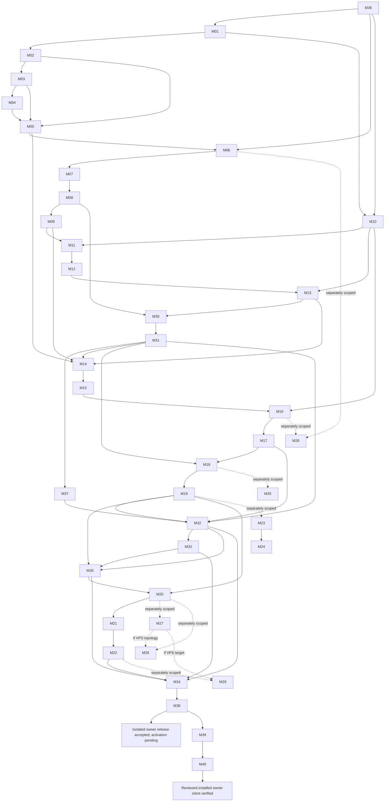

# Mobile client taskbook: OpenCode entry point

Status: accepted Android full-owner direction; implementation and qualification await fresh inspection.
This 2026-11-01 revision changes four planning documents only. It neither accepts nor rejects existing
code, inspects APKs, runs tests, nor authorizes installed-instance changes. Read this file, the
[implementation guide](mobile-client-implementation.md), [architecture](mobile-client-plan.md) and
[checkout isolation](mobile-development.md) together.

The prior taskbook reported M01–M22 qualification on an A142 / Android 16 arm64 phone, Python
17,111 passed / 22 skipped, WebUI 1,369 passed, phone 23 passed / 8 live skipped, and a signed APK at
`mobile/evidence/20261101-m22-release/nanobot-mobile-release.apk` with SHA-256
`936803375e50f9b54ca243eb2ea1609b4b1aa706bc5bd7182ce83e7ff4e3edd7`. It also reported
`GATEWAY_MODEL_OK` / `PHONE_OK` in `mobile/evidence/20261031-full-gateway/`, network/media/custody
checks and a product decision to skip TalkBack. These are attributed historical reports, unverified
by this revision; they establish neither current full-owner parity nor current test/release acceptance.
M36 records what exists and which evidence remains applicable; affected work must be requalified.

## Outcome and starting state

Deliver the same feature surface and behavior as the desktop WebUI through shared React, Capacitor
and one embedded userspace Tailscale node. One pairing grants one owner capability after explicit
full-control consent. The selected server alone owns the agent, tools, files, sessions, skills,
credentials and history. Owner clients use settings/providers/models, Apps/MCP/CLI/API service,
local/custom and installed skills, automations, temporary and persistent chats, session actions,
workspace modes/grants/Full and the lifecycle actions the selected desktop actually supports.
M36 freezes the complete action inventory; no category may disappear silently. Legacy chat-only
devices retain their negotiated ceiling.

Persistent work survives disconnect; temporary chats are connection-owned and disposed on disconnect.
Use the standard feature `/api/*`, WS and media surface, with bounded named native operations rather
than a raw-URL proxy. Long-lived app credentials stay native. Existing provider secrets are never read;
newly typed provider keys may be submitted transiently to the standard write endpoint without persistence
or logging. Native permission references stay server-side. There is no phone agent/model runtime.
iOS, VPS deployment/migration/model linking and new generic process/service control remain separate scope.

- Work only in `/home/jaden/.codex/worktrees/mobile-client/nanobot-custom`, branch `codex/mobile-client`.
  Planning-review baseline: `b05292b0769732ea99f72c0a74f13f222d98030f`. M36 records the actual clean
  implementation HEAD and manifests rather than enforcing this historical HEAD.
- The earlier rebase included staging `a60d8c5037479848d985475eb2e1bc81159d1bb7`; M10 still verifies
  current permission/API/layout assumptions. Earlier `b0291974` / `43462942` references are historical.
- Preserve unrelated edits and other worktrees. Installed staging environment/config/data/services are
  never fixtures. Use this worktree's environments and an isolated, explicitly selected instance.
- Read `AGENTS.md` and `.agent/{design,security,gotchas}.md`. Freeze command/environment/source evidence;
  do not silently reset a checker baseline or treat old reported PASS as fresh evidence.

## Plan consistency review — 2026-11-01

- Structural check: 40 task rows, 40 implementation-guide anchors, no row/anchor mismatch.
- Dependency check: M36 starts the inventory; M01/M06/M10 consume it; M30/M31/M37 precede the owner UI;
  M32/M33/M35 precede candidate integration; M20–M22 precede M34/M38; M39/M40 remain activation-only.
- Coverage check: chat/history/media, settings/providers/models, Apps/MCP/CLI/API service, skills,
  automations, workspace/grants/Full, server directory browser, devices/entry, lifecycle and platform
  adaptations are all in the M36 inventory categories.
- Evidence check: historical M01–M22 reports are explicitly unverified until M36 applicability review;
  the current signed artifact remains chat-scoped and is not an owner-client release.
- Open product decisions:
  1. Initial remote enable/re-enable, new-device approval and scope upgrade remain local-only safety
     exceptions. Confirm this is accepted.
  2. Remote Start of a fully stopped gateway remains unsupported unless M23/M24 are promoted. The
     desktop app/service or a local launcher is required.
  3. Folder-browser roots default to empty pending explicit server configuration. A default workspace
     root (not `/`) may be needed for usable first-run behavior.
  4. Provider keys are write-only; existing keys are never returned to the phone.
  5. M39/M40 activate the actual installed instance only after local opt-in; M35 is isolated.
- Next action: M36. No owner-scope, standard-API, folder-browser or full-UI implementation is claimed
  complete by this planning revision.

## Execution rules

Invoking the prompt below authorizes implementation and tests of ready **current** tasks in dependency
order. This planning revision launches nothing. Do not request human permission after each ordinary
task. Measured feasibility and genuine external inputs remain mandatory; missing input leaves its row
PENDING while independent ready work continues. Review and concrete service/network/installed-instance
opt-ins are later activation gates, not permission to run unreviewed builds on installed staging.

M01–M22 are retained foundation/evidence obligations inside the current workflow, not an alternative
chat-only product or finish line. Reuse implementation only after M36 applicability review and current
checks. P0 feasibility still gates broad integration; native transport and physical proof cannot be
waived by mocks, old artifacts, host Tailscale, `10.0.2.2`, skipped live checks or arm64 compilation.
M30 has backend/contract prerequisites, not a later real-phone prerequisite. M14 proves the current
backend in an emulator; M21/M34 later prove the physical phone.

Use one writer per overlapping boundary, with recorded file/hash handoffs. Default to sequential work;
optional parallelism is limited to disjoint, independently verifiable frozen contracts. The
[ownership ledger](mobile-client-implementation.md#ownership) governs all paths. No package owns
unrelated runner/provider changes, broad cleanup or migration-stage closure.

States: **Ready** can begin isolated work; **Dependency** waits for listed evidence; **External** also
requires the named real input; **Deferred** is outside this prompt. Table prerequisites, guide fields
and graph below describe the same workflow. Each guide task supplies owned/forbidden paths, steps,
positive/negative checks, evidence, inputs and rollback.

## Complete backlog

Paths are summaries; proposed names must be reconciled with M36's fresh inspection before dispatch.
No file-existence claim is made by this planning edit.

| ID / package | Outcome | Dependencies | Owned paths / boundary | Initial state | Binary completion gate |
| --- | --- | --- | --- | --- | --- |
| [M36 / inventory](mobile-client-implementation.md#m36) | Freeze desktop parity/API and implementation baseline | None | `mobile/contracts/desktop-parity.json`, baseline/evidence only | Ready | Every feature/action has auth/native/UI/dependency/check rows; existing work and gaps recorded |
| [M01 / P0](mobile-client-implementation.md#m01) | Pinned Android shell/toolchain and AVD | M36 | `mobile/` build/lock/scripts | Dependency | Reproducible x86_64 execution; arm64 build labeled separately |
| [M02 / P0](mobile-client-implementation.md#m02) | Non-agent HTTP/WS/auth/media fixture | M01 | `mobile/fixture/`, fixture contracts/tests | Dependency | Deterministic limits/failure/range/effect checks pass |
| [M03 / P0](mobile-client-implementation.md#m03) | One Go/C ABI/Kotlin native broker | M02 | `mobile/native-network/`, Android bridge | Dependency | HTTP/WSS/TLS, registry denial and queue checks pass |
| [M04 / P0](mobile-client-implementation.md#m04) | Keystore credential/node custody | M03 | Android custody/backup/lifecycle files | Dependency | Death/restore/logout checks; no durable secrets in JS/logs/backups |
| [M05 / P0](mobile-client-implementation.md#m05) | Transport/media/deep-link feasibility | M02, M03, M04; fixture enrollment/opt-in | `mobile/` fixture qualification | External | App-node plus backend path proof; transport-off private calls fail |
| [M06 / P1](mobile-client-implementation.md#m06) | Host-neutral owner/legacy contracts | M05, M36 | `nanobot/remote/protocol.py`, mobile contracts/tests | Dependency | Standard-feature/control/legacy registry and compatibility vectors pass |
| [M07 / P1](mobile-client-implementation.md#m07) | Independent durable owner/private IPC | M06 | Remote store/owner/IPC; `config/schema.py` | Dependency | Records, peer/role checks and typed delegation envelope pass |
| [M08 / P1](mobile-client-implementation.md#m08) | Single-winner pairing/rotation/revoke | M07 | Remote pairing/auth/devices/tests | Dependency | Collector/race/rotation/revocation negatives pass |
| [M09 / P1](mobile-client-implementation.md#m09) | Isolated listener/local approval/private entry | M08; mapping opt-in | Remote listener/staging/entry/tests | External | Independent control routes work with gateway absent; teardown preserves records |
| [M10 / sync](mobile-client-implementation.md#m10) | Verify staging permission/API/layout | M01, M36 | Mobile-branch manifests/integration only | Dependency | Current seam/checker evidence; no copying dirty staging files |
| [M11 / P2](mobile-client-implementation.md#m11) | Authenticated HTTP/WS/media foundation | M09, M10 | WebUI gateway/channel edge/tests | Dependency | Current identity on every frame/range; unknown operations deny |
| [M12 / P2](mobile-client-implementation.md#m12) | Immutable operations/replay-only reconnect | M11 | `inbound_commands.py`, edge/replay tests | Dependency | Renewal/rotation replay effect count 1; unknown replay count 0 |
| [M13 / P2](mobile-client-implementation.md#m13) | Task/workspace authority binding | M12, M10 | Workspaces/projection/ingress/tests | Dependency | Source/task/revision checks; no native references/inherited desktop grants |
| [M30 / owner backend](mobile-client-implementation.md#m30) | Single owner pairing/controller delegation | M13, M08 | Remote owner/IPC/management/permissions/config/tests | Dependency | Owner administration succeeds; unauthorized/local-only/setup negatives deny |
| [M31 / owner API](mobile-client-implementation.md#m31) | Standard feature API/native registry | M30 | Gateway/WS route owners; native registry/contracts | Dependency | Existing-handler owner/legacy/native checks pass; local-only enrollment/setup actions explicitly deny |
| [M37 / folder backend](mobile-client-implementation.md#m37) | Bounded directory API/fresh grant validation | M31 | `webui/workspace_directories.py`, workspaces/config/permission adapter/tests | Dependency | Roots/canonical/race/limits/auth checks pass; UI contract frozen |
| [M14 / P3](mobile-client-implementation.md#m14) | Current real-backend Android identity | M05, M09, M13, M31 | `mobile/` profile/pair/auth/connection | Dependency | Emulator pairs once as owner, renews/revokes/replays through native path |
| [M15 / P3](mobile-client-implementation.md#m15) | Native product media/attachments/deep links | M14 | `mobile/` native resources/pickers/links | Dependency | Real-backend ranges/limits/cleanup/recovery pass in emulator |
| [M16 / P4](mobile-client-implementation.md#m16) | Shared runtime/bootstrap/client transport | M10, M15 | Shared `webui/src/lib/`, build entry/tests | Dependency | Shared client/registry/replay, browser/desktop and mobile SW checks pass |
| [M17 / P4](mobile-client-implementation.md#m17) | Shared Android layout/recovery | M16 | Shared chat/media/components/styles/tests | Dependency | Persistent/temporary semantics, keyboard/Back/accessible states pass |
| [M18 / P5a](mobile-client-implementation.md#m18) | Local admission/delegated device-entry settings | M17, M31 | Transferred remote/config/settings modules/tests | Dependency | Setup/approval stay local; owner device/revoke/entry management succeeds |
| [M19 / P5a](mobile-client-implementation.md#m19) | Independent controller supervision | M18; isolated service opt-in | Remote supervisor/entry + desktop glue | External | Owner survives gateway stop; cleanup retains records |
| [M32 / owner UI](mobile-client-implementation.md#m32) | Full shared UI/mobile folder adaptation | M17, M19, M31, M37 | Shared settings/apps/skills/automation/workspace UI/tests | Dependency | Inventory UI/actions and explicit project selection pass at phone width; local-only setup controls hidden/denied |
| [M33 / safeguards](mobile-client-implementation.md#m33) | Confirmation/device audit/secret safety | M32 | Shared confirmation; remote audit/management/permissions/tests | Dependency | Two devices distinguishable; redaction/revoke/TTL/confirmation negatives pass |
| [M35 / isolated integration](mobile-client-implementation.md#m35) | Desktop-equivalent instance qualification | M19, M32, M33 | Isolated instance/launcher/mapping runbook and evidence | External | Canonical runtime; same-instance/stopped-gateway proofs; staging untouched |
| [M20 / integration](mobile-client-implementation.md#m20) | Current candidate automated evidence | M19, M35 | Tests/evidence/docs; fixes return to owners | Dependency | Full required regressions and inventory coverage on exact candidate |
| [M21 / P6a](mobile-client-implementation.md#m21) | Physical Android qualification | M20; actual phone | Device runner/evidence only | External | arm64/cellular/Doze/custody/power/media/update qualification |
| [M22 / P6](mobile-client-implementation.md#m22) | Reproducible signed current-candidate APK | M21; signing identity | Mobile release/build/notices/evidence | External | Signed install/update/revoke/rollback; no historical finish |
| [M34 / owner release](mobile-client-implementation.md#m34) | Complete parity/release bundle | M22, M32, M33, M35 | Final inventory/tests/evidence/release runbook | Dependency | Every row passes or has explicit accepted exception; phone/release evidence frozen |
| [M38 / review](mobile-client-implementation.md#m38) | Independent integrated acceptance | M34 | Read-only review/evidence | Dependency | Reviewer PASS for exact server/WebUI/mobile/config manifest before promotion |
| [M39 / promotion](mobile-client-implementation.md#m39) | Controlled installed-instance activation | M38; installed target/concrete opt-ins | Reviewed install/config/launcher/service/mapping transition | External | Reviewed build installed once; durable data retained; no parallel writer |
| [M40 / activated check](mobile-client-implementation.md#m40) | Postactivation same-instance verification | M39 | Non-destructive installed checks/evidence | External | Same installation/history/policy; control/revoke/recovery/rollback verified |

### Separately scoped backlog

M23/M24 add new remote Start or service-manager capabilities; they are not required merely to use
restart/stop already supported by the selected desktop WebUI. M25 is legacy/external exact-target
approval only, superseded for owner authority by M30/M33. No deferred row is dispatched below.

| ID / package | Outcome | Dependencies | Owned paths / boundary | Initial state | Binary completion gate |
| --- | --- | --- | --- | --- | --- |
| [M23 / P5b](mobile-client-implementation.md#m23) | Additional guarded desktop lifecycle | M19; new lifecycle scope | Fixed lifecycle/desktop adapter/tests | Deferred | Strict owner/race/Quit tests and review before added capability |
| [M24 / P5b](mobile-client-implementation.md#m24) | Exact service-manager lifecycle | M23; named-unit contract | Fixed service adapter/tests | Deferred | Manager Stop defeats resurrection; no arbitrary unit/PID authority |
| [M25 / P7](mobile-client-implementation.md#m25) | Legacy/external target approvals | M18; fresh permission scope | Permission adapter/receipt tests | Deferred | Single-use source/task/revision-bound receipts |
| [M26 / P8](mobile-client-implementation.md#m26) | iOS implementation/qualification | M06, M16; iOS scope/toolchain | `mobile/ios/`, named shared handoff | Deferred | Actual signed-device iOS evidence |
| [M27 / future VPS](mobile-client-implementation.md#m27) | Headless deployment/permission qualification | M20; actual future host | Named deployment/operator paths later | Deferred | Actual host/operator/task/recovery proof |
| [M28 / future model](mobile-client-implementation.md#m28) | Private server-to-model link | M20; M27 if VPS topology | Server provider config/runbook | Deferred | Authenticated data-only inference; guards unchanged |
| [M29 / future migration](mobile-client-implementation.md#m29) | State/identity cutover | M22; M27 if VPS target | Named migration state/runbook later | Deferred | One authoritative writer; no resurrected credentials |

## Dependency order and finish lines



Default dispatch: M36, M01–M13 (M10 may run after M01), M30, M31, M37, M14–M19, M32,
M33, M35, M20–M22, M34, M38, then M39/M40 only with their real external gates satisfied.
The graph permits disjoint preparation but never transfers ownership implicitly. M35 uses an isolated
desktop-equivalent instance; installed staging is never a fixture. M20–M22 qualify this integrated owner
candidate. M34 closes parity/evidence, M38 independently accepts it, M39 promotes that exact reviewed
build, and M40 checks the actual activated instance. Qualification/review never depend on promotion.
Missing activation inputs leave the installed outcome PENDING while the isolated release may be accepted.

## Copyable OpenCode execution prompt

```text
Implement the current Android full-owner workflow in docs/mobile-client-tasks.md and
docs/mobile-client-implementation.md: M36 first; retained M01–M22 foundation/evidence
obligations plus M30–M35 and M37–M40 in documented dependency order. Read AGENTS.md,
.agent instructions, mobile-client-plan.md and mobile-development.md. Do not stop at
the historical M22 chat release. Full-owner isolated completion is M34 then M38 review;
installed promotion and same-instance completion are M39 then M40 with external gates.

Work only in the dedicated codex/mobile-client worktree. Record actual clean HEAD and
source/dependency/environment manifests at M36. Inspect existing implementation freshly:
historical reports neither prove nor disprove current behavior. Reuse only after recorded
applicability review and affected requalification. M10 verifies included staging semantics;
never copy dirty staging files or use installed environment/config/data as fixtures.

For each ready task reconfirm exact owned paths/prerequisites, preserve unrelated edits,
capture a meaningful red test or deterministic pre-check, implement minimally, then record
green commands/exits and binary evidence. One writer per boundary; record backend/native/
WebUI/settings handoffs. Ordinary ready implementation needs no new approval.

Freeze the desktop action/API inventory and prove every owner operation through the bounded
native registry and standard feature API. Preserve legacy chat-only compatibility without
silent scope upgrades, current-auth/replay/media limits, server-side grant/Full receipts,
native credential custody, write-only provider settings and browser/desktop regressions.
Keep P0 non-agent and isolated. Native transport failure stops broad integration; no host
Tailscale, 10.0.2.2, skipped live check or arm64 compile replaces required path/device proof.

Implement M35 on an isolated desktop-equivalent instance after M33 safeguards. Complete
M20–M22 and M34 physical/signing/parity evidence, then independent M38 review. M39 requires
the exact reviewed server/WebUI/mobile/config/launcher manifest, selected installed target,
compatibility/backup/rollback and concrete install/service/network opt-in. Present the
concrete transition before requesting missing genuine external authorization. Do not mutate
installed staging or activate experimental bundles while qualifying the build.

If enrollment, setup/service opt-in, phone, signing, target or activation permission is
missing, mark that criterion PENDING and continue independent ready work. Do not invent
credentials, reset global Tailscale, run a competing writer, merge, publish or dispatch
deferred M23–M29. Stop before unauthorized external action. Return exact evidence,
release/checksums when qualified, durable-state/rollback proof and pending criteria.
```

## Required integrated review handoff

Return a sanitized navigable evidence index with actual hashes and PASS/FAIL/PENDING per task and
inventory row. A checklist or author-reported PASS alone is insufficient.

1. Actual clean base/final HEAD, source/dependency/config/environment manifests, command/cwd/exits,
   diff/changed paths, ownership handoffs and unchanged unrelated-file comparison.
2. M36 desktop baseline and complete parity/API/native registry: feature/action, route+method or WS
   action, UI, owner/legacy auth, native limits, adaptation/exception, dependency, checks and evidence.
3. Owner/IPC/delegation/permission evidence, installation and acting-device IDs, sanitized operation
   correlations, replay effects, current revoke checks and receipt/source/task/revision negatives.
4. Emulator/native path/TLS/media/ABI/WebView/acceleration and browser/desktop regressions; separately
   labeled physical custody/power/network/accessibility/update/signing qualification.
5. Required full Python/WebUI/native/lint/build/type output and immutable same-environment checker
   comparisons with zero new signatures. Report debt honestly; no skip/timeout/refreshed-baseline PASS.
6. Exact server package/commit, bundled WebUI hash, APK/signature/application version, protocol/registry
   and config/data-schema versions. M38 binds these; changes reopen affected checks/review.
7. M35 isolated data/control routing and stopped-gateway proofs; M39 prior/desired/final installed
   executable/environment/launcher/config/service/mapping transition; one runtime; M40 instance checks.
8. Rollback retains installation identity, device/revocation/audit records and sessions. Remove only
   owned resources/disposable fixtures; disable ingress before incompatible downgrade. Include pending
   inputs and local recovery. Never share keys/tokens/private hostnames or unsanitized user content.

Enrollment/setup/service/activation opt-ins, physical hardware and signing are real external inputs.
iOS/VPS/model/migration inputs belong only to future scopes. This planning edit supplies no new test,
implementation, review or activation PASS; independent inspection of the future candidate is required.
