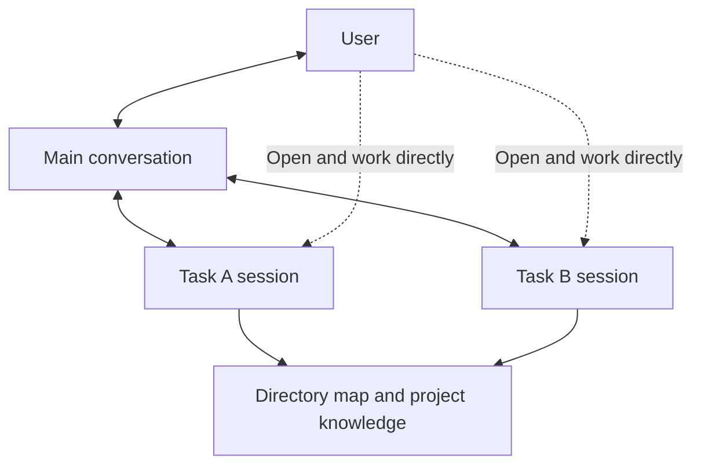

# SuperAgent research and future agent-managed sessions

Date: **2026-11-03** (Asia/Kuala_Lumpur).
Source-reference update: **2026-11-04**; user-supplied article text archived and reviewed.
Status: **research findings and future direction; implementation deferred**.
Nanobot source baseline: `a90191a41b025884e76ce029b98a5d5349171f2e`.
DeepSeek prototype snapshot: `8c32a9dc5d72c033816c6a8110b37f40cf94fba4`.

## Decision and current priority

The user considers agent-managed sessions a useful future capability. The intended
experience is one ongoing assistant that can create or reuse task sessions,
route follow-ups, track work, and surface results or decisions. The user must
retain direct access to each working session. Reducing the attention needed to
manage work is the purpose; requiring the user to monitor several conversations
would miss that purpose. The user's practical concern is keeping track of more
than about three simultaneous sessions, not a measured universal limit.

**First stabilise the existing agent architecture and current interaction model.**
Keep the current topic/session capabilities while polishing context continuity,
recovery, execution ownership, and desktop/channel behaviour. Local inference
is not yet ready for multiple concurrent requests in the user's intended setup.
Do not assume that adding worker sessions will improve responsiveness there.

This records a future direction, not a selected schema, implementation backlog,
permission to enable a coordinator, or a change to running configuration. The
desktop/channel alignment discussion remains separate follow-up work. The
existing [session lifecycle plan](session-recovery-architecture.md) and
[mobile/request-settings plan](mobile-remote-request-plan.md) retain their own
scope and acceptance criteria; neither is completed by this document.

The earlier [harness direction](harness-prototype-direction.md) sought one
personal assistant working across directories in one conversation. Its statement
that background process continuation does not require another model worker
remains correct for that capability. The new discussion expands the possible
future design to multiple managed task sessions; it does not retroactively make
worker orchestration a requirement for existing process continuation.

## Sources, method, and confidence

- Primary reference: [DeepSeek's public prototype][dsh-readme], inspected through
  its README, domain/execution/panel/architecture documents, role prompts, and
  routing, task, session, scheduler, report, and UI implementation at the pinned
  snapshot above. It is MIT-licensed research code, not an official DeepSeek
  product or a production qualification. It targets **one GitHub repository**,
  with optional Feishu input. Its public implementation differs from the
  internal system and broader design essay; some essay ideas are future work.
- User-provided explainer: [DeepSeek SuperAgent Explained: A Coding Agent That
  Works Beyond a Single Chat](https://deepseekv4pro.com/guides/deepseek-superagent-explained),
  by SIAPI.AI, dated 2026-11-01. The supplied
  [Google share link](https://share.google/SaQFZXQAg66RGozbF) resolved there.
  It is an independent explanation, not DeepSeek product documentation.
- Original team essay: [Exploring Super-agent Design: Towards a More
  Autonomous Agent System](https://x.com/DeepSeekHarness/article/2116857257245987236).
  This is the direct article URL supplied by the user on 2026-11-04; retain it
  alongside the [associated post](https://x.com/DeepSeekHarness/status/2116857257245987236).
  The live URL returned HTTP 403, but the user subsequently supplied the article
  text on 2026-11-04. The [source record and full-text archive](references/deepseek-superagent-design-article.md)
  preserve that attachment byte for byte. It labels itself an English machine
  translation of a Chinese original; the translation and live page have not
  been independently authenticated. The supplied text has now been reviewed.
  Earlier search summaries and third-party accounts are not substitutes for it.
  Article design claims remain distinct from the inspected prototype code.
- Nanobot findings come from the baseline source, existing project documents,
  focused tests, and a read-only inspection of the selected desktop runtime.
  Imported classes, documentation, passing isolated checks, active registration,
  and live behaviour are distinguished below.

No prototype installation, execution, benchmark, or live task-routing trial was
performed. No model accuracy, throughput, latency, cost improvement, or reduction
in user attention has been established by this study. Proposed nanobot behaviour
below is a design interpretation, not behaviour supplied by the prototype.

## Concepts and the distinction that matters

| Concept | Role |
| --- | --- |
| Assistant | The continuing entity the user interacts with; it can be backed by more than one execution context |
| Topic | Nanobot's visible conversation entry; a regular WebUI topic normally maps to a persisted session |
| Session | Execution history, context/checkpoints, and runtime metadata for a conversation; not necessarily the complete lifetime of a task |
| Task | A piece of work with an original request, scope, status, result, and questions; DeepSeek calls its durable work item a Ticket |
| Assignment | In the prototype, one execution assignment for a Ticket; retries or recovery can replace an assignment while retaining the task and session |
| Project/folder map | Navigation metadata identifying relevant directories and knowledge associations |
| Knowledge | Selected durable facts and decisions stored separately from private runtime history |
| Background process | A shell job or external operation that can finish later and wake its owning assistant; distinct from an independently reasoning model worker |

The directory map helps determine **where to work and what to read**. Task/session
coordination determines **which ongoing work owns a message and what happens
next**. These are complementary responsibilities. Several tasks may concern one
project, and one task may use several directories. Do not require one project,
one topic, one task, and one working directory to be the same identity.

| Option discussed | Benefit | Cost or limitation |
| --- | --- | --- |
| Strictly one execution session | One conversation to follow | Independent tasks share history and contend for one foreground loop; background tools alone do not supply independent model reasoning |
| Current manually managed topics | Direct access, separate histories, and independent work | The user creates/selects topics, tracks context, and remembers pending work |
| One main conversation with managed task sessions | Automatic organisation with separate task context and potential concurrency | Adds routing, ownership, state reconciliation, inference demand, and interface complexity |

The third option is the future direction to explore. It does not require removing
manual topics or direct sessions, and its task sessions can execute serially when
inference capacity is limited.

**Subsequent decision on 2026-11-03:** remove the Telegram-specific H1
coordination implementation rather than extend it to desktop; agent-managed
sessions are its future replacement. The
[cleanup plan](telegram-h1-concurrency-cleanup-plan.md) and isolated coding
workspace are prepared; consult that work separately for implementation status.
Preserve
the generic SessionManager, canonical execution/source
ownership, background-process continuation, and required accepted-input/recovery
handling. Removing the channel-specific layer is not removal of these foundations.

## What the supplied article adds

This section describes the [user-supplied article](references/deepseek-superagent-design-article.txt),
not newly verified runtime behaviour. The article itself says it discusses
architectural ideas and is not a feature announcement for DeepSeek Harness.

It frames the goal as continuity across conversations, productive task
concurrency, proactive event handling, and persistent operation. Its central
distinction matches our goal: the user follows one continuing assistant while
the system manages execution contexts. Router and Worker are **logical roles**;
neither must always be exactly one physical session. The example uses a
long-lived router because it is sufficient for the authors' present workload.

| Article component | Design described | Relevance to our future direction |
| --- | --- | --- |
| Two-level architecture (§2) | The router handles human interaction, global context and dispatch; isolated workers execute tasks and may contain teams/subagents | Separate routing from substantial work without requiring the user to manage every execution session |
| Event-driven triggers (§3) | Code filters deterministic noise; model policies assess candidates; many-to-many subscriptions pass follow-ups to owning workers without another router decision | Task ownership and explicit event routing matter; a parent model need not reinterpret every follow-up |
| Context organisation (§3.3) | Inline likely-needed summaries and related IDs, spill larger content behind references, and follow linked objects through a Chain of Recall | Keep the main context bounded and retrieve task detail on demand; a folder map still supplies location rather than task ownership |
| Full-duplex channels (§4) | Long tools return a started acknowledgement; completion arrives as a later event; output detail fits the channel | Managed sessions alone do not make a blocking router responsive; background execution and input admission are separate parts of the design |
| Compute/state/environment separation (§5) | Persist sessions independently from loop compute and reach existing execution machines through endpoint daemons | Cross-device/cloud operation is an additional design choice, not a prerequisite for our current local desktop goal |
| External Watchdog (§6) | A separate scheduled session checks infrastructure and substantive progress and attempts recovery | A future recovery option with its own compute and authority requirements; not part of the H1 cleanup |

Router event batching (§2.1) groups arrivals from the preceding inference step
into a later call. It is different from making simultaneous model requests and
does not prove that our local inference backend can serve a router and workers
responsively. The article suggests a lighter router model and stronger worker
models; the actual assignments, availability and performance for nanobot remain
open. Its speculative background work (§3.4) is also an optional policy, not
authorization for us to start tasks or take external actions without a request.

### Direct collaboration remains a product decision

In the article's ordinary external-channel flow, workers report to the router
and do not post their reasoning/tool activity directly to people. This differs
from forbidding inspection or intervention: §8.2 explicitly leaves open how a
person can take over or collaborate during background work, and allows visible
conversations to differ from underlying execution sessions. The inspected
prototype's Open Session control is separate implementation evidence below.
Our accepted requirement remains direct access to each actual working session,
with a main/router page that shows status and requests for attention. The
article does not select that UI for us or remove our need to design it.

### Reported experiments and their limits

Section 7 reports a synthetic scheduling experiment: about 300 messages and 20
work requests per run, five runs per design, with coding replaced by a tool
that consumes time. Reported task-completion p50/p95 in minutes are 12.4/15.7
for Super-agent, 12.6/15.5 without pass-through, 20.4/29.5 for a neutral
single-session/subagent prompt, and 13.8/29.0 for its delegation-first prompt.
Super-agent used 23.2M cache-read tokens per run versus 6.1M and 10.8M for the
single-session variants. Removing pass-through increased that to 31.8M with
similar completion times in this workload: reduced router overhead, rather
than demonstrated task-quality improvement, is the relevant result.

The separate router test used a real router model and mock workers. Across about
1–40 decision-requiring triggers per minute, reported average batch size rose
1.0→2.8, time per request 2.5→3.9 seconds, and amortised inference time per
decision fell 6.4→1.6 seconds. These are the authors' preliminary measurements,
not nanobot benchmarks or local-model throughput guarantees. The article does
not establish coding quality, a universal session count, or production capacity.

Its open questions (§8) cover router scaling and long-term memory, interaction
without a one-chat/one-session mapping, context/permission boundaries between
agents, and security/privacy. In particular, connected execution machines and
credentials create risks beyond ordinary session routing. None of the cloud,
endpoint, speculative-work, or Watchdog proposals is added to the current
cleanup scope by saving this reference.

## What the DeepSeek prototype actually implements

### Work identity and routing

The flow is Source event → Trigger/Thread → assessment when needed → Ticket →
Assignment → Executor Session → report/reply. A Ticket records its original
request, authorisation basis (Mandate), destinations, inputs, assignments, and
question for a person. Ticket state is separate from executor-session state.
One source Thread can have several Tickets, with many-to-many Subscriptions.
Correlation between Threads adds context; it does not itself route messages.
See the [domain model][dsh-domain] and [Ticket implementation][dsh-tickets].

The parent/Main Session uses task summaries and source references for routing.
Workers own technical investigation, implementation, and verification. The
[dispatch prompt][dsh-dispatch] tells the parent to preserve the original request,
avoid adding technical plans or invented requirements, and attach only when the
message explicitly identifies an existing task. Similar subject matter alone is
insufficient. A short routing note is limited to 30 words; the host carries the
original trigger reference separately.

Once a human follow-up belongs to a subscribed task Thread, stored subscription
routing delivers it to its worker without another parent assessment. The parent
receives a notice and must not forward the message again. A worker handles an
in-scope follow-up or hands back a request beyond its task. Threads followed only
for context do not grant task authority or resume ended work. A human stop is
preserved. See [intake/fan-out][dsh-intake] and [follow-up ownership][dsh-model].

This is more than automating a New topic button. The useful capability is
retaining task identity, context ownership, status, and follow-up routing over
time. It also shows that every message need not pass through a model parent.

### Persistent workers, direct access, and execution capacity

Each Ticket gets a persistent `worker-<ticket-id>` session and its own directory.
The prepare command may create a Git worktree; without one, a worker can start
in an empty directory. Retrying reuses the session, directory, branch, and pull
request. Worker creation/reuse is visible in [Sessions.ensure][dsh-sessions] and
[DshExecutor][dsh-executor].

The task page exposes an Open Session button. A person can type directly into
that session; executor hooks observe that input, and the tools remain usable
after a blocked/failed report. The worker is an actual inspectable conversation,
not an inaccessible child whose outputs can only be obtained through the parent.
See [task page][dsh-ticket-ui], [session button][dsh-widgets], and
[execution/recovery behaviour][dsh-execution].

Worker slots cover preparation, active turns, and remaining background work.
Human follow-ups or status requests may use one extra slot beyond the configured
worker limit and take priority over new launches. New router/worker presets yield
long shell work after five seconds. A turn ending with live background work
normally retains its slot and is woken by completion; the documented background
wait limit is 30 minutes. Handoff to a person releases the slot, with separate
rules for remaining review servers/jobs. These are prototype policies to study,
not selected nanobot defaults. See [execution][dsh-execution] and
[WorkerSlots][dsh-executor].

### Runtime state, attention, and communication

The deterministic host owns task transitions, scheduling, concurrency, input
delivery, and persisted effects. It records work before attempting it and retries
failed deliveries. The Main Session is not the sole ledger of unfinished work.
Restart recovery retains sessions/directories and asks workers to inspect actual
state before repeating external actions. See [architecture][dsh-architecture]
and [assignment/report handling][dsh-assignments].

Structured reports distinguish progress, waiting, ready, blocked, failed, and
dropped work. A question for a person is stored explicitly rather than inferred
from prose. Waiting for a model turn to end is not the same as task completion.
The overview prioritises tasks waiting for a person; healthy activity remains
available without demanding constant supervision. Ordinary progress stays
internal; usable results, decisions, and definitive failures return to the
originating conversation. See [philosophy][dsh-philosophy], [panel][dsh-panel],
and [overview implementation][dsh-overview].

The prototype's instruction that the router avoids technical work is partly a
prompt rule: its registered base tools still include shell and file reads.
Worker sessions are configured with `danger-full-access` as the OS user.
Directories/worktrees organise work but do not establish a sandbox. Nanobot's
existing permission owners and file/process policies must remain controlling;
copying this deployment policy is not part of the proposed direction.
See [session setup][dsh-sessions] and [model-facing interfaces][dsh-architecture].

## Current nanobot foundations and gaps

| Area | Source finding | Meaning for future work |
| --- | --- | --- |
| Topic/session mapping | [Session identity](../nanobot/webui/session_identity.py) maps a WebUI chat to `websocket:<chat-id>`; the [session manager](../nanobot/session/manager.py) owns its history/metadata | Existing topics provide directly accessible execution histories |
| Multiple topics | [WebUI](webui.md#topic-workspace) and the [workbench model](../webui/src/components/workbench/workbench-model.ts) support independent conversations and groups of up to four panes | Grouping is presentation, not history merging or task orchestration |
| Folder switching | [WorkspaceFocusOwner](../nanobot/session/workspace_focus.py) changes focus on the same owned persistent WebSocket session; absolute paths permit cross-directory work | A new topic is unnecessary just to work in another project |
| Folder map | [Catalog](../nanobot/context_repo/catalog.py) and [context construction](../nanobot/agent/context.py) provide bounded names, paths, purposes, and associations; the prompt includes up to 24 mapped entries with a listing fallback | Metadata supports model-driven discovery; it does not preload contents or grant access |
| Context and notes | [Tool instructions](../nanobot/templates/agent/tool_contract.md) request per-request repository resolution, relevant instruction/file reads, selected knowledge saving, and note retrieval on return/after compaction | The intended A → B → A workflow is present in instructions; reliable autonomous recognition is not proven by source presence |
| Context separation | Session history remains shared after a folder change; agent-home memory is shared; legacy configured context repositories can inject supplemental memory/run summaries | Folder focus and compaction do not automatically filter all history or provide hard semantic task isolation |
| Session helper tools | [Search/read implementations](../nanobot/agent/tools/sessions.py) and [list/message implementations](../nanobot/agent/tools/session_messages.py) exist | They are reusable code, not proof of active capabilities |
| Actual registration | [ToolLoader.load](../nanobot/agent/tools/loader.py) uses the explicit [core factories](../nanobot/agent/tools/fork_factories.py), which omit those session helpers and background `spawn` | The earlier conversational claim that session messaging was already available was too broad; explicit wiring is needed |
| Foreground roles | [Delegation tools](../nanobot/agent/tools/delegation.py) wait for bounded planner/worker/reviewer work | Existing delegation is not a managed persistent task-session service |
| Background processes | [Completion runtime](../nanobot/process_completion.py), [exec sessions](../nanobot/agent/tools/exec_session.py), and explicit gateway composition support process completion → owning assistant continuation | Preserve this capability independently of introducing more model workers |
| Execution ownership | [Canonical turn admission](../nanobot/agent/loop.py) serialises the same session and permits other sessions within configured capacity | A coordinator should reuse canonical execution/source ownership, not add a competing writer |

Registration findings concern the default built-in manifest at the baseline;
they do not inventory arbitrary externally installed plugins. No current code
establishes the complete automatic task creation/reuse, routing, tracking, and
direct-session reconciliation experience proposed here. Restoring an imported
`spawn` tool alone would not establish it.

### Desktop and channel findings retained for later discussion

Within one configured gateway instance, desktop/WebSocket and Telegram use the
same AgentLoop, AgentRunner, and SessionManager. The native desktop shell runs
the selected Python gateway and displays the WebUI; it does not have a second
agent engine. Separate gateway installations/configurations are separate
instances. See [desktop child](../nanobot/desktop/gateway_child.py),
[gateway composition](../nanobot/cli/gateway_runtime.py), and
[runtime event projection](../nanobot/session/webui_turns.py).

Desktop keys are `websocket:<chat-id>`; Telegram keys are `telegram:<chat-id>` or
`telegram:<chat-id>:topic:<thread-id>`. Shared engine does not mean shared history,
permission state, or reply route. The desktop [session-list endpoint](../nanobot/webui/ws_http.py)
filters for WebUI keys. [Workspace scope selection](../nanobot/security/workspace_access.py)
currently specialises per-chat focus for WebSocket; other channels use the
configured default. Showing or controlling a Telegram conversation from desktop
therefore needs deliberate projection, authority, and output-routing decisions.

At the inspected baseline, H1 coordinated input to one busy assistant: steer,
next turn, status, and stop. Its [Telegram integration at that baseline](https://github.com/JadenChun/nanobot-custom/blob/a90191a41b025884e76ce029b98a5d5349171f2e/nanobot/channels/telegram/gateway_busy.py)
uses one explicitly configured persistent owner, requires `unifiedSession=false`,
and excludes general cross-channel ownership. Its tool-free control model proposes
routes; the runtime retains authority. The broader [H1 design](migration/h1-busy-inbox-design.md)
contains proposals beyond this supported slice. Use the pinned source and
[baseline integration notes](https://github.com/JadenChun/nanobot-custom/blob/a90191a41b025884e76ce029b98a5d5349171f2e/docs/assistant-prototype-integration.md)
when reading that historical implementation.

The separate `agents.defaults.unifiedSession` option maps eligible messages to
`unified:default`; explicit session-key overrides remain separate. It performs
neither task-to-folder matching nor managed-task orchestration. Do not enable it
as a shortcut to the future design or to bypass the Telegram owner restriction.
See [key selection](../nanobot/session/keys.py) and [AgentLoop](../nanobot/agent/loop.py).

## Local inference constraint

Keep **stored session count**, **runnable task count**, and **simultaneous model
requests** separate. Several topics can retain context while only one request
uses a constrained local model. Task concurrency can also consist of external
processes waiting/completing without another active model generation.

At the inspected baseline, nanobot offered `NANOBOT_MAX_CONCURRENT_REQUESTS`: unset/non-positive means
unlimited admitted inbound turns; a positive value caps turns in one AgentLoop.
It holds across the admitted turn, including tool waits, and applies to sessions
using different providers/models in that gateway. Auxiliary/delegated calls within
a turn, separate gateways, and the Telegram control model are not all covered by
that limit. A distinct provider object can still target the same physical
inference server. It is an optional instance-wide work limit, not provider-aware
inference scheduling.
See the baseline [configuration](https://github.com/JadenChun/nanobot-custom/blob/a90191a41b025884e76ce029b98a5d5349171f2e/docs/configuration.md#runtime-environment-variables),
[admission](https://github.com/JadenChun/nanobot-custom/blob/a90191a41b025884e76ce029b98a5d5349171f2e/nanobot/agent/loop.py), and
[control calls](https://github.com/JadenChun/nanobot-custom/blob/a90191a41b025884e76ce029b98a5d5349171f2e/nanobot/agent/busy_control.py).

The earlier suggestion to set this global limit to 1 for local inference is
withdrawn for mixed-provider use: it would also hold back independent cloud
sessions, even while a local task is waiting on a tool. The user-directed boundary
is that backend capacity/serving belongs to the provider or inference server,
with rate handling at the relevant provider adapter. A local backend's constraint
must not become a cap on every model in nanobot. The cleanup recommendation is
to retire the optional global turn semaphore; its code/configuration removal is
now scoped in the [cleanup plan](telegram-h1-concurrency-cleanup-plan.md) and is
not performed by this research.
It is disabled by default and was absent from the inspected running gateway, so
removing it would not itself speed up that current runtime.

Retain same-session execution ordering and source/write ownership. Those protect
conversation integrity. Tool fan-out, delegated-work budgets, and scheduler worker
counts are separate controls; do not remove them merely because they mention
concurrency. Nanobot already has provider-specific request pacing/cooldowns in
[KeyPoolCoordinator](../nanobot/providers/key_pool.py) and
[PooledProvider](../nanobot/providers/pooled_provider.py), without holding a global
turn slot for every model.

### DSH comparison for concurrency ownership

The local DeepSeek Harness baseline inspected for this comparison was
`903a6dd97cb9fd5eff68e1d1a4a3799661ab1cf1`. Its unrelated uncommitted pi-ai
adapter changes were not used to establish the following core findings:

- [ReactLoopAgent](https://github.com/deepseek-ai/deepseek-harness/blob/903a6dd97cb9fd5eff68e1d1a4a3799661ab1cf1/packages/core/agent-loop/src/agent.ts)
  has its own inbox and phase, and reserves one driver for that session. Another
  session has another agent/driver; no equivalent global turn semaphore was found
  in the inspected core driver or shared LLM dispatch.
- [LlmRuntime](https://github.com/deepseek-ai/deepseek-harness/blob/903a6dd97cb9fd5eff68e1d1a4a3799661ab1cf1/packages/llm/llm/src/index.ts) selects the
  provider adapter and streams through the `llm/stream` middleware boundary.
  The common dispatch does not impose an all-provider concurrency gate. Plugins
  can wrap that boundary, so this is not a guarantee about every DSH deployment.
- [Agent-loop configuration](https://github.com/deepseek-ai/deepseek-harness/blob/903a6dd97cb9fd5eff68e1d1a4a3799661ab1cf1/packages/core/agent-loop/src/index.ts)
  exposes `maxParallelToolCalls`, with a default of 10 per agent step. That is a
  tool-batch bound, not a cap on independent model sessions.
- The separate SuperAgent prototype's `WorkerSlots`/`maxWorkers` caps scheduled
  task execution at the application layer, including preparation/background work,
  with extra capacity for a human follow-up. It is not a global DSH model-serving
  limit and is not evidence that all model routes should share nanobot's turn cap.

The transferable distinction is per-session correctness versus provider/backend
capacity versus task/tool fan-out. This source comparison does not benchmark
either harness or certify the local inference manager's queueing behaviour.

A future design must budget task workers, the main conversation/router,
compaction, and other helper calls against their actual shared backend capacity.
Queued work must not imply simultaneous inference. Consider receipt/status/stop
paths that can operate without a competing generation, and decide how human
interaction gets service while other work waits. Backend-wide limits, fairness,
priority, routing fallback, and cache/context-switch costs remain unmeasured and
undecided. The inference manager's own scheduling was not audited here.

Read-only local observation on 2026-11-03 found the desktop selecting
`~/.nanobot-staging/config.json`, the checkout's `.venv/bin/python`, and the local
Strata model through `local_manager`. In that selected configuration Telegram
and Telegram busy input were disabled, `unifiedSession` was false, and process
continuations were enabled. The running gateway had no request-cap environment
variable set. This is a dated local snapshot, not production inventory, proof of
the inference server's concurrency policy, or a request to change settings.

## Future interaction direction

The following is the shape to explore, not an approved implementation layout:



1. The main conversation is the normal entry point. The assistant creates or
   reuses a task session when work needs it; a new subject or ordinary question
   must not automatically create another permanent conversation.
2. A visible, correctable target such as “Continuing: client proposal” makes a
   routed message understandable. Explicit task references, reply targets, and
   the original request should outrank similarity of wording. Ambiguity needs
   clarification rather than silent attachment to unrelated work.
3. Opening a task enters its actual session, with direct instructions and
   history, rather than a copied conversation or compulsory relay through the
   parent. Returning to the main conversation should reflect what happened there.
4. Runtime task state and worker reports must keep the main assistant informed.
   The main history should contain useful summaries/references instead of every
   worker transcript or hidden deliberation. Stable decisions remain in the
   designated knowledge files and can be retrieved after compaction.
5. Show questions, review requests, failures, and usable results first. Running
   work remains inspectable without forcing the user to watch every session or
   receive repetitive progress. Direct/manual topics remain available.
6. Keep one execution owner and canonical input order per session. A coordinator
   and a person must not create two competing task runners when both address the
   same worker. Preserve original destinations and current permission authority.

This is intended to let the agent perform the session-management work the user
currently performs manually, while preserving hands-on collaboration.

### Main-agent/router page UI (future design)

Agent-managed sessions will also require a new UI design for the main-agent or
router page. It should show working sessions and their status at a glance, make
clear which work needs the user's attention, and provide understandable ways to
interact with or open each session directly. The aim is to help the user follow
ongoing work without having to monitor and remember every conversation.

Explore the layout, visual hierarchy, status presentation, and interaction
controls alongside the open questions and future architecture discussions.
The need for this UI design is recorded; its design and implementation remain
deferred, with no wireframe or final layout selected.

### Risks and adaptation questions

- **Loss of intent through the parent:** pass original requests and references;
  distinguish routing facts from technical instructions. Do not force every
  direct exchange through another interpretation step.
- **Incorrect task boundaries:** similar projects can have distinct tasks, and
  several tasks may be active in the same project. Define reuse/new-task and
  stop/resume rules before making them automatic.
- **Home-thread fan-out:** the prototype subscribes tasks to external Threads.
  Our main conversation can contain unrelated tasks. Inference from its source:
  subscribing every worker to the whole main conversation would deliver unrelated
  messages to all of them. Its subscription policy cannot be copied blindly.
- **Stale parent state:** worker activity, including direct user messages, must
  reconcile into authoritative task state. The parent's last summary cannot be
  treated as proof that no later work or decision occurred.
- **Concurrent edits/effects:** separate model histories do not prevent file or
  external-effect conflicts. Use existing ownership and coordinated writes;
  overlapping code changes may need serial execution or optional worktrees.
  Ordinary project access must not require duplicate checkouts for every task.
- **Extra latency and compute:** routing and summarisation add work even with
  serial workers. Availability of more sessions is not evidence that the local
  model can serve them responsively.
- **Persistence and recovery:** retries must preserve task identity, accepted
  input, human stops, output destinations, and uncertain external outcomes.
  Delivery retry must not become blind repetition of implementation effects.
- **Architecture growth:** keep coordination at the generic session/channel/tool
  edges and reuse canonical execution. A Rust harness rewrite, new mandatory
  repository manifest, cloud/watchdog system, or full GitHub/Feishu deployment is
  not implied by this research. Follow [.agent/design.md](../.agent/design.md).

### Decisions deliberately left open

- Whether the main conversation is a strict router or may perform small work
  directly, and how substantial work is moved out before it blocks responsiveness.
- The task identity/state representation and how it relates to existing session,
  run, goal, source, and process identities. No parallel ownership database is
  selected by this document.
- Session creation/reuse, manual topic adoption, task completion/reopening,
  explicit holds, correction of misrouting, and permission scope for each action.
- How the main assistant learns of direct-session changes and which structured
  states/actions the interface presents; no mockup or final wire protocol exists.
- The new main-agent/router page UI: how working sessions, status, attention
  requests, and direct session access are presented clearly at a glance. Develop
  this design alongside the future interaction and architecture discussions.
- Whether and how desktop and channels can address the same task/session, with
  sender authorisation, reply destinations, privacy, and scope preserved.
- Local/hosted model assignment, actual inference limits, priority/fairness, and
  operation when the router or worker model is unavailable.

## Evidence retained and future evaluation

Three focused test runs completed during this discussion on 2026-11-03. They used
existing tests and no live provider/Telegram calls:

```sh
.venv/bin/python -m pytest \
  tests/context_repo/test_repository_catalog.py::test_prompt_catalog_stays_small_and_context_is_read_on_demand_after_switch \
  tests/security/test_workspace_focus.py::test_concurrent_chat_selection_updates_only_its_owned_focus \
  tests/agent/test_workspace_scope.py::test_selected_websocket_project_is_visible_to_the_model \
  tests/agent/test_context_builder.py::TestBuildSystemPrompt::test_selected_project_identity_keeps_agent_data_in_agent_workspace -q
# 5 passed

.venv/bin/python -m pytest \
  tests/agent/test_loop_concurrency.py \
  tests/agent/test_migration_canonical_admission.py::test_same_session_serializes_and_other_session_progresses \
  tests/agent/test_migration_bus_admission.py::test_bus_and_direct_share_admission_lock \
  tests/migration/test_gateway_telegram_busy.py::test_authenticated_startup_keeps_status_responsive_and_queues_same_owner_work \
  tests/migration/test_gateway_telegram_busy.py::test_direct_stop_cancels_current_turn_without_a_control_model_call -q
# 6 passed

.venv/bin/python -m pytest \
  tests/providers/test_pooled_provider.py::test_concurrent_requests_keep_context_and_credentials_local -q
# 1 passed
```

These support folder/context plumbing, session ownership, turn admission, the
configured request-cap mechanism, and selected Telegram queue/stop behaviour.
The provider check demonstrates overlapping requests with request-local context
and credentials through a fake pooled-provider leaf; it is not a live cloud or
local-backend performance result.
They do not establish autonomous task recognition, direct-session/coordinator
reconciliation, cross-channel continuity, live routing accuracy, inference
performance, or full-suite/release acceptance. The passing results are retained
evidence from the investigation, not reruns for this documentation change.

When future implementation is considered, evaluate a small set of observable
workflows before committing to the interaction design:

1. Start task A, request unrelated task B while A works, and see truthful named
   targets/status without manually creating either session. With one local
   inference slot, work queues without pretending both models run simultaneously.
2. Open A, steer it directly, then return home and ask what needs attention.
   The answer reflects the actual updated task, with no duplicate execution.
3. Give an ambiguous follow-up with A and B active, correct a routing choice,
   and stop one task without stopping or resurrecting the other.
4. Work in project A, then B, then return to A after compaction. Retrieve useful
   decisions and instructions without loading every mapped project's contents.
5. Receive a process completion for A after the conversation has moved to B.
   The original task, directory, instructions, and reply route remain attached.
6. Recover after an interruption with accepted inputs and uncertain effects
   preserved, and see failures/questions/results without repetitive healthy noise.

Measure user attention and rework as well as elapsed time: manual topic switches,
context restatement, routing corrections, missed follow-ups, duplicate work,
questions/notifications, correctness, model usage, queue time, and response
latency. These are future evaluation criteria, not a new test infrastructure or
benchmark task. Any necessary new behaviour cases follow the repository's
requirements-only authoring rule when implementation is actually scoped.

The immediate continuation is discussion and stabilisation of the existing
desktop/channel/session foundation. Agent-managed sessions remain future work.

[dsh-readme]: https://github.com/deepseek-ai/dsh-superagent-prototype/blob/8c32a9dc5d72c033816c6a8110b37f40cf94fba4/README.md
[dsh-philosophy]: https://github.com/deepseek-ai/dsh-superagent-prototype/blob/8c32a9dc5d72c033816c6a8110b37f40cf94fba4/docs/000-philosophy.md
[dsh-domain]: https://github.com/deepseek-ai/dsh-superagent-prototype/blob/8c32a9dc5d72c033816c6a8110b37f40cf94fba4/docs/001-domain.md
[dsh-execution]: https://github.com/deepseek-ai/dsh-superagent-prototype/blob/8c32a9dc5d72c033816c6a8110b37f40cf94fba4/docs/003-execution.md
[dsh-panel]: https://github.com/deepseek-ai/dsh-superagent-prototype/blob/8c32a9dc5d72c033816c6a8110b37f40cf94fba4/docs/005-panel.md
[dsh-architecture]: https://github.com/deepseek-ai/dsh-superagent-prototype/blob/8c32a9dc5d72c033816c6a8110b37f40cf94fba4/docs/007-architecture.md
[dsh-dispatch]: https://github.com/deepseek-ai/dsh-superagent-prototype/blob/8c32a9dc5d72c033816c6a8110b37f40cf94fba4/prompts/dispatch.md
[dsh-intake]: https://github.com/deepseek-ai/dsh-superagent-prototype/blob/8c32a9dc5d72c033816c6a8110b37f40cf94fba4/src/core/intake.ts
[dsh-model]: https://github.com/deepseek-ai/dsh-superagent-prototype/blob/8c32a9dc5d72c033816c6a8110b37f40cf94fba4/src/core/model.ts
[dsh-tickets]: https://github.com/deepseek-ai/dsh-superagent-prototype/blob/8c32a9dc5d72c033816c6a8110b37f40cf94fba4/src/core/tickets.ts
[dsh-assignments]: https://github.com/deepseek-ai/dsh-superagent-prototype/blob/8c32a9dc5d72c033816c6a8110b37f40cf94fba4/src/core/assignments.ts
[dsh-sessions]: https://github.com/deepseek-ai/dsh-superagent-prototype/blob/8c32a9dc5d72c033816c6a8110b37f40cf94fba4/src/app/sessions.ts
[dsh-executor]: https://github.com/deepseek-ai/dsh-superagent-prototype/blob/8c32a9dc5d72c033816c6a8110b37f40cf94fba4/src/executor/dsh.ts
[dsh-ticket-ui]: https://github.com/deepseek-ai/dsh-superagent-prototype/blob/8c32a9dc5d72c033816c6a8110b37f40cf94fba4/src/client/ticket.tsx
[dsh-widgets]: https://github.com/deepseek-ai/dsh-superagent-prototype/blob/8c32a9dc5d72c033816c6a8110b37f40cf94fba4/src/client/widgets.tsx
[dsh-overview]: https://github.com/deepseek-ai/dsh-superagent-prototype/blob/8c32a9dc5d72c033816c6a8110b37f40cf94fba4/src/app/views/overview.ts
